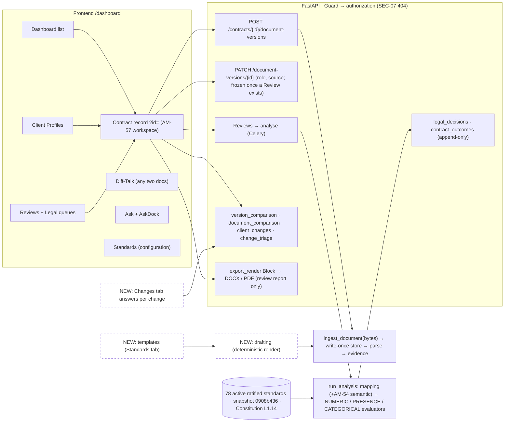
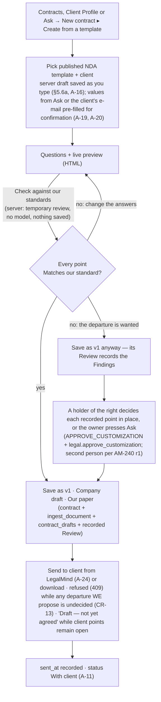
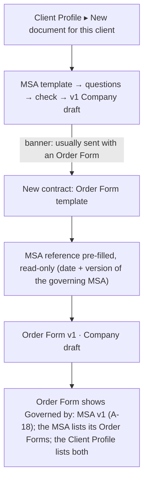
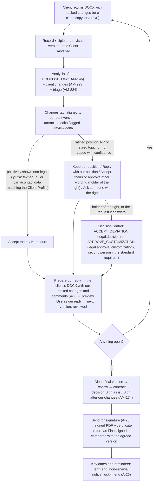
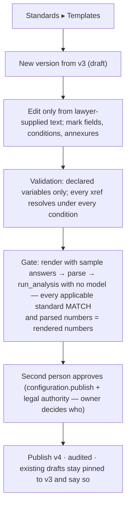
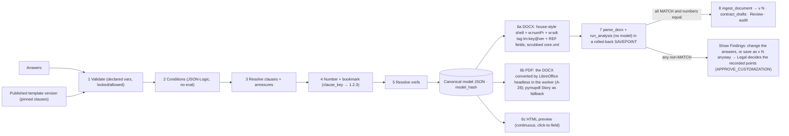
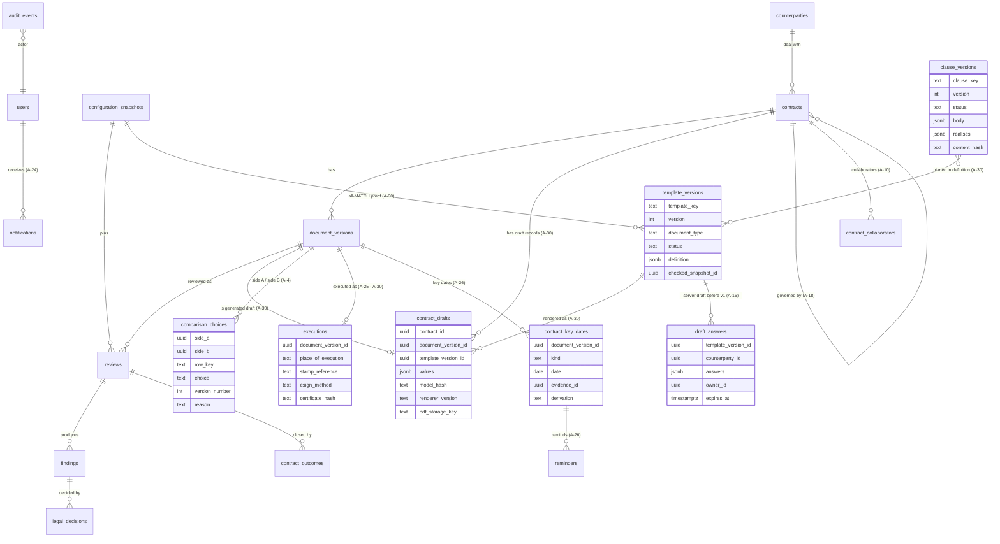

# Creating, reviewing and negotiating MSAs and NDAs in LegalMind — consolidated R&D report

`📁 PROPOSAL` — **research only. Decides nothing, authorizes no build, amends no lock.** It is written **product
first** (CLAUDE.md "Product first", owner 2026-11-02): it designs the best product, then lists every lock that design
collides with as a drafted amendment in **§17 (A-1 … A-39)**. Those amendments are **drafted for the owner, not appended**
to `all_lock.md`; they are appended under rule 22 when the build starts. Rules 7/21, rule 18 with `SEC-*`, the append-only
audit trail, the zero-tolerance Legal Rule as legal policy and the Gemini cost guard are **not** amended by that licence —
items that touch them are presented as explicit owner (+ lawyer) choices (§17.2).

| | |
|---|---|
| Date | 2026-11-02 |
| Branch / worktree | `research/clm-contract-creation-20261102` · `/root/legalmind-worktrees/clm-rnd-20261102` (= `origin/main` at `30455ff`) |
| Workstream reports | [01 Existing system](01-existing-system-architecture.md) · [02 Legal & CLM research](02-legal-clm-research.md) · [03 UX & information architecture](03-ux-information-architecture.md) · [04 Document engineering](04-document-engineering.md) |
| Verification ledger | [05-verification-ledger.md](05-verification-ledger.md) — 50 claims re-checked: 32 confirmed, 18 partly right and corrected here, 0 refuted (one supporting sub-claim refuted, VL-11). Rows are cited as `VL-nn`. |
| Prior R&D | [DOCUMENT_BUILDER_RND.md](../DOCUMENT_BUILDER_RND.md) (2026-09-15) — superseded where stale; what it got right is kept and cited (§3.4) |
| Audience | Management, the owner and the company's commercial-contracts lawyer. Each section opens in plain language; technical depth follows. |
| R&D coordinator choices | Three choices the R&D workflow made to keep the workstreams consistent — **RECOMMENDATIONS, not owner rulings**, each listed in §16(a) for owner confirmation: **C-a** defer the clause-library page (§6) — replaced in the product-first revision by the Playbook option A-37; **C-b** rest the determinism claim on the resolved model hash, not file bytes (§8); **C-c** extend `comparison_choices` rather than add `negotiation_items` (§11.2). |
| Revision | Revised 2026-11-02 after a critical review; then **revised product-first** the same day under the owner's instruction (§1 rewritten, every lock-driven compromise in §4–§15 replaced by the best-product version with its amendment A-n, §15 re-phased by user value, new §17 draft amendment batch). Changes and rejected review points are in the *Review notes* appendix. |

**Labels.** **VERIFIED** — read in the code (`file:line`), the statute text or the vendor's own page (URL), or run on this
server. **PRACTICE** — how in-house teams and contract tools commonly work; not law and not a LeapSwitch position.
**RECOMMENDATION** — this report's proposal; decides nothing. Counterparties are written "the client". Nothing here states a
legal position the Constitution or a ratified standard does not already state (rules 7, 21).

Each major recommendation carries a block in this shape:

> **CR-n** · **Why** · **Reuses** · **Builds** · **DB change?** · **Complexity** (S/M/L) · **Failure scenarios** · **How tested**

---

## 1. Executive summary

### The answer

**Can LegalMind create, negotiate and sign MSAs and NDAs? Yes — inside the contract record LegalMind already has, with
no AI writing any clause.** This report designs the best product first and lists, in §17, every earlier lock that design
collides with as a drafted amendment (A-1 … A-39). The owner approved amending locks that stand in the way of the product
(2026-11-02). [RECOMMENDATION]

**Do not build a separate "contract builder". Make drafting, review, negotiation, signature and the signed contract's key
dates five stages of one contract record, and let the same review engine that checks the client's paper check our own
drafts too.** [RECOMMENDATION]

What a salesperson, a Department Lead and the lawyer get:

1. **Start in one place.** "New contract" on the **Contracts** screen (today's Dashboard, renamed — A-13) offers *Create
   from a template* or *Upload a contract*. Ask can start it too: "start a mutual NDA with this client" pre-fills the
   questionnaire from the conversation or the client's e-mail/PO, each value marked "from your message — confirm"
   (A-19, A-20). The draft saves to the server as you type, resumes on any device and can be handed to a colleague (A-16).
2. **A generated draft is version 1 of that contract** ("Company draft"), entering through the existing upload pipeline so
   the existing engine measures it against every applicable ratified standard (`AM-51`). From approved text with standard
   answers it comes back all-matching; a departure is saved with its Findings and decided by a person with the right
   before it can be sent — the server refuses any send or client-facing download of a version carrying an undecided
   departure we propose (CR-13, §5.1).
3. **The client's returned copy is version 2.** LegalMind already reads its tracked changes, moves and comments and says
   which changes move risk onto LeapSwitch (§3.1). The document stays in the centre with the client's changes marked
   inline, Word-style; the right rail lists **Changes (47)** beside Summary and Findings, each with a checked plain
   sentence and its answer controls (A-5, A-6, A-7, A-8). Every answer keeps its history across rounds (A-4).
4. **A person with the right decides on the spot** (owner, 2026-11-02). `LEGAL_DECISION_AUTHORITY` goes to holders named
   by the owner (recommended: Department Leads + named lawyers, §16(a)2; the grant itself needs no amendment, A-1). Wherever a point appears — Changes, Findings, the approval panel,
   the To-do queue — a holder chooses *Keep ours · Accept theirs · Approve other wording* with a reason, through the
   existing `DecisionControl`, with a second person where the standard sets `requires_second_person` (`AM-240` r1).
   Everyone else sees one line naming who can decide ("Your Department Lead can accept this") and an [Ask] button. A
   Review with deviations can close the same day. **Zero tolerance still binds the system:** the engine never accepts a
   deviation by itself.
5. **"Prepare our reply" produces the file.** One click builds the client's own DOCX with our tracked changes (author
   LeapSwitch) and our notes as comments, every change mapping to an answer a person recorded, inserting only the
   client's text, our prior text, verbatim lawyer-approved template wording or wording a holder approved. The person
   previews it and presses "Use as our reply"; it becomes the next version and is reviewed like any upload (A-2, A-3).
6. **Send, sign and keep.** "Send to client" e-mails the chosen file through LeapSwitch's own relay and records "Sent"
   (A-24); colleagues get in-app and e-mail notifications carrying no contract content. "Send for signature" goes to one
   India-capable e-sign provider once the contract decision is Sign as is / Sign after our changes, and the signed copy
   and certificate return as the Final signed version (A-25). The signed contract shows its key dates — term end,
   non-renewal notice deadline, lock-in end — each cited to its clause, with reminders (A-26).
7. **Everyone sees where every deal is.** Contracts tiles and filters show *Drafting · Internal review · With client ·
   Client returned (our turn) · Ready to sign · Signed · On hold*, each with its age, derived from acts users already
   perform (A-11); the record header says it in one line ("Negotiating · round 2 · our turn", A-12); a **To-do** screen
   collects decisions I can make, second approvals I owe and client returns on my deals (A-15). Owners can add
   same-department collaborators so a deal does not stop when its owner is away (A-10).
8. **Templates live under Standards**, hold only text the lawyer supplied, and publish only when the engine says every
   point matches (§6). LegalMind never writes clause wording, and no model sits in the generation path.

**Options that touch safety, offered as explicit owner (+ lawyer) choices, never defaults (§17.2):** sending the
Constitution's illustrative Drafting Notes to a client on a holder's approval (A-31); a lawyer-supplied ladder of
alternative wording a holder picks in one click (A-32); a contract owner typing reply wording on positively non-legal
changes (A-33); assistant help that adapts approved wording or suggests a starting draft, always approved by a holder
before it can reach a client (A-34, A-35); an assistant-drafted cover e-mail built only on recorded answers (A-36); a
read-only Playbook of our positions (A-37); a guest review link for the client (A-38); further "in our favour" directions
(A-39). **Not amended under the product-first licence (safety policy; available only as its own owner + lawyer
decision, §17.3):** pre-approved wording someone without the right could send with no Legal Decision (it changes the
zero-tolerance policy), and any model-written text reaching a client without a holder's approval.

### Gate 0

| # | Gate | Status | Who decides |
|---|---|---|---|
| **G0-1** | **Scope and design locks.** `PROD-07` / Step 37, AB-3's out-of-V1 list, `AM-136` r9, `AM-42` r3/r4, AB-12 r9, `AM-57`, `AM-38` and the others in §17 stand in the way of this design (VERIFIED quotes with `all_lock.md` lines in §17). | **A draft amendment batch is ready (§17).** The owner approved amending locks that stand in the way of the product (2026-11-02); the batch is appended when the build starts. **No longer a blocker to design.** Items touching safety (§17.2) still need the owner (+ lawyer) explicitly. | **Owner** confirms the batch; appended under rule 22 |
| **G0-2** | **There is no approved template text to generate from** (rule 21). The Constitution calls the MSA *"reference / template / skeleton material … not automatically the company's final authoritative contractual position"* (VERIFIED `LEGAL_CONSTITUTION_L1.14.md:291`, §7.1) and the NDA reference *"not itself a lawyer-approved standing mutual template"* (`:691`, §15.5; VL-19). The eight *"Drafting Notes for Counsel — Illustrative Clause Language (not yet in any signed contract)"* (VL-20) are illustrative by the Constitution's own label. The reference MSA **fails our own liability standard** (§17.2's six months of affected-service fees against `LIABILITY-MSA-001`'s 12 months of total fees, `AM-43` r4), contradicts itself (§17.2 vs §17.7, `DOC-LIAB-04`), and its indemnity is one-way while §10 states a mutual framework (VL-22). | **A real blocker.** Generating from it would issue paper LegalMind's own review marks as deviating. | **Lawyer** supplies or designates approved text per type with the fixed / variable boundary; **owner** confirms it as Source of Truth (Constitution §8.1/§26) |
| **G0-3** | **Which legal entity and brand issues the paper is not modelled** — C-19 (open, MEDIUM; VERIFIED `docs/00-project/CONFLICTS.md:37`). | **An owner decision.** Generated paper prints the issuing entity and brand; the Constitution forbids measuring a CloudPe contract against a LeapSwitch-scoped rule silently (§4). | **Owner** — a schema decision (brand/entity axis on contracts, templates and standards) |

### What can start immediately

Everything that works on the client's paper or needs no template text: the Changes rail and Changes tab with Word-style
marks, alignment, move pairing and the untracked-edit check; per-change answers with history; decision authority for the
holders the owner names and deciding in place; the derived deal status with Contracts tiles and the To-do queue; "Prepare
our reply" built from the client's text, our prior text and holder-approved wording; notifications; Ask filing a returned
copy into its contract; and the records work (amendment batch, `CONFLICTS.md`, registry). None of it waits on G0-2 or G0-3
(§15 Phase 1). It waits only on the owner confirming the §17 batch.

### What management should expect

| Phase | Delivers | Waits on | Size (rolled up from the CRs) |
|---|---|---|---|
| 1 | **Negotiate and decide** on the client's paper: Changes rail + tab, Word marks, answers with history, holders decide in place, "Prepare our reply" file, deal status tiles, To-do, notifications | §17 batch confirmed | **L** |
| 2 | **Create**: templates under Standards, NDA then MSA + Order Form from a questionnaire with server drafts and Ask pre-fill | Phase 1 machinery; G0-2; G0-3 | **L** |
| 3 | **Send and sign**: "Send to client", e-signature, executed copy compared with the agreed version | A-24, A-25; lawyer's e-sign/stamp answers | **M–L** |
| 4 | **After signing**: key dates, renewal reminders, amendments and new Order Forms under the MSA | A-26 (A-18 lands in Phase 2) | **M** |
| Options | Safety-touching items the owner (+ lawyer) chooses to switch on (§17.2) | Explicit owner (+ lawyer) choice | per item |

---

## 2. The real-world MSA and NDA lifecycle

**In plain words.** A commercial contract goes: pick the right paper → fill in the deal → check it internally → send it →
the client marks it up → we answer each change → repeat until agreed → approve the final clean text → stamp and sign → file
the executed copy → later changes go in amendments or new order forms.

| # | Step | How contract tools do it | India-specific | LegalMind today |
|---|---|---|---|---|
| 1 | Choose template / variant (mutual or one-way NDA; MSA + Order Form; no SOW — the company does not use SOWs, VERIFIED §31.13, VL-21) | Pre-approved templates only; text variations driven by rules on fields. **VERIFIED** Juro rules/smartfields; Ironclad from product page + indexed snippets (VL-39) | — | No approved template (G0-2) |
| 2 | Party and deal data | Intake form → typed fields. **VERIFIED** Juro smartfields (text, long text, number, email, list, date) | Name, registered office and CIN on business letters/notices (Companies Act 2013 s.12(3)(c)); signatory authority (s.21); GSTIN/PAN for invoicing [PRACTICE] | `counterparties` entity exists (`AM-42`); no CIN / notice-address / signatory fields |
| 3 | Conditional clauses and schedules | Clause library with conditions. **VERIFIED** Icertis marketing page ("fallbacks and dependents … mandatory language … clause approval workflows"); rest indexed only (VL-39) | DPDP processor terms only where personal data is processed on a customer's behalf for offering goods/services to Data Principals (DPDP s.8(2) qualifier, VL-38) | — |
| 4 | Internal check and approval | Rule-routed approvals before signature. **VERIFIED** Juro: internal edits after approval retrigger approval. Ironclad: reset is **configurable** (indexed). SpotDraft: approvals do **not** reset automatically. So "approvals reset on change" is a common option, not universal (VL-39) | Board authority for the signatory is a corporate approval distinct from Legal's [PRACTICE] | Review engine, Send for review, point decisions, second person, contract decision — all for **uploaded** versions |
| 5 | Send | Version tagged sent; outbound copy frozen [PRACTICE] | — | No "sent" fact; no outbound channel (VL-04) |
| 6 | Client redline → our answers, round by round | New version per round; compare; accept / reject / counter each change; unresolved changes block signature. **VERIFIED** Juro negotiation; Word legal blackline | — | Reading and listing is strong (AM-146/157/158/223/224, Diff-Talk); answering per change is partial (§9) |
| 7 | Final approval | Clean consolidated text, all changes resolved [PRACTICE] | — | Contract decision Sign as is / Sign after our changes / Do not sign / On hold (`AM-174`), checked at write time (`AM-175`–`AM-179`) |
| 8 | Stamp duty | — | **Public-source legal research (PRS web copy — not a project statute; not in the supplied or `AM-47`/`AM-48` statute set with handle, as-on date and SHA-256), for the lawyer to confirm; none of it becomes configuration.** Maharashtra Stamp Act 1958 s.17: stamped *"before or at the time of execution or immediately thereafter or on the next working day following the day of execution"* — i.e. up to the next working day **after** execution (VERIFIED, corrected per VL-26). s.18(1): executed only outside the State → three months after first received in the State (VL-27). s.34: not admissible or acted upon until duty and a penalty of 2% per month, capped at four times the deficiency, are paid (VL-28). That an unstamped agreement is **not void** comes from *In re Interplay …*, 2023 INSC 1066 (7 judges), construing the **Indian Stamp Act 1899 s.35** for arbitration agreements — applying it to the Maharashtra Act and to every commercial contract is a widely accepted **reading**, not statute (VL-28, VL-29). The Constitution records stamp duty as not yet assessed (§27 Item 18) | Nothing |
| 9 | Execution | E-signature platform or wet ink [PRACTICE] | IT Act s.5 and s.10A (VL-32); s.3A + Second Schedule item 1 Aadhaar/e-KYC eSign (VL-33); MSA, NDA, Order Form and amendment are not on the First Schedule exclusion list (VL-34, corrected: S.O. 4720(E) of 26-9-2022 amended three entries of a Schedule substituted by Act 10 of 2009) | `FINAL_SIGNED` is a declared role only |
| 10 | Store and manage | Executed copy archived with signing evidence [PRACTICE] | BSA 2023 s.66/s.86 on proof of e-signatures (report 02 A.4) | Upload + archive |
| 11 | Post-signing change | Amendment / addendum / restatement / new Order Form (§10) | Contract Act s.62 (VL-36); each supplementary instrument generally separately stampable — **lawyer question** | Amendment/Addendum standards exist (§31.12) for review only |

**Two Indian points the lawyer must settle before any template is fixed** (VERIFIED statute text, interpretation
labelled): Contract Act s.27 voids restraints of trade except on sale of goodwill (VL-35) — so the Constitution §15 two-year
non-solicit is flagged for Counsel; s.74 limits recovery on a named sum to reasonable compensation, and increased interest
from default *"may be a stipulation by way of penalty"* (VL-37) — relevant to early-exit fees and late interest.

### 2.1 The clause skeleton — the checklist for the lawyer's fixed / variable boundary (G0-2)

Condensed from [report 02 Part B](02-legal-clm-research.md) (B.1 MSA, B.2 NDA), which has the full table. Each part is
classed **P** populated from the deal's answers · **F** fixed approved text · **A** needs legal approval to vary;
"position" is a Constitution section or ratified standard, **NONE** a gap only the lawyer can fill. [PRACTICE for the
order; positions as report 02 reads them — this report adds none.]

| Doc | P (populated) | F (fixed) | A (approval to vary) | Position NONE today |
|---|---|---|---|---|
| MSA | parties block, term period, fee amounts, notice addresses, signature blocks, Order Form schedule | definitions, services/ordering (§31.11), customer obligations + AUP (§17), SLA by reference (§11), governing law (§22), boilerplate | committed term (§14/§31.2), payment (§16), suspension (**C-28**), data protection (§12), confidentiality + IP (§15), indemnity (§10), liability (§9), termination (§13), change of control / discontinuation (§31.14) | recitals, definitions beyond "Confidential Information", warranties, force majeure, assignment, notices, most boilerplate, DPA schedule form |
| NDA | parties, date, purpose (free text, reviewed), signature blocks | CI definition (§15), mutuality (§15), governing law (§22) | term (`TERM-NOTICE-NDA-001`), survival, residuals, non-solicitation (§15), negotiated Schedule 1 (§31.12) | exclusions, permitted disclosees, compelled disclosure, return/destruction, no-licence/no-warranty, remedies, boilerplate |

The lawyer marks the boundary against this list (§16(b)1); every NONE cell is a §16(b)4 gap, offered in no template until
wording is supplied.

---

## 3. Existing LegalMind architecture — assessment

**In plain words.** LegalMind is already most of a negotiation system for the client's paper. It has no authoring half.
Three things exist that a contract-creation feature needs and should not rebuild: the contract record with versions and
version roles, the deterministic review engine, and the review/decision workflow.



The code references behind §1: a rendered draft enters through `ingest_document` (VERIFIED
`backend/legalmind/ingestion/service.py:115`, VL-02); returned copies are read by `AM-146`/`AM-157`/`AM-158` (redlines,
deletions, moves), `AM-223` (every client change and comment) and `AM-224` (what each change does to LeapSwitch).

### 3.1 What exists and is reused (VERIFIED)

| Capability | Where | Reuse for CLM |
|---|---|---|
| Contract → N immutable versions; each version human-declared `COMPANY_DRAFT` ("what we sent") / `CLIENT_MODIFIED` ("what came back") / `FINAL_SIGNED` ("what was executed") | `backend/legalmind/domain/client_profile.py:67-71`; `api/schemas.py:378-383`; declared metadata (source, counterparty, effective date, role) **frozen once any Review exists**, 409 (`api/routers/documents.py:78-124`, locked 33.7) (VL-01) | The negotiation track is these roles. No new state axis. |
| Ingest bytes as a new version | `ingestion/service.py:115-125` — validates (34.16), hashes, stores write-once, numbers under row lock, parses. It does **not** analyse; a Review must be created, and the role declared (VL-02) | A rendered draft enters here unchanged |
| Deterministic review engine | `analysis/service.py:193` `run_analysis`; reproducible from version + snapshot | Checks our own drafts. Note: recognition may call the egress seam (`analysis/semantic.py:237, 390`, raw clause content in the prompt) — so the publish gate and the pre-save check run with no model (§14) |
| "Check without saving" | `api/temporary_review.py:114-163` (`AM-143`): a SAVEPOINT always rolled back; egress audit rows re-recorded afterwards (VL-07) | Preview check of a draft, nothing persisted |
| Reading the client's markup | `ingestion/parsing.py:2424-2448` (`w:ins`/`w:del`/`w:moveFrom`/`w:moveTo`), comments kept beside clauses (`AM-223`, parsing `:2802-2876`) | Incoming redline is solved |
| Listing and triaging client changes | `analysis/client_changes.py` (`AM-223`); `analysis/change_triage.py` (`AM-224`, code reading on, model reading off) | Feeds the Changes tab |
| Two comparison engines | `version_comparison.py:165` (same contract, by `section_number`); `document_comparison.py` (any two documents, by text similarity; detects **moved** clauses, `:305-349`, VL-13) | Alignment tiers 2/3 (§9) |
| Per-change wording choice | `comparison_choices` (`AM-136`): ours/theirs per difference per pair, **last writer wins**, not audited per click, wording only — never a Finding or Legal Decision (VL-03) | Candidate store for per-change answers (§11.2) |
| Contract customization (locked Step 1) | `all_lock.md:46-64`: *Finding → Authorized Legal Decision → Approved Exception → Optional: Create Customized Contract → Human reviews/accepts proposed change → New Contract Version*; *"approving a deviation does NOT automatically modify the contract"*. Decision type `APPROVE_CUSTOMIZATION` needs the extra grant `legal.approve_customization` (`workflow/decisions.py:54-56`, locked Step 23 / 47.5; `SEC-02`); `ACCEPT_DEVIATION` needs `legal.decision` (`domain/enums.py:82-92`) | The route for any non-standard text **we** propose (in a draft or a reply), and the "a person accepts the proposed version" step before a reply is recorded (§5.1, §9.3, CR-7) |
| Review workflow | Send for review (`review_assignments`), point decisions (`legal_decisions`, append-only), second person from the standard (`AM-240`), contract decision (`contract_outcomes`, append-only, `AM-174`), reopen (`AM-175`), one review-stage vocabulary (`AM-179`), `expected_version` optimistic concurrency (49.7, made mandatory by `AM-177` — not `AM-175`; VL-08) | Approval spine for our own drafts too |
| Append-only trigger | `legalmind_append_only()` on `audit_events`, `legal_decisions`, `contract_outcomes`; since `AM-176` a contract hard-delete cascades through (VL-09) | Reused on every new history table |
| Counter-proposal wording | `api/angles.py:667-701` `_proposals` (`AM-152`): Constitution Drafting Notes from the indexed `knowledge_items` copy, whitespace-normalised, positions-permission gated; falls back to the Company Position labelled "(no approved clause wording exists for it)" (VL-20) | V1 counter-proposal source |
| Render | `api/export_render.py:96-107` `Block`, `:818` `render_docx` (python-docx), `:928` `render_pdf` (pymupdf.Story), `:959` `RENDERERS` (VL-10) | Extend for contract-grade output (§8) |

### 3.2 What the engine and renderer cannot do yet (VERIFIED, VL-10, VL-12, VL-14)

- **Renderer:** no Word-native clause numbering (no `w:numPr` / multilevel list; it has PAGE/NUMPAGES fields, a bullet style
  and text-prefixed point numbers), no cross-references, no signature blocks, no watermark (only a "Confidential · internal
  legal review" header/footer label), and **no metadata scrub** — the DOCX ships python-docx's default `core.xml`
  (`dc:creator` "python-docx", 2013 dates). This last point also affects today's review-report export.
- **Parser:** looks *through* Word content controls but never reads their tags or bookmarks (`parsing.py:2522-2534`).
- **No untracked-edit detector.** An edit the client made without tracking shows as an ordinary CHANGED row in a comparison,
  not distinguished from a tracked one (VL-14).
- **No outbound channel for users** — no e-mail, e-sign or customer webhook. (An ops-only Slack alert webhook exists in
  `backend/tools/alert_failures.py`; `smtplib` is one of ~30 modules banned by the import-boundary test for the `legalmind`
  package, VL-04.)
- **Single organisation**, no tenancy; issuing entity/brand not modelled (C-19).

### 3.3 Discrepancies found while verifying (reported, rule 5 — none resolved here)

| Where | What | Status |
|---|---|---|
| `LOCKED_DECISIONS.md:114` vs `all_lock.md:17160-17165` (AM-42 / AB-13 r3) | The locked text says a document-to-document relationship table *"is created … and none is needed"*; the registry paraphrases it as *"none may be"*. `all_lock.md` wins. Either way this design adds no such table (VL-06). | Rule 5: to be **entered in `CONFLICTS.md`** in the records change that carries this report, and the registry wording aligned there — not resolved here |
| `ingestion/parsing.py:2627-2628, 2634-2635` | `parse_docx` docstring says auto-numbering is not rendered and comments are never read; the code reads both (`AM-185`, `AM-223`) (VL-15) | Stale docstrings; engineering fix |
| `frontend/src/components/workspace/model.ts:537-543` | Comment says Research "isn't available yet"; the page renders a working Ask dock with no client-side gate (server still enforces `assist.ask`) (VL-05) | Stale; see §4 |
| Report 01 line 62 | "The zero-tolerance Legal Rule says no fallbacks exist" overstates `LAWYER_REASONING_RESEARCH.md` §8.2, which calls fallbacks an open owner decision (VL-24) | Corrected in §9.3 |
| `all_lock.md:15737` (`AM-25`) vs `:5128` | `AM-25` cites "the Step 38 V1 explicitly excludes entries"; the list sits under *"# Step 37 — V1 Scope Freeze"* and `LOCKED_DECISIONS.md:418` registers it as Step 37 (`PROD-07`) | Rule 5: for `CONFLICTS.md` in the records change; A-2 cites Step 37 |
| `AM-30` t2/t3 vs this design | The questionnaire, template setup and the reply e-mail would send material outside t2's allow-list; each such payload is named in its own amendment (A-19, A-21, A-22, A-36) rather than assumed | Drafted in §17 |

### 3.4 The 2026-09-15 Document Builder R&D — what it got right, what is stale

**Kept (it was right):** a template is **structured data rendered fresh**, never text replacement inside an uploaded DOCX
(§5.1); fields are structural, so there is no input for "remove the cap" (§5.3); **no LLM in the render path** (§10–11);
reuse the existing python-docx / pymupdf renderers and escaping (§10–11); reject docxtpl and any external generation service
(§10); scrub output metadata — flagged then as unchecked, **now confirmed not done** (§11, VL-10); Ask only *detects and
redirects* (§9); and the standing blocker — **no approved output text exists** (§16).

**Superseded:** a separate `/dashboard/builder` section and a `GeneratedDocument` graph apart from `Contract` (§2, §6) —
answered by the per-version source and role fields that shipped five days earlier and that redline reading, triage and the
review workflow all key on (report 03 §10); "40 ratified files" (now 85 standard files — 78 active + 7 retired; the 86th directory entry is `proposed/`); ten document types (now 13,
`AM-72`); module paths (`assist/query/*`, `assist/llm/generation.py`); "the Constitution is never retrieved" (retrieved since
`AM-79`, now L1.14); "no reviewer workflow" (now Send for review, second person, contract decision, reopen); and it did not
cite `PROD-07`'s or AB-3's exclusions (G0-1).

---

## 4. Existing UI problems and consolidation

**In plain words.** The same things appear in too many places: five ways to upload, two chat screens, six ways to show
findings, three or four version pickers, three ways to see "what changed", and two legal queues. Adding a builder as a new
page would make every one of these worse. The fix is to make the contract record the one place for a deal.

### 4.1 Problems (VERIFIED, corrected)

| Problem | Evidence | Note |
|---|---|---|
| Upload ×5 | File inputs at `UploadDocument.tsx:54`, `AskWorkspace.tsx:1143`, `UploadContract.tsx:215`, `UploadToClient.tsx:169`, `diff-talk/Setup.tsx:206` | The three create-and-upload flows **differ**: UploadContract suggests a type and analyses without declaring; UploadToClient declares and analyses; Diff-Talk Setup declares and deliberately does not analyse (cost guard). Only `uploadFirstDocument` is shared by all three (VL-47) |
| Ask ×2 | `AskDock` (workspace) and `AskWorkspace` (`/dashboard/ask`); the shell's Ask link only navigates (VL-48) | Settled as "one product, two places" (DD-19/21); orphan `/dashboard/research` remains |
| Findings ×6+ | Dashboard cell, Summary, Findings tab, Legal queue, Report, Ask deal review | Ask deal review uses a second vocabulary (Must change / Ask for a change / Legal decides) beside `AM-184`'s Matches our standard / Change needed / Missing / Needs a decision (VL-25). **Fix it, not fence it:** two axes everywhere — status in `AM-184`'s four words, action in one code-owned set shared by Findings, Changes and Ask (A-9) |
| Versions ×3–4 | Header `<select>`, `VersionComparison`, Client Profile rows, Diff-Talk picker | No timeline anywhere |
| "What changed" ×3 | `VersionComparison` (clause level, no word marks — owner boundary 2026-09-04, VL-50), Diff-Talk (word marks + choices), inline tracked changes in `DocumentPane` | Largest overlap; two adjacent header links |
| Legal queues ×2 | Reviews (`review.view` and `legal.review`) and Legal (`legal.review`) | A reviewer must know which to open |
| Nav | 8 items at most (`model.ts:477-544`); an ordinary user sees 3 (Dashboard, Client Profiles, Ask) (VL-46) | — |

### 4.2 Consolidation — recommendations, each with the sign-off it needs

> **CR-1 · One contract record, three tabs.** **Why:** every CLM we could verify keeps create → negotiate → sign inside one
> record (Juro, SpotDraft VERIFIED; Ironclad indexed — report 03 §2); a separate builder forces a hand-off exactly where
> history matters. **Reuses:** `WorkspacePage`, `WorkspaceLayout`, version roles, `?id=` routing. **Builds:** tabs Document ·
> Changes · Versions; a **Changes** panel in the right rail beside Summary and Findings (A-5); one header line with the deal
> status as the stage word and the review stage as its sub-line ("Negotiating · round 2 · our turn — 3 points waiting on
> Legal", A-12); the version dots move into the Versions tab as navigation; readable paths `/contracts/{id}[/changes|/versions/{n}]`
> (A-14). **DB change?** None for the UI. **Complexity:** M. **Failure scenarios:** two competing stage words on one screen
> — A-12 makes the deal status the only stage word, `review_stage` its qualifier; old deep links (`?id=`, `?version=`,
> `?finding=`, `?compare=1`) break — permanent redirects keeping query strings, `?compare=1` opens Changes; the path form
> leaks existence — the SEC-07/API-10 byte-identical 404 applies to it exactly as to the query form. **How tested:**
> existing workspace tests unchanged; redirect tests for each old link; 404 parity tests; accessibility of the tablist.
> **Sign-off:** §17 A-5, A-12, A-13, A-14.

| Consolidation | Sign-off needed | Complexity |
|---|---|---|
| Replace **Reviews** and **Legal** with one permission-scoped **To-do** screen for every user (decisions I can make · second approvals I owe · client returns on my deals · my requests answered · drafts unsent for N days); the legal queue becomes a holder's filter of it; old URLs redirect | A-15 (Step 52.6's screen list) | M |
| Same-contract "Compare versions" + "Compare in Diff-Talk" + inline changes → the **Changes** rail and tab, Word-style marks with an Inline / Side-by-side toggle, one diff component shared with Diff-Talk (cross-document comparison stays there, `AM-137`) | A-6 (the 2026-09-04 owner boundary) | M |
| Version `<select>` + Client Profile version rows → the **Versions** timeline | None beyond UX go-ahead | S |
| `/dashboard/research` → redirect to Ask, delete the page | None (dead route; server already gates) | S |
| Unify the create-and-upload flows behind one helper, keeping Diff-Talk's deliberate no-analysis path | None (engineering) | S–M |
| Rename **Dashboard** to **Contracts** (every contract and draft, with deal-status tiles); still no separate Create / Negotiation / History items | A-13 (`AM-38` r1) | S |
| Templates as a tab under **Standards**; a read-only **Playbook** of current positions for position holders, if the owner chooses it | Owner UX go-ahead; Playbook is A-37 (safety option) | S |

Result: **7 navigation items at most instead of 8** (Contracts · Client Profiles · To-do · Ask · Diff-Talk · Standards ·
admin), and no new page.

**How the record sits — a reviewing pane, as in Word.** The **Document** tab is the `AM-57` document-primary workspace: the
document keeps the flexible centre column with the client's changes marked inline, and the right rail reads **Summary ·
Findings · Changes (once a client version exists) · Ask** (A-5). Selecting a change scrolls to and lights its passage, as a
finding does (`AM-57` r2); j/k steps through the document and the list together. The record-level **Changes** tab stays for
the wide side-by-side and round-to-round view; **Versions** is the timeline. Nothing rests over the document (`AM-57` r4).

> **CR-11 · The consolidations (Reviews + Legal → To-do, three "what changed" views → Changes, `/dashboard/research` removed, one
> upload helper).** **Why:** §4.1 — each duplicate is a place a reader must know to look. **Reuses:** the Legal page and its
> queries, `VersionComparison`, Diff-Talk's diff components (`react-diff-viewer-continued`), `uploadFirstDocument`.
> **Builds:** the To-do screen with a view per item kind, every item resolved server-side from the caller's permissions and scope (A-15); redirects from `/dashboard/reviews`, `/dashboard/legal` and `/dashboard/research`; the Changes tab as the
> single same-contract "what changed" surface; one create-and-upload helper with an explicit `analyse` flag so Diff-Talk keeps
> its no-analysis path. **DB change?** None. **Complexity:** S–M overall. **Failure scenarios:** bookmarked
> `/dashboard/reviews?…` or `?compare=1` links land nowhere — server-side redirects preserving query strings; a reviewer
> holding `review.view` but not `legal.review` loses the Reviews list — the To-do screen's Reviews view is gated on
> `review.view` (permission-driven, presentation only, server still enforces); the wrong queue opens
> by default — the default view follows what the reader holds; the unified helper analyses a Diff-Talk upload and spends
> model calls — the `analyse` flag defaults off and a test pins Diff-Talk's call; deleting `/dashboard/research` breaks a
> nav link — the model.ts entry goes in the same change. **How tested:** redirect tests for every old URL (§14); per-role
> tests that each persona sees the same items it sees today; Diff-Talk e2e asserts no analysis is queued; existing
> `VersionComparison` and Diff-Talk tests pass unchanged until the Changes tab replaces the former.

---

## 5. Proposed user workflows

**In plain words.** A salesperson starts an NDA from a template (or from Ask, or from the client's e-mail), answers a few
questions, sees the draft, checks it against our standards, and sends it from LegalMind. If they asked for something
non-standard, a person with the right decides that point on the spot. When the client sends back a marked-up copy, every
change is answered beside the document, "Prepare our reply" builds the Word file, and the agreed version goes for
e-signature. The signed contract then reminds its owner of its own key dates.

### 5.1 Create an NDA



Order matters: a holder decides only **persisted** Findings, so a departing draft is saved as a version with a recorded
Review first — the preview check is rolled back (`AM-143`) and leaves nothing to decide. A departure *we* propose on our
own paper is a customization (locked Step 1), so it is decided as `APPROVE_CUSTOMIZATION`, which needs
`legal.approve_customization` beside `legal.decision` (`SEC-02`). Whether Step 1's chain — written for a customized
contract following an approved exception — applies in this order to our own first draft is an owner/lawyer confirmation
(§16(a)). [RECOMMENDATION]

### 5.2 MSA + Order Form



**"New deal"** can create the MSA and its first Order Form together: the Order Form questionnaire takes services,
quantities, monthly fees, committed term, billing cycle, currency, GSTIN/PAN and billing contact as typed, validated fields
(entity details from the Client Profile), printed into the lawyer-approved Order Form text and checked live against the
ratified ORDER_FORM standards (payment period, committed term) before the draft is saved. These are commercial terms
**printed in a contract**, not purchase-order, billing or invoice records — LegalMind stores none of those (A-17). An Order
Form carries commercial terms only and refers to the MSA's payment terms; it never restates MSA terms
(`REFERENCE-GOVERNING-MSA-ORDER_FORM-001`, `ORDER-PRECEDENCE-PO-ORDER_FORM-001`, Constitution §31.11; report 02 A.3.2).
The Order Form template text itself still needs the lawyer (G0-2, §16(b)19).

### 5.3 The client returns a redline, through to signature



### 5.4 Template admin publishes a new template version



### 5.5 Wireframes (short — full set in [03 §6](03-ux-information-architecture.md))

```text
Contracts                                                     [ New contract ▾ ]  ├ Create from a template
[Drafting 4] [Internal review 2] [With client 6 · oldest 9 d] [Our turn 3] [Ready to sign 1] [Signed 41] [On hold 1]
Document                      Type  Status                    Findings            Updated  Owner
MSA — the client              MSA   Our turn · round 2 · 2 d  ✓18 · △3 · ◇1       2 h      Contract owner (+1)

← MSA — the client   MSA · the client · Client's paper                   /contracts/{id}
  Negotiating · round 2 · our turn — 3 points waiting on a decision
  Document │ Changes 47 │ Versions 3                [Prepare our reply] [Send to client] [⋯]

┌ contents ┬──────────── document (client's changes marked inline) ────────────┬ Summary · Findings · Changes 47 · Ask ┐
│ 13 Liab. │ 13.2 … liability shall not exceed the fees paid in the ~~three~~     │ ◇ 13 §13.2 Liability                  │
│          │ __six__ months preceding the claim …                                │ They want six months instead of three.│
│          │                                                                     │  Plain summary by the assistant — read│
│          │                                                                     │  the clause (A-7)                     │
│          │                                                                     │ △ Change needed (from the review)     │
│          │                                                                     │ OUR POSITION · Constitution §9 "…"    │
│          │                                                                     │  (positions permission only)          │
│          │                                                                     │ Holder: (•) Keep ours ( ) Accept      │
│          │                                                                     │  theirs ( ) Approve other wording     │
│          │                                                                     │  Reason [__________] [Record]         │
│          │                                                                     │ Others: Your Department Lead can      │
│          │                                                                     │  accept this. [Ask]                   │
│          │                                                                     │ R1: kept ours (owner, 24 Oct) →       │
│          │                                                                     │ R2: client pushed back                │
└──────────┴─────────────────────────────────────────────────────────────────────┴───────────────────────────────────────┘
```

Report 03's "Being prepared" filter is restored as **Drafting**: server drafts (A-16) appear there and nowhere in analysis
tiles. Names in report 03's wireframes stand for roles; this report writes "Contract owner".

### 5.6 Contract states — what each is, how it maps onto what exists, what is new

**The deal status is its own vocabulary (`NEGOTIATION_STAGE`), derived on read from version roles, `sent_at` and recorded
outcomes; it is never stored, never typed by a user, and never shares a field or enum with the five legal state axes, the
Review lifecycle, `review_stage`, `ContractStatus` or `ConfigStatus`** (rule 14, `REC-06`; A-11). It answers "where is this
deal?" on the Contracts tiles, filters and the record header; `review_stage` (`AM-179`) qualifies it for the version on
screen (A-12). [RECOMMENDATION]

| Status shown | Meaning | Derived from | What is new |
|---|---|---|---|
| **Drafting** | Questions being answered, or v1 saved and not yet internally decided | A server draft (`draft_answers`, A-16), or a latest `COMPANY_DRAFT` whose Review has undecided points and no `sent_at` | `draft_answers` table; drafts are not contracts, so they never block profile deletion (`AM-70` r3 unaffected) or count in analysis tiles |
| **Internal review** | Sent for review on our own draft | `review_assignments` on the latest Company draft | Nothing new |
| **With client** | We sent version N | `document_versions.sent_at` on the latest Company draft (A-11), written by "Send to client" (A-24) or "Mark sent" | One nullable column + the append-only `document.version_sent` audit event |
| **Client returned (our turn)** | Their markup or clean copy, changes to answer | Latest version `CLIENT_MODIFIED`; AM-146/157/158 reading; AM-223 list; AM-224 triage | Alignment to our sent clauses; untracked-edit flag; review delta; answers with history (A-4) |
| **Ready to sign** | Clean agreed text, contract decision recorded | `contract_outcomes` SIGN_AS_IS / SIGN_WITH_CHANGES (`AM-174`–`AM-179`) | Nothing new |
| **Signed** | Signed copy | `FINAL_SIGNED` version, from e-signature (A-25) or upload | `executions` record (place, stamp reference, e-sign method, certificate hash); key dates (A-26); signed copy compared with the agreed version |
| **On hold** | Paused | `contract_outcomes` ON_HOLD (`AM-174`) | Nothing new |

Sub-states shown on the record, not as tiles: *Do not sign* (`DO_NOT_SIGN`), *Reopened* (`AM-175`), *Superseded* (a higher
`version_number`), *Archived* (`contracts.archived_at` — VERIFIED `backend/legalmind/db/models.py:278-284`). Each tile shows
its age ("With client · 9 days"), oldest first. **"Approval resets when text changes" comes free:** changed text = new
version = new Review. **Amended after signing** is a new `AMENDMENT` contract that names the agreement it sits under (A-18).

### 5.6a Where the answers live before v1 exists

> **CR-12 · Server drafts before v1 (A-16).** **Why:** a draft held in one browser is lost on another device, in a private
> window or when data is cleared, and nobody can pick it up — the owner's own reason for `AM-136` ("vanished on another
> device"). **Reuses:** the owner-scoped resolution and SEC-07 404 (AB-12), `audit_events`. **Builds:** `draft_answers`
> (template version, nullable counterparty ON DELETE SET NULL, answers JSONB, owner, timestamps, `expires_at`), autosave
> ("Saved"), "Hand over to…" (transfers ownership, audited), a sweep N days after the last edit with notice first (audited
> `draft.expired`), and "Save as v1" consuming it in the same transaction that creates the contract, version,
> `contract_drafts` row and Review. **DB change?** One table (A-16, collected in A-30). **Complexity:** S–M. **Failure
> scenarios:** a draft counted as a contract — it is not a `contracts` row, so `AM-70` r3, Dashboard counts and department
> read scope do not reach it; answers hold client identifiers — owner-scoped server storage, never in a model payload except
> under A-19's rules; the template is retired while a draft waits — on load the draft says so and offers the current
> version; two tabs editing — `expected_version`, 409. **How tested:** autosave and resume on a second session; 404 for any
> other user; sweep and audit; "Save as v1" atomic (no contract row on failure); profile with only a draft deletes normally.

> **CR-13 · "Sent" as a fact, and the outbound gate.** **Why:** `COMPANY_DRAFT`
> declares what the paper is, not that it left the building (VL-04); the deal status and the "With client · 9 days" tile need
> a queryable fact. **Reuses:** `audit_events` (append-only), the Review's evaluations and `legal_decisions`, the metadata
> freeze once a Review exists (VL-01), `document.download`. **Builds:** `document_versions.sent_at` / `sent_by`, written once
> by `POST /document-versions/{id}/sent` (owner, collaborator or Lead per A-10, `contract.update`) or by "Send to client"
> (A-24), with a `document.version_sent` audit event (who, when, how, no recipient identifier beyond the domain).
> **One server-side outbound rule:** no send, no "Mark sent" and no client-facing download (draft-marked or not) of a version
> that carries an undecided departure **we** propose — an `APPROVE_CUSTOMIZATION` point, or wording or a non-standard
> questionnaire value a non-holder entered — refused 409 naming the points; the "Draft — not yet agreed" marker covers only
> undecided **client** points. **DB change?** One column (A-11).
> **Complexity:** S. **Failure scenarios:** a non-holder's requested wording reaching the client as a "draft" — refused by the
> rule above; sent with an undecided client point on a "final" — the send carries the draft marker; recorded twice — first write wins, each later send is an audit event; sent on a superseded version — 409; the gate
> computed in the UI — never: the server decides (rule 18). **How tested:** 409 tests for superseded versions and for
> send / Mark sent / download of a version with an undecided own-departure; audit row
> content (no clause text); tile counts from `sent_at`; per-role 404 alike.

### 5.7 Who can edit what, and on which screens

Condensed from [report 03 §9](03-ux-information-architecture.md). [RECOMMENDATION]

| Part of the draft | Who | What happens |
|---|---|---|
| Fixed template text | A holder of `legal.approve_customization`, for this contract only (never the template) | The holder changes it and records the approval with a reason (`APPROVE_CUSTOMIZATION`, second person if the standard requires it). Anyone else uses "Ask someone with the right to change this text…", which records the wording and reason; the draft is saved with that departure and its Findings, and **no send and no client-facing download** of that version (draft-marked or not) is possible until a holder decides it (CR-13) |
| Fields | Contract owner, a collaborator or the department Lead (A-10), in the questionnaire only; values pre-filled from Ask or the client's file are marked "from your message — confirm" and saved only when confirmed (A-19) | A measured value is checked **by the server**; an empty required field shows its name in brackets — never silently blank |
| Optional clauses | Contract owner or collaborator, only where the template declares them optional | Excluding one that carries a ratified position is measured as *Missing* **by the engine, not by the UI** |
| Order, numbering, defined terms | No one | Computed at render |
| Reply wording in negotiation | Contract owner or collaborator chooses among the answers in §9.3; a holder approves any other wording in place | Typed wording by a non-holder is an owner (+ lawyer) option (A-33): on a change the engine positively shows non-legal it goes as typed, labelled with its author; on anything else it becomes a request a holder approves. A *"Comment to the client"* field is always available |
| Confidential fields (LEGAL-02) | — | **Omitted** for readers without the positions permission, never greyed or nulled (SEC-07) |

Every approval request uses one shared pattern: dashed left rule + **"Requested change — needs a decision"** naming who can decide (by role) + the
requester's name and reason, resolving to "Decided by ⟨name⟩, ⟨date⟩" after `DecisionControl` records it, with no
optimistic update.

**Responsive limits.** Desktop (≥ 1280 px) shows three columns; 900–1279 px follows the existing workspace rules (the
Changes list becomes a slide-over); below 900 px one region at a time. **The phone is for reading and responding only** — a
response per change at 44 px targets; **template authoring is desktop-only** and says so. The record tabs collapse into a
`<select>` below 600 px, never a horizontal scroll.

**Accessibility commitments.** Real tab semantics (`role=tablist`, arrow keys). Redlines use `<ins>`/`<del>` with visually
hidden "client added:" / "client removed:" text — **never colour alone**, contrast ≥ 4.5:1 on tints. The questionnaire uses
native inputs, `<fieldset>`/`<legend>` per group, required marked in text, errors tied by `aria-describedby`, a
missing-fields summary at the top on submit with focus moved to it, and save status in a polite live region. Keyboard: j/k
(↑/↓) next/previous change, 1/2/3 to pick a response, `[`/`]` previous/next field, all listed in `KeyboardShortcutsHelp`.
The continuous HTML view is the accessible reading surface whether or not the PDF is tagged. Tests in §14.

---

## 6. Template and clause management architecture

**In plain words.** A template is a list of approved clauses in order, with marked blanks and optional sections. Each clause
says which Constitution section and standard it realises. A template can only be published if the review engine finds that a
draft made from it matches every applicable standard. The lawyer supplies the words; LegalMind never writes them.

> **CR-2 · Templates as versioned structured data, published only through an engine gate.**
> **Why:** a JSON clause is diffable, hashable and reviewable; it carries the stable clause identity negotiation needs; it
> removes template injection as a class (no user-controlled template language) — confirms DOCUMENT_BUILDER_RND §5.1–5.3.
> The engine gate keeps "approved template" and "ratified standard" from drifting apart, and would today catch the reference
> MSA's `LIABILITY-MSA-001` mismatch. **Reuses:** the `requirements → *_versions → configuration_snapshots` pattern; the
> `Block` model; `run_analysis` and `temporary_review`; `_docx_list_numbers` (`AM-185`) to read back numbering;
> `legalmind_append_only()`. **Builds:** `clause_versions`, `template_versions`, an authoring tab under Standards, a
> ~40-line JSON-Logic-shaped condition evaluator (operators `eq ne in gt gte lt lte and or not`, declared variables only, no
> `eval`, no Jinja), publish validation. **DB change?** Yes — two tables, **needs an approved amendment batch**.
> **Complexity:** L. **Failure scenarios:** template text authored by an engineer or a model (rule 21) — the import refuses
> text without a recorded lawyer source; a cross-reference to a clause excluded by a condition ("see Section [ ]") — refused at
> publish; a template that passes only because the semantic recogniser was available — see §14; a published template edited
> in place — trigger refuses changes to `body`/`definition` once not DRAFT. **How tested:** STRUCTURAL placeholder fixtures
> that assert nothing legal; publish-gate test (all-MATCH + numbering round-trip) in CI for every PUBLISHED template; trigger
> tests; refusal tests for unknown variables and dangling xrefs. **Gate runs with no model:** the publish check runs
> `run_analysis` with the egress seam unavailable (lexical and deterministic only — `AM-54` recognition and `AM-152`'s model
> reading off), in CI and in production alike, so a model's YES/OPPOSED verdict can neither open nor block publication of
> approved text; a model run is a diagnostic only (§14).

**Shape** (from report 04 §B, unchanged in substance): a *clause version* = `clause_key` (stable, never renumbered or
reused) · version · status DRAFT/APPROVED/RETIRED · body (Block tree; text fixed except `{var}` nodes; `{xref: clause_key}`
resolved at render) · `realises` (Constitution section + requirement code) · source (lawyer, approval reference) ·
`content_hash`. A *template version* = `template_key` · version · status DRAFT/APPROVED/PUBLISHED/RETIRED · document type ·
brand/entity label (C-19) · pinned `(clause_key, version)` list with optional `when` conditions · annexures · typed variables
(`locked_value` / `allowed` set equal to the ratified position for anything the engine measures) · questionnaire grouping ·
`content_hash` · `checked_snapshot_id` (the all-MATCH proof). These status words are a template vocabulary only — never
shared with `ConfigStatus` or any legal axis.

**Clause library and Playbook.** `clause_versions` is the unit templates pin. The user-facing library is a read-only
**Playbook**: each topic with our current position, why it matters, the approved wording (or the Constitution's Drafting
Notes, labelled), the lawyer's alternative rungs once they exist (A-32), searchable and usable "in a reply". It needs no
configuration rights, but it widens LEGAL-02's audience from "positions on your own deals" to all current positions, so it
is an **owner choice** (A-37, safety-flagged); without it, positions stay visible per deal as today. History, drafts and
publishing stay behind `configuration.*`. (R&D coordinator choice C-a is replaced by this option.)

**Where template text lives.** The organization's **own** lawyer-approved template text is configuration, like the ratified
standards that already quote the Constitution verbatim and the redacted Constitution itself, which sits in the repository
(`docs/02-legal-domain/LEGAL_CONSTITUTION_L1.*.md`). Locked 54.6 as locked (`all_lock.md:14830-14833`) is a test-data rule
about real counterparty contracts; the wider "no clause text beyond short cited excerpts" sentence is `AM-25` r9's. A-23
clarifies both, so template text lives under `backend/config/templates/`, reviewed as a diff, with the CI publish gate.
[RECOMMENDATION]

> **CR-14 · Template text as reviewed configuration, imported into versioned rows (A-23).** **Why:** every wording change
> becomes a reviewed diff with history, git is the second copy while server backups are still an open ops item, and the CI
> publish gate (all-MATCH + numbering round-trip) runs on exactly the text that ships. **Reuses:** the
> `backend/config/company_standards/` import/publish pattern, `audit_events`, `test_source_material.py`. **Builds:**
> `backend/config/templates/` JSON with each clause's source (supplier, approval reference, SHA-256); an import tool that
> refuses text with no recorded lawyer source; Standards ▸ Templates for small corrections, each a new clause version
> exported back to a diff. **DB change?** Inside `clause_versions` (A-30). **Complexity:** S. **Failure scenarios:** a
> counterparty's or client-returned text committed as a "template" — 54.6's rule stands and `test_source_material.py` is
> extended to refuse template-shaped text with no recorded lawyer source; an engineer or model writes template text — the
> import refuses it (rule 21); repo and DB drift — the stored SHA-256 makes it detectable and CI compares them. **How
> tested:** import refusal without a source; hash re-verified; publish gate in CI on every PUBLISHED template; STRUCTURAL
> placeholder text only in tests.

### 6.1 Clause dependencies — checked by code and the Constitution, never by an LLM verdict

Some clauses only make sense together. [PRACTICE] examples: liability cap ↔ its exclusions; confidentiality ↔ survival;
termination ↔ payments due on exit (committed term); data-loss exclusion ↔ indemnity; main body ↔ annexure precedence.

> **CR-3 · Declared dependencies, deterministic checks.** **Why:** a removed or changed clause can silently break another
> (renumbering is the commonest defect in generated contracts, report 02 B.1). **Reuses:** existing whole-contract checks —
> cross-reference targets and undefined Terms (`AM-241`), `analysis/consistency.py`, the evaluator's CONFLICT classification
> for two provisions on one scope (fixture `DOC-LIAB-04`), and Constitution §8.2's rule (follow an express precedence
> clause; otherwise REVIEW REQUIRED, no invented hierarchy). Constitution L1.14 §9 already states the data-loss exclusion's
> relationship to the cap (CLAUDE.md, `AM-163`). **Builds:** a `depends_on` / `requires` list on a clause version, set by the
> template author from the lawyer's instruction; publish refuses a template that includes one side without the other; in
> negotiation, a change to one side of a pair adds "also re-read §x" to the paired clause. **DB change?** No beyond the clause
> JSON. **Complexity:** S–M. **Failure scenarios:** a dependency list invented by an engineer — rule 7: **which pairs bind is
> the lawyer's call** (§16(b)); a "re-read" hint shown as a verdict — it is a pointer, never a Finding, never a reader word.
> **How tested:** publish refusal tests on STRUCTURAL placeholder pairs that assert nothing legal. The negotiation fixture
> where a cap change flags the exclusions clause is **deferred until the lawyer answers §16(b) item 15** (which pairs bind);
> it will then be a `STANDARD_DERIVED` fixture built from supplied documents and the ratified standard via
> `company_standard_ref`, never from invented text (rule 21).

---

## 7. Dynamic questionnaire design

**In plain words.** The user answers questions; they never edit the contract text. Where the company has a position, the
answer can only be that position — choosing anything else is a request a person with the right decides. Where the company
has no position yet, the question cannot be offered until the lawyer supplies one. Deal facts the client already sent (name,
address, CIN, signatory) are pre-filled from their e-mail or PO for the user to confirm, and every question carries the
lawyer's short help text.

Classes: **M** mandatory · **O** optional · **C** conditional (shown only when its trigger holds) · **AO** approved options
only (a lawyer-approved list or a fixed value; never free text) · **NP** no position yet (a gap — not offered until the
lawyer supplies one). Positions named below are ratified standards or Constitution sections as read by report 02 §A.3; this
table restates them, it creates none.

| Field | NDA | MSA | Class | Source | Notes |
|---|---|---|---|---|---|
| Our entity | ✓ | ✓ | AO (fixed: Leapswitch Networks Pvt. Ltd.) | Constitution §4 | Brand (LeapSwitch / CloudPe) is a separate AO list — **C-19 / G0-3** |
| Our signatory + designation | ✓ | ✓ | AO + **NP** | — (who signs is not defined) | Companies Act s.21 |
| Client legal name, entity type, registered office | ✓ | ✓ | M | — | Exactly as registered |
| CIN / LLPIN | ✓ | ✓ | C (Indian company / LLP) | — | s.12(3)(c); validate format only, never infer an entity |
| Country of incorporation | ✓ | ✓ | C (foreign entity) → routes to Legal | **NP** | |
| Client signatory, designation, authority evidence | ✓ | ✓ | M; evidence C (not a director/KMP) | **NP** (what evidence to demand) | [PRACTICE] board resolution / POA |
| Notice address + e-mail | ✓ | ✓ | M | — | |
| GSTIN, PAN, billing contact | O | M | M for MSA | — | [PRACTICE] invoicing / TDS. Printed in the paper as commercial terms, never a billing record (A-17) |
| NDA direction | ✓ | — | AO | §15 (mutual is the position; one-directional protecting only one party is Unacceptable); `CONF-MUTUAL-NDA-001` | NDA standards state the **receiving** side only; one-way where we only disclose has **no position** → Legal |
| Purpose | ✓ | — | M (free text, Legal reads it) | — | The only free-text legal field |
| Effective date | ✓ | ✓ | M | — | |
| Term / early-end notice | ✓ | — | AO | `TERM-NOTICE-NDA-001` | |
| Confidential Information definition, residuals, survival, trade secrets | ✓ | survival ✓ | AO (fixed) | §15; `CONF-DEFINITION-NDA-001`, `RESIDUALS-NDA-001`, `CONF-SURVIVAL-*`, `TRADE-SECRET-CARVEOUT-NDA-001` | |
| Non-solicitation | ✓ | O | AO | §15; `NON-SOLICIT-NDA-001` | s.27 — Counsel to confirm (VL-35) |
| Return/destruction, compelled disclosure, permitted disclosees, NDA exclusions | ✓ | — | **NP** | retired standards (`AM-65`) / none | Not offered until supplied |
| Personal data shared / hosted? | ✓ | ✓ | M (yes/no) → C DPDP clause or DPA | §12, §12.2, §28.2 | No DPA form exists; s.8(2) qualifier (VL-38) |
| Brand + services | — | ✓ | M (list) | §5, Appendix D | Selects the brand's SLA (§11 — never merged) |
| Initial term; committed term | — | ✓ | M; C (fixed-term) | §14, §31.2, §31.15; `EARLY-TERM-RESTRICTION-MSA-001` | s.74 on early-exit sums — Counsel |
| Auto-renewal + non-renewal notice | — | ✓ | AO | §31.15; `AUTORENEW-MSA-001` | Renewal period itself is "a negotiable commercial term" |
| Fees, billing cycle, currency | — | Order Form | M | §16 | Order Form only; exclusive of GST; typed, validated fields printed into the approved Order Form (A-17) |
| Payment period, late interest, dispute window, price-change notice | — | ✓ | AO | §16; `PAYMENT-PERIOD-MSA-001`, `LATE-INTEREST-MSA-001`, `DISPUTE-WINDOW-MSA-001`, `PRICE-CHANGE-NOTICE-MSA-001` | Net-30 named as approval-required in §16 (VL-23) |
| Suspension for non-payment | — | ✓ | AO + **blocked** | §13 vs §16 — **C-28 open** | One text needed before any template |
| Liability cap, indirect/consequential exclusion, data-loss exclusion | — | ✓ | AO | §9; `LIABILITY-MSA-001`, `LIAB-EXCLUSIONS-MSA-001`, `DATA-LOSS-EXCLUSION-MSA-001` | §9 names a longer mutual cap period as approval-required (VL-23) |
| Liability carve-outs, warranty disclaimer, force majeure, assignment, notices, boilerplate | — | ✓ | **NP** | retired / none | |
| Indemnity | — | ✓ | AO + **lawyer question** | §10 mutual vs reference MSA one-way (VL-22) | |
| SLA / service credits | — | ✓ | AO (by reference) | §11; `SLA-CREDIT-REMEDY-SLA-001` | |
| Termination for convenience / cure; data export; change of control; service discontinuation; IP | — | ✓ | AO | §13, §15, §31.14 and their standards | |
| Governing law, courts, arbitration | ✓ | ✓ | AO (fixed) | §22; `GOVLAW-*`, `ARBITRATION-MSA-001`, `DISPUTE-VENUE-MSA-001` | |
| Order of precedence | — | ✓ | AO / **NP** | §31.11 (MSA over a PO); §8.2; none for MSA vs SLA / DPA | |
| State of execution, stamp payer, execution method | ✓ | ✓ | M / **NP** | §27 Item 18 | Phase 3 (A-25) |

**Rules** [RECOMMENDATION]: a measured value (cap months, notice days, payment period) is declared with `locked_value` or an
`allowed` set equal to the ratified position; any other value is not a field edit but a **requested change** that becomes a
point Legal decides — the UI evaluates nothing (rule 18); the server's check does. **Opening position.** Pinning values to the ratified position with the all-MATCH gate would make our **opening** position
equal our **acceptance** standard, so the first concession falls below it. **Correction, no amendment needed:** for the three
standards `AM-239` r4 already gives a sourced direction (`PAYMENT-PERIOD-MSA-001`, `PRICE-CHANGE-NOTICE-MSA-001`,
`CHANGE-OF-CONTROL-NOTICE-MSA-001`, MSA paper, `all_lock.md:27340-27356`), a template that opens in our favour already reads
Acceptable, so the publish gate accepts a value `AM-239` classes as in our favour and the Changes tab shows the client's
push back towards the standard as "still within our standard". Further directions are declared only by the lawyer from a
source — an owner + lawyer choice (A-39, §16(b)20). [RECOMMENDATION]

**Help beside every question** (no model): the lawyer's short help text per question, and a "Why is this fixed?" link that
quotes the Constitution section verbatim to readers with the positions permission (omitted for others). The Ask dock stays
open beside the questionnaire, answering "what does residuals mean?" from the field's published template clause and the
user's own unsaved answers (A-21). **Pre-fill** (A-19): picking the client fills stored details by code; "Fill from the
client's e-mail or PO" keeps a value only if it occurs verbatim in that file, tags it "From your file — please check", never
fills an approved-options field, and shows a differing stated term as a requested change ("Your client's file asks for 60
days. A person with the right decides this if you request it."). One questionnaire object should serve both
creation and review (the "deal sheet", `LAWYER_REASONING_RESEARCH.md` Phase 2) — build it once.

> **CR-4 · Questionnaire = typed variables of the pinned template version.** **Why:** a field that does not exist cannot be
> asked to "remove the cap" (DOCUMENT_BUILDER_RND §5.3). **Reuses:** native inputs, `Guard`, server validation. **Builds:**
> validator (types, required, length caps, control-character strip, money as integer paise + currency), answers stored on
> `draft_answers` until v1, then `contract_drafts.values`. **DB change?** Inside A-16 / A-30. **Complexity:** M. **Failure scenarios:**
> an internal position pre-filled for a user without `legal_position.view` (LEGAL-02) — such defaults are omitted, never
> shown; an empty required field rendered blank — fail closed: the field name shows in brackets and the draft cannot be saved.
> **How tested:** validation unit tests incl. unknown keys refused (4xx, never partial render); omission tests per role.

---

## 8. Document generation and preview architecture

**In plain words.** The contract is kept as structured data. From it we make a Word file for negotiation, a PDF for reading,
and an on-screen preview. Before saving, the draft is read back by the same parser and engine that read the client's paper.



> **CR-5 · Render with what is installed; no LLM, no new dependency.** **Why:** python-docx (MIT, 1.2.0) is already the DOCX
> renderer; pymupdf (1.28.2) already the PDF renderer; raw OOXML for numbering, content-control tags and tracked changes can
> be written through python-docx's `OxmlElement`, as `export_render.py:866-878` already does — lxml 6.1.1 is installed
> transitively and needs declaring in `pyproject.toml` only if code imports it directly (VL-16). **Reuses:** `Block`,
> `render_docx`/`render_pdf`, `html.escape` path, `ingest_document`, `temporary_review`. **Builds:** a `legalmind/drafting`
> module (validate → resolve → render), a house-style shell DOCX (styles + one multilevel list, no legal text), signature
> blocks, a "Draft — not yet agreed" marker, a client-facing footer (**the current "Confidential · internal legal review"
> frame must never appear on paper we send**), neutral core properties. **DB change?** `contract_drafts` (amendment).
> **Also builds (byte-stable rendering, named here rather than in its own CR):** fixed-timestamp re-zip of the DOCX and
> `set_metadata({})` + `tobytes(no_new_id=True)` for the PDF (VL-11), so a re-render can be compared byte for byte; the
> determinism *claim* still rests on `model_hash` (C-b).
> **Complexity:** L. **Failure scenarios:** DOCX and PDF paginate differently — the PDF is the DOCX
> converted by pinned, sandboxed, network-less LibreOffice headless in the worker (A-28), so the signature page and page
> numbers agree; if the converter fails, the Story PDF is used and labelled a reading view; the shell's list and our numbers disagree — caught by the
> numbering round-trip; a client-facing file leaks `realises` or internal positions — custom properties carry only IDs and
> hashes; a render in-request times out on a 40-page MSA — recorded generation runs in the worker (locked 55.1 for a recorded
> Review). **How tested:** same input → same `model_hash` (100 runs); parse-own-output numbering equality; core.xml has no
> "python-docx" creator; no external relationships in output; the all-MATCH gate; same model → identical DOCX and PDF
> SHA-256 across two processes.

**Determinism.** Per R&D coordinator choice C-b (a RECOMMENDATION for owner confirmation, §16(a)), the guarantee is on the **resolved model hash and the parsed text**, not file
bytes. *Recorded as an amplification, with evidence:* the ledger shows both renderers can also be made byte-stable cheaply —
DOCX differs only in ZIP entry timestamps (fixed-timestamp re-zip fixes it); PDF differs only in the trailer `/ID`
(`set_metadata({})` + `tobytes(no_new_id=True)` gave identical SHA-256 across processes on this server). Report 04's
statement that the PDF "was not made byte-stable" by that change is **refuted** (VL-11). [RECOMMENDATION: do both — the
claim stays on the model hash; stable bytes make "re-render and compare" a cheap integrity check.]

**Preview** [RECOMMENDATION, report 03 §8, corrected]: (1) **continuous HTML** built from the same Blocks — click-to-field,
provenance labels, engine markers, accessible, instant; (2) **Page view** — the server-rendered PDF shown in the browser's own
viewer through an `<iframe>` on a blob URL. That mechanism exists in `DocumentPane`'s Original view, which today shows the
**uploaded** original PDF, only for PDFs and only to `document.download` holders (VL-49); it would point at the rendered
draft instead. With pdfjs-dist in the Page view (A-29), clicking a filled value on the page jumps to its question; whether
the PDF is tagged for accessibility is unverified (§16(c)), so the HTML view stays the accessible surface.

> **CR-15 · Preview: continuous HTML plus a Page view of the server PDF.** **Why:** instant, accessible, click-to-field
> reading while answering; a paginated view for "what will it look like". **Reuses:** the `Block` tree and the existing
> `html.escape` path; `DocumentPane`'s Original-view `<iframe>`-on-blob mechanism (VL-49); `render_pdf`. **Builds:** an HTML
> renderer over the same canonical model (no client-side substitution — the server returns HTML already filled); a Page view
> that asks the server for the PDF of the current answers (no storage) and shows it in the iframe; provenance labels and
> engine markers in the HTML only. **DB change?** None. **Complexity:** M. **Failure scenarios:** HTML and PDF disagree in
> text or numbering — both come from one `model_hash`, and a test compares their extracted text; the Page view shows a stale
> PDF after an answer changes — keyed by `model_hash`, re-fetched on change; the iframe is offered to a reader without
> `document.download` — the Page view of an *unsaved* draft is the author's own and needs no download grant, but a saved
> version's PDF keeps today's gate; the preview call makes model calls — it runs the no-model check only (CR-2); a 40-page
> MSA preview is slow — in-request with a timeout, as `AM-143` does. **How tested:** snapshot parity of HTML text vs PDF
> text vs parsed DOCX text from one model (§16(c)); escaping tests with hostile answer strings; per-role tests on the Page
> view; latency measured on a 40-page specimen.

---

## 9. Contract negotiation and redlining workflow

**In plain words.** When the client sends the contract back, LegalMind should line up each of their changes against what we
sent, warn if anything was changed without being tracked, show which changes touch our positions, and let the right person
answer each change — keeping every answer, round after round.

### 9.1 What exists and what is missing

| Need | Exists (VERIFIED) | Missing |
|---|---|---|
| Read tracked insertions, deletions, moves, comments | `parsing.py:2424-2448`; comments `AM-223` | Pair `w:moveFrom` ↔ `w:moveTo` by `w:name` (today a tracked move reads as delete + insert, VL-13) |
| Compare clean copies | `version_comparison` (by section number), `document_comparison` (by text, detects moves) | Alignment by **our stable clause ID** |
| What a change does to us | `change_triage` code reading (`AM-224`) | — |
| Every change listed | `client_changes` (`AM-223`) | An answer per change that persists across rounds |
| Legal assessment of their text | `run_analysis` on the proposed text (`AM-146`) | **Review delta**: Findings that changed between our sent version's review and theirs |
| Untracked edits | — (VL-14) | Compare the returned copy's *original* side (`metadata.revision.original`) and any clean copy to **our sent text** |
| Reply document | — | Our answers as the client's DOCX with our tracked changes (CR-7, A-2) |
| A plain sentence per change | `change_triage` fixed readings (`AM-224` r1) | One checked descriptive sentence per change from the same single triage call (A-7) |

### 9.2 Alignment tiers [RECOMMENDATION, report 04 §E.2]

1. **ID-anchored** — our outbound DOCX carries `w:sdt` content controls tagged `lm:<clause_key>@<version>` (locked with
   `sdtLocked`) plus bookmarks; the parser records the tag on each evidence row (additive parser change, version bump). Same
   key, new number = renumbered; same key, new position = moved; key gone = deleted or "anchor lost" (fall to tier 2); no key
   = client-added clause. Applies only to paper we generated (Phase 2+).
2. **Text-anchored** — the existing `document_comparison.align` for PDFs, scans, retyped documents and the client's own paper.
3. **Unaligned** — one side only, never forced into a pair. The tier used is shown per clause.

> **CR-16 · Alignment tiers and content-control tagging.** **Why:** clause numbers move between rounds; a stable key is the
> only reliable anchor for paper we generated, and the client's own paper still needs text alignment. **Reuses:**
> `document_comparison.align` and its move detection (`:305-349`, VL-13), `parse_docx`, the parser-version and reprocess
> machinery. **Builds:** tier 1 — `w:sdt` tags + bookmarks written by the renderer (Phase 2+) and read by the parser onto
> each evidence row's metadata (an additive parser change → **parser version bump**); tier 2 within one contract for
> Phase 1; the per-clause tier label. **DB change?** None (evidence metadata JSONB). **Complexity:** M (tier 1) / S (tier 2
> in Phase 1). **Failure scenarios:** the client strips the content controls, or Google Docs / LibreOffice drop `w:sdt` on
> round trip — the clause falls to tier 2 and says so, never a silent mis-pair; a tag copied by the client onto a different
> clause — a tag whose text similarity to our sent clause is below a floor is treated as "anchor lost"; the parser bump
> changes how existing versions read — old versions keep their recorded reading, and reprocessing obeys the existing
> reprocess blockers (a version with a Legal Decision is not silently re-read); a forged tag in an inbound file — tags are
> anchors only, never trusted for meaning or authority. **How tested:** tag round-trip (render → parse → same keys);
> existing DOCX parser tests unchanged; reprocess-blocker tests; real returned copies through Word, Google Docs and
> LibreOffice when supplied (§16(c)), never invented specimens.

### 9.2a Which changes are shown, and how each is classed

Condensed from [report 04 §E.3](04-document-engineering.md). [RECOMMENDATION] **Normalise first** — whitespace, quotes,
dashes and ligatures through the existing `normalize_text` — then **drop pure renumbering and pure formatting**, so the
Changes count is not inflated by noise. Each remaining change is classed only by what the engine already says:

| Class | Source | Shown as |
|---|---|---|
| **A Finding changed** between our sent version's review and theirs | Review delta (the engine run twice) | Substantive by definition; a holder decides |
| **Moves risk onto us** | `change_triage` code reading (`AM-224`) | Shown with its assist-lane label; routed as §9.3 |
| **Wording changed, no standard measures it** | Neither of the above | "A person reads it" — routed as §9.3 (to a holder unless positively non-legal) |
| **Positively shown non-legal** (a sub-class of the row above, decided by code only) | The change is **normalised-text-equal** to our sent text (after `normalize_text`), **or** every changed span lies inside a field the template marks as the party's name, address or contact block and the new value matches the Client Profile's stored party, address or contact data | The contract owner may answer it (§9.3 row 1). Anything else — including a typo fix the code cannot prove is one, and every substantive edit to an unmeasured clause — falls to a holder (rule 15) |

**A text diff is never approval:** nothing in this lane sets ACCEPTABLE, and dispositions on ratified positions require a
Legal Decision.

### 9.3 Answering a change — a person with the right decides, in place

**Zero tolerance binds the system, not the people who hold the right** (owner, 2026-11-02). The engine never accepts a
deviation by itself (MATCH → ACCEPTABLE; any DEVIATION → UNACCEPTABLE → a Legal Decision; `AM-33`; `AM-239` adds only
sourced deviations in our favour). A person holding `legal.decision` accepts the client's change (`ACCEPT_DEVIATION`); a
person holding `legal.approve_customization` approves other wording for this contract (`APPROVE_CUSTOMIZATION`); each is a
Legal Decision with its reason, and a second person where the standard sets `requires_second_person` (`AM-240` r1,
`workflow/decisions.py:119-122`). **Who holds it:** holders the owner names — recommended every Department Lead and named lawyers
(§16(a)2). The grant needs no amendment (AB-12 r9: *"granting `LEGAL_DECISION_AUTHORITY` later needs no further
amendment"*); granting every Lead does reverse the owner's 2026-09-05 refusal recorded in r9. A-1 amends only r9's
"no approval workflow" policy sentence, r2's in-place deciding and the 33.16 clarification; grants pass the `AM-237`
guards and never reach `PLATFORM_ADMIN`, `DEVELOPER` or any super-role (`SEC-02`, `ROLE-05`). **Where:** on any screen that
shows the point — Changes rail and tab, Findings, the approval panel, the To-do queue — through the existing
`DecisionControl` (no optimistic UI, 409 handling); the change and the decision render as separate rows, so locked 33.16
(the system never infers approval from a comparison, `all_lock.md:3471-3488`) holds. A Review with deviations can close the
same day, and `AM-174`'s contract decision is recorded rather than waiting in a queue nobody can clear.

The Constitution names a few approval-required alternatives (§9 a longer mutual cap period, §16 Net-30 or a different
reasonable cure period, §12 a weaker breach notice vendor-facing only, §31.15 the renewal period, §11 a deal-specific
schedule; §10 only "minor variations in drafting that preserve the substance"; §13, §15 and §22 none — VL-23). Where it says
"subject to commercial approval" (L1.14 §9, §16 — `LEGAL_CONSTITUTION_L1.14.md:354, :713`), that means **at minimum a Legal
Decision**; whether a commercial approver is also required is a lawyer question (§16(b)21).

> **CR-6 · Per-change answers, decided in place.** **Why:** this is the negotiation half every CLM has and LegalMind lacks.
> **Reuses:** Diff-Talk's block anatomy and choice words, `DecisionControl`, `EscalateControl`, Findings; `angles._proposals`
> (`AM-152`) as the internal counter-proposal card it already is. **Builds:** the Changes rail and tab; the answer set below
> with one code-owned action vocabulary shared with Findings and Ask (A-9); a checked plain sentence per change (A-7) and an
> "Explain this" panel assembled by code (A-8); review delta; untracked-edit flag; move pairing; per-change history (A-4);
> "[Ask]" requests that land in the named holder's To-do (A-15) and notify them (A-24). **DB change?** Per-change answer
> history — §11.2. **Complexity:** M. **Failure scenarios:** an answer treated as a Legal Decision — it never is, never
> renders as one and never sets ACCEPTABLE; accepting a change on a ratified position by a lighter permission — reachable
> only through `legal_decisions` by a holder, server-side; mapping misses a clause so a legal change looks "unmeasured" —
> **fails closed**: anything not positively shown non-legal routes to a holder (rule 15); internal position text in a reply
> (LEGAL-02; `AM-30` t3 treats it as an egress rule) — the reply builder admits only the sources in A-2 r1; a third status
> vocabulary — A-9. **How tested:** permission tests (a non-holder sees no accept control — absent, not disabled — and the
> line naming who can decide); a change on an NP topic, an unmapped change and a substantive edit to an unmeasured clause (§9.2a fixture) all route to a holder; the reply builder
> refuses Company Position and Drafting-Notes text unless A-31 is chosen; append-only and `expected_version` 409 tests; a
> `STANDARD_DERIVED` fixture from a supplied returned copy and the ratified liability standard via `company_standard_ref`,
> never invented text (rule 21); untracked-edit fixture.

| The change… | Answers offered | Who |
|---|---|---|
| is **positively shown non-legal** — only as defined in §9.2a (normalised-text-equal, or a party / address / contact field matching the Client Profile); "changes no measured value" is **not** enough | Accept theirs · Keep ours · (option A-33) type our wording, labelled with its author | Contract owner, collaborator or Lead (A-10) |
| departs from a **ratified position**, falls on an **NP or retired topic** (§7), or is **not mapped with confidence** | **Keep our position** (default) · **Reply with our wording** — the matching clause from the PUBLISHED template, verbatim, pre-selected by code (content-control tag, then Constitution topic, then the LOCAL embedding model ranking ids only — A-3); where none exists, *"No approved wording for this — a person with the right decides"* · **Accept theirs** (`ACCEPT_DEVIATION`) · **Approve other wording** (`APPROVE_CUSTOMIZATION`, typed by the holder) | **A holder decides in place**; everyone else sees "Your Department Lead can accept this" and **[Ask]** |
| is **accepted by the engine under `AM-239` r1/r4** (never an r3 `favourable_counsel_check` standard — DISPUTE-WINDOW, CLAIM-WINDOW, LATE-INTEREST, LATE-FEE — which stays zero tolerance and routes as row 2) | Accept theirs (the engine already classed it Acceptable; its reason shown) | Contract owner |

Our own template wording needs no Legal Decision: it is the standard. The reply version is a new version the engine reviews,
so a wrong pick shows as a Finding.

**Owner (+ lawyer) options that extend this table (§17.2, never defaults):** Constitution Drafting Notes as reply wording on a
holder's approval (A-31); a lawyer-supplied ladder Preferred → Fallback 1 → Fallback 2 → Walk-away that a holder picks in
one click, each pick a Legal Decision (A-32); assistant adaptation of approved wording to the client's defined terms and
numbering, labelled "Assistant-adapted — not approved" with a diff against its source, inserted only after a holder approves
(A-34); an assistant starting draft for a holder where no approved wording exists but a ratified position does, labelled
"Suggested wording, written by the assistant, not approved", never sent as written (A-35). **Pre-approved wording a
non-holder could send with no Legal Decision:** not amended under the product-first licence (zero-tolerance policy);
available only as its own owner + lawyer decision (§17.3).

### 9.4 The reply file

"Prepare our reply" is **human-directed document generation**: every tracked change applies an answer a person recorded, and
inserted text comes only from approved sources. That is exactly what `PROD-07` / Step 37's "Automatic modified DOCX/PDF
generation" and "Automatic redlining", AB-3's "automatic redlining" and `AM-136` r9 exclude today, so A-2 narrows them
(keeping "Automatic legal clause rewriting" by a model, "AI negotiation" and "AI legal advice" excluded). It ships in Phase 1
with the Changes tab — there is no interim release in which users rebuild the reply by hand in Word.

> **CR-7 · Reply DOCX with our tracked changes (A-2).** **Why:** clients negotiate in Word; a reply that shows our answers as
> tracked changes is what the lawyer builds today by hand [PRACTICE]. **Reuses:** the client's returned DOCX as the base, the
> answers from CR-6, `OxmlElement` OOXML writing, the locked Step 1 chain (*"Human reviews/accepts proposed change → New
> Contract Version"*, `all_lock.md:61`). **Builds:** a `w:ins`/`w:del` writer (author "LeapSwitch", date) and Word comments
> for our notes, applying only recorded answers and inserting only A-2 r1's sources (the client's text, our prior text,
> verbatim published template clauses, holder-approved wording); a preview in the record; "Use as our reply" → next Company
> draft, reviewed like any version; the same builder serves Diff-Talk's "Build the agreed version" (clean or tracked). A clean
> PDF is produced alongside (A-28). **DB change?** None beyond a new version and the `document.reply_prepared` audit event
> (pair, answer count, file hash, no clause text). **Complexity:** L. **Failure scenarios:** Word rejects or repairs the file
> (rsid/ordering) — open-in-Word acceptance test; the reply silently drops an unanswered change — the button names every
> unanswered change and refuses; content controls stripped by the client — tier 2 alignment; an internal position reaches
> the client file — the writer's input type admits A-2 r1 sources only and a test scans output for Company Position and
> Drafting-Notes text; a proposed reply recorded without a person's acceptance — ingest requires the explicit accept.
> **How tested:** round-trip: write reply → `parse_docx` reads exactly our changes as `metadata.revision`; real returned-copy
> specimens supplied by the owner (rule 21), never invented.

---

## 10. Annexures, amendments and addenda

**In plain words.** Before signing, agreed changes go into the final text itself. After signing, changes go into a signed
amendment (or a new order form for commercial changes). Side letters are discouraged because nobody reviewing the main
contract sees them.

| Term | Meaning [PRACTICE unless marked] | MSA example | NDA example | India notes |
|---|---|---|---|---|
| **Schedule** | Part of the agreement holding operative detail | Schedule 2 — Service Levels (the brand's published SLA, §11) | Schedule 1 — negotiated variations (§31.12 notes "negotiated Schedule 1 amendments observed in signed NDAs") | "Schedule" for operative parts, "Annexure" for attached forms is common but not uniform |
| **Annexure** | A document attached for reference or as a form | Annexure A — Order Form template | Annexure — list of permitted disclosees (if the lawyer supplies a position) | Binds only as far as the body says; precedence per §8.2 |
| **Exhibit** | US term for an annexure | Exhibit A — security measures | — | Avoid mixing with "Annexure" in one contract |
| **Addendum** | Adds terms to an existing agreement | Addendum adding a DPA where none existed (no DPA form exists — §12.2) | NDA addendum adding a data-sharing clause | Constitution treats Amendment/Addendum together (§21, §31.12) |
| **Amendment** | Changes existing terms of a signed agreement; in writing, signed by both | Amendment No. 1 changing the payment period | Amendment extending the term | VERIFIED Contract Act s.62 "alter" (VL-36); §31.12: written mutual amendment, precedence only over the terms amended. Separately stampable — **lawyer question** |
| **Side letter** | Separate letter varying or clarifying terms | One-off fee waiver | — | Conflicts silently unless its precedence is express (§8.2); Maharashtra s.34 proviso (b) — letters forming one contract, one stamped (VL-28) |
| **Amended and restated** | Whole agreement re-issued with all changes | MSA v2 restating v1 + 3 amendments | — | Fresh instrument for stamp purposes — **lawyer question** |
| **Schedule of negotiated terms** (before signing) | A deal-specific schedule that expressly overrides named clauses, with a precedence clause, so the template itself is not altered | Schedule 3 — negotiated variations to §9 and §16 | Schedule 1 — negotiated variations (§31.12 notes them in signed NDAs) | Precedence must be express (§8.2); report 02 C.4 |
| **Novation** | After signing, a new party or obligor substitutes for an existing one | Customer's group company takes over the MSA | — | VERIFIED Contract Act s.62 "substitute a new contract" (report 02 C.4); consent of all parties — **lawyer question** |
| **Order Form** | Transaction document under an MSA | 4 GPU servers, 12 months | — | §31.11; Maharashtra Art. 5(h)(A)(iv): 0.1% of the amount agreed up to ₹10 lakh (min ₹100), 0.2% above (VL-30) — whether it applies to an order is a **lawyer question** |

**Stamp duty rates — corrected** (VL-31; public-source legal research from the PRS web copy, not a project statute — for the
lawyer to confirm; if stamp duty is ever modelled, the Act must first be obtained through the `AM-47`/`AM-48` provenance
route with handle, as-on date and SHA-256): Art. 5(h)(B) "if not otherwise provided for" is **₹500**, by the Maharashtra Stamp
(Amendment) Act, 2024 (Mah. Act IX of 2025, gazetted 1 Jan 2025, deemed in force 14 Oct 2024), which replaced Ordinance XII of
2024. "₹100" is the unamended body text of the PRS copy, whose appended amendments run to Mah. 42 of 2026. Which article an
MSA, NDA, Order Form or amendment falls under is **the lawyer's call**, not a system rule. Statutes are background law —
LegalMind derives no Requirement, threshold or position from them.

**In the product** [RECOMMENDATION]: an annexure is part of the template (a pinned clause list with an optional `when`
condition, or a lawyer-supplied DOCX appended unchanged with docxcompose, A-29). An Order Form, amendment or addendum is a
**new contract record** that names the agreement it sits under: "Governed by: MSA v3, signed 12 Mar" as a link, picked from
that client's agreements at creation; the MSA lists "Order Forms and amendments (4)", which also gives §8.2 precedence checks
their hierarchy (A-18 — one nullable self-FK, same counterparty enforced, not a join table; a link renders only where the
caller can read both contracts). "Create an Order Form under this MSA" sets it (A-17). Amendments are reviewed against the
existing §31.12 standards and appear on the parent's timeline. Generating one uses CR-8 unchanged, from an approved
Amendment or Order Form text — none exists yet (§16(b)19).

---

## 11. Database and API changes

**In plain words.** One amendment batch adds every table and column the best product needs, so the build is not stopped at
separate gates: clause and template versions, generated drafts, server drafts, collaborators, execution records, key dates
and reminders, notifications, answer history on `comparison_choices`, and three columns (`contracts.governed_by_contract_id`,
`document_versions.sent_at`/`sent_by`, the issuing entity for G0-3). Everything else — contracts, versions, reviews,
decisions, audit — is reused. The batch is A-30 (`IMPL-01`, locked 42.3); AM/AB numbers are assigned only when it is
appended (collision rule). Migrations are forward-only and additive (Step 55).



> **CR-8 · A generated draft is a contract plus a `COMPANY_DRAFT` version, entering through `ingest_document`.** **Why:**
> the same deterministic engine then reviews our paper and theirs; redline reading, triage, comparison, decisions and the
> version roles all key on Contract → versions already; a parallel document graph would duplicate them and could never be
> compared with the client's markup without a cross-graph link that `AM-42` r3 rules out. **Reuses:** `contracts`,
> `document_versions`, write-once storage, `validate_upload` (34.16), version numbering under the row lock, parsing, Reviews.
> **Builds:** role and source declared **at creation, before the Review is created** (the declaration freezes once any Review
> exists, VL-01); a `contract_drafts` row with the template-version pin, answers and `model_hash`. The same path generates an
> amendment or addendum after signing: a new contract of type `AMENDMENT` (§10). **DB change?**
> `contract_drafts` — amendment. **Complexity:** M. **Failure scenarios:** the role is forgotten and then frozen — the drafts
> route declares it in the same transaction; a render that fails `validate_upload` (format) — caught in the pre-save check;
> orphan stored object on rollback — accepted as today's ingestion order does. **How tested:** e2e answers → v1 with role
> `COMPANY_DRAFT` and source our paper → recorded Review; 409 on a late role change.

> **CR-9 · Per-change answers with history in an amended `comparison_choices` (A-4, §11.2).** **Why:** "what did we say to
> this clause in round 1?" must have an answer, and a colleague's answer must never silently replace yours. **Reuses:** the
> table, its read traversal and owner-scoped write (`AM-136` r3/r4, widened to collaborators by A-10), `PATCH
> /comparisons/choices`. **Builds:** `version_number` (current = highest), optional one-line `reason`, the CR-6 answer set,
> `legalmind_append_only()` (cascade deletes still pass, `AM-176` r1), `expected_version` → 409 "changed by a colleague a
> minute ago — reload"; one read returning the answers for the consecutive version pairs of ONE readable contract (A-4 r2'),
> so each change shows "R1: kept ours (contract owner, 24 Oct) → R2: client pushed back → R2: accepted theirs (Legal Decision,
> reason …)". **DB change?** A-4. **Complexity:** S–M. **Failure scenarios:** Diff-Talk's PATCH contract breaks — current rows
> migrate as version 1 and PATCH inserts behind a current-answer view; an answer mistaken for a Legal Decision — never rendered
> with a reader word, never sets ACCEPTABLE (`AM-136` r2 stands); cross-contract listing — forbidden, `AM-42` r3 unamended for
> it. **How tested:** Diff-Talk suite unchanged; append-only and 409 tests; history across three rounds; 404 for the pair
> listing outside scope.

> **CR-10 · E-signature and execution evidence (A-25).** **Why:** signing outside the product loses who has signed and the
> certificate; an unstamped instrument cannot be admitted or acted upon until duty and penalty are paid (s.34, VL-28); proof
> rests on the platform's evidence (BSA 2023 s.66/s.86, report 02 A.4). **Reuses:** ingest + `FINAL_SIGNED` role +
> `effective_date`; the contract decision (`AM-174`). **Builds:** "Send for signature" on a version whose Review has every point
> decided and a SIGN_AS_IS / SIGN_WITH_CHANGES outcome; signatories pre-filled from the questionnaire; the method per the
> lawyer's answer (Aadhaar eSign/DSC or click-to-sign); the signed PDF and audit certificate returned through
> `ingest_document` as `FINAL_SIGNED`; an `executions` record (place, stamp article and certificate/e-SBTR reference, method,
> certificate hash); a comparison of the signed copy with the agreed version ("Signed copy matches the agreed version" or the
> exact difference). **DB change?** `executions` (A-30). **Egress:** one provider, named in A-25 (AB-3 *e-signature* and, for
> that provider only, *hosted document processing*; `AM-25` r9; `AM-30` t1/t8 with its allow-list test; t4 narrowed to
> signatory names and e-mail addresses only — a data-protection choice the owner notes explicitly); the provider receives the
> client-facing rendered file and never an internal position (t3, LEGAL-02); written no-training and retention terms before
> release (the `AM-31` discipline). **Complexity:** L. **Failure scenarios:** LegalMind asserting a stamp article or duty —
> never; the lawyer's answer is configuration; a provider callback forged — signed callbacks verified, every send and callback
> audited with the file hash only; the signed copy differs from the agreed one — shown as the exact difference, never
> silently accepted. **How tested:** the t8 deny-by-default test still passes for every other host; record round-trip;
> permission tests; comparison on a supplied signed specimen.

### 11.1 Tables (all collected in A-30)

| Table / column | Purpose | Amendment |
|---|---|---|
| `clause_versions` | Unit the lawyer approves and templates pin; immutable once APPROVED (trigger) | A-30 |
| `template_versions` | Ordered pinned clauses, variables, conditions, annexures; one PUBLISHED per key (partial unique index) | A-30 |
| `contract_drafts` | Links a generated version to its template version, answers, `model_hash`, optional `pdf_storage_key`; insert-only; cascades with the contract (ruled explicitly, `AM-70` r2) | A-30. Rejected: `document_versions.metadata` JSONB — no FK pin, PATCHable until a Review exists |
| `draft_answers` | Server draft before v1; owner-scoped; swept after N days | A-16 |
| `contract_collaborators` | Same-department collaborators who may write negotiation acts | A-10 |
| `comparison_choices` (extend) | Per-change answers with history across rounds | A-4 |
| `document_versions.sent_at` / `sent_by` | The "With client" fact | A-11 |
| `contracts.governed_by_contract_id` | Order Form / amendment → the agreement it sits under (ON DELETE RESTRICT) | A-18 |
| `contracts.issuing_entity` / brand on templates and standards | C-19 | G0-3 (owner decision), then A-30 |
| `executions` | Stamp and e-sign record of the executed version; ON DELETE RESTRICT | A-25, A-27 |
| `contract_key_dates`, `reminders` | Dates read from the signed document's own words, each cited to evidence; reminders | A-26 |
| `notifications` | In-app notifications; content is a link and a fixed sentence, never clause text | A-24 |

### 11.2 `negotiation_items` or extend `comparison_choices`? — R&D coordinator choice C-c (a RECOMMENDATION, for owner confirmation)

| | New `negotiation_items` (report 04 §C.2) | Extend `comparison_choices` (`AM-136`) |
|---|---|---|
| Already references two document versions + a change key | No (new) | **Yes** — each side a version FK, `row_key`, SEC-07 read traversal, owner-scoped write, cascade on version delete |
| Answers of the same nature (wording, never a Finding) | Yes, plus an `ESCALATED` state | Yes; escalation already lives on the Finding (`EscalateControl`), so no extra state is needed |
| Append-only history with reason | Built in | Added by A-4 |
| Effect on Diff-Talk | None | Diff-Talk gains history for free; existing rows migrate as version 1; PATCH becomes an insert |
| Tables added | +1 | 0 |

**RECOMMENDATION: extend `comparison_choices`** under A-4 — one table, one meaning ("a person's choice about wording between
two versions"), and Diff-Talk benefits. **History ships from day one**: there is no interim last-writer-wins release.

### 11.3 API (all through `Guard`; contract-scoped routes resolve with `require_contract_readable`/`_owned` or the A-10 negotiation resolver, SEC-07 404; 49.1: no PUT; regenerate `docs/api/openapi.json`)

| Endpoint | Phase |
|---|---|
| `GET /comparisons/negotiation?outbound=&returned=` — aligned change list, tier per clause, untracked flags, review delta, plain sentences (A-7) | 1 |
| `GET`/`PATCH /comparisons/choices` (extended, A-4) · `GET /contracts/{id}/answers` (pairs of one contract) | 1 |
| `POST /contracts/{id}/reply` (proposed reply DOCX + PDF) · `POST /contracts/{id}/reply/{id}/accept` | 1 |
| `POST /document-versions/{id}/sent` · `GET /todo` · `GET`/`PATCH /notifications` · `POST`/`DELETE /contracts/{id}/collaborators` | 1 |
| `GET /template-versions?document_type=&status=PUBLISHED` · `POST /templates/{key}/versions` · `/approve` · `/publish` · `/retire` | 2 |
| `POST`/`PATCH /drafts` (server draft) · `POST /drafts/{id}/preview` · `POST /drafts/{id}/save` (render → ingest → `contract_drafts` → Review) · `POST /drafts/{id}/prefill` (A-19) | 2 |
| `POST /document-versions/{id}/send` (e-mail, A-24) · `POST /document-versions/{id}/signature` + provider callback (A-25) | 3 |
| `GET /contracts/{id}/key-dates` · `GET /key-dates?due_within=` | 4 |

---

## 12. Technology and library comparison

**Sources.** Versions, licences and installed state are VERIFIED from PyPI JSON, the vendors' own pages and this server
(`pip`/`npm` listings, `which soffice`) — see report 04's *Sources* and report 03 §8, re-checked in VL-16, VL-17, VL-18 and
VL-42–VL-45. Verdicts are RECOMMENDATIONS.

| Option | Licence | Installed? | Verdict |
|---|---|---|---|
| python-docx 1.2.0 | MIT | **Yes** (declared) | **Use** — DOCX renderer; no tracked-change API, write OOXML via `OxmlElement` (VL-16) |
| lxml 6.1.1 | BSD-3-Clause | **Yes** (transitive; not declared) | Use through python-docx; declare only if imported directly |
| PyMuPDF 1.28.2 (pin `<2`; PyPI latest 2.0) | **AGPL-3.0 or Artifex commercial** | **Yes** | **Use** for the PDF view. Widening it to client-facing documents is an **owner/licence question** (VL-17) |
| Jinja2 3.1.2 | BSD | System-wide, **not declared**, unused | Do not use — no template language in the design |
| docxtpl 0.20.2 | LGPL-2.1-only | No | **Reject** — legal logic in an opaque Word file; Jinja surface; run-splitting fragility |
| docxcompose 2.2.0 | MIT | No | **Use** in the drafting module only, to append lawyer-supplied annexure DOCX files unchanged (A-29) |
| WeasyPrint 70.0 | BSD (+ Pango/HarfBuzz) | No | Not needed; Story suffices |
| LibreOffice headless | MPL-2.0 | **No** (VL-18) | **Use** — worker image only, sandboxed, no network route, pinned version recorded with each output, converting only DOCX LegalMind rendered (A-28) |
| Pandoc | GPL-2.0+ | No | Reject — adds nothing python-docx cannot |
| python-redlines | MIT (bundles .NET binaries) | No | Reject for V1 |
| Carbone · docx4j · Aspose | CCL · Apache-2.0 (JVM) · commercial | No | Reject — new runtime or cost |
| Paged.js | MIT | No | Reject — browser re-layout for a PDF we already make |
| pdfjs-dist | Apache-2.0 | No | **Use** in the Page view for click-to-field (A-29) |
| docx-preview | Apache-2.0 | No | Reject — no real-time pagination (breaks only on manual and `lastRenderedPageBreak` markers), fields/TOC unsupported, tracked changes experimental (VL-42); a second, weaker reading of what the server already reads |
| mammoth.js | BSD-2-Clause | No | Reject — drops styling, table borders and (by default) comments (VL-43) |
| TipTap / ProseMirror | MIT core; **Tracked Changes is a separately priced add-on on top of a paid plan; DOCX import/export needs any paid plan** | No | Reject for V1 — free-text editing contradicts the locked-template model (VL-44) |
| ONLYOFFICE Docs | AGPL-3.0 (Community; ~20 users recommended, not enforced) | No | Reject — new server + AGPL; revisit only if the owner wants Word-fidelity free editing (VL-45) |
| Collabora Online | MPL-2.0 (CODE "not recommended for production") | No | Reject — new server |
| react-diff-viewer-continued 4.4.0 | MIT | **Yes** (frontend) | Already used by Diff-Talk; reuse in Changes |

Any external document-generation service is rejected (the only third parties added are the mail relay and the e-sign provider, each by name in A-24/A-25): it would send the whole agreement and deal data to a third party
(DOCUMENT_BUILDER_RND §10), outside the single egress seam (`AM-30`).

---

## 13. Security and permissions

**In plain words.** Nothing new is visible to anyone who cannot see it today, except where an owner option says so (A-37,
A-38). Owners, their same-department collaborators and the Lead create and negotiate a deal; a person holding the right
accepts a deviation, in place; only standards administrators with a second approver publish templates. Two outside services
are added, each by name: LeapSwitch's own mail relay and one e-sign provider.

| Concern | Position [RECOMMENDATION unless VERIFIED] |
|---|---|
| Scope | Drafts and negotiation answers inherit the contract's scope: owner, named collaborators and the department Lead write negotiation acts through one server-side resolver (A-10); archive, delete and transfer stay with the owner and Lead; department / assigned / legal scope read; otherwise a byte-identical 404 (VERIFIED `security/authorization.py:89-135`, SEC-07) |
| Generating a draft | Reuse `contract.create` + `document.upload` (generation is an upload of rendered bytes) — no new permission. Optional `document.generate` only if the owner wants to restrict it (§16(a)6) |
| Model payloads | The no-model publish gate and pre-save check (CR-2) send nothing. If a model check is ever run on a draft, its parties block and annexures carry client and signatory names, CIN and PAN by construction, and `semantic.py` sends raw clause content — `AM-30` t4 forbids counterparty and signatory identifiers in a payload, so t4 redaction at the seam must be verified first, or the parties block and annexures excluded from the shortlist (§16(c)) |
| Templates | Reuse `configuration.draft` / `configuration.publish`, plus a **second person with legal authority** to publish (mirrors `AM-240`). **Owner decides** whether that is `legal.decision` or a new `template.approve` (catalogue change → amendment) |
| Accepting a deviation | A client's deviation: `ACCEPT_DEVIATION` by a `legal.decision` holder. A departure **we** propose (non-standard request in a draft, any non-template wording in a reply): `APPROVE_CUSTOMIZATION`, which also needs `legal.approve_customization` (locked Step 1, Step 23/47.5, `workflow/decisions.py:54-56`). `SEC-02`/`ROLE-05`: no super-role bypass; DEVELOPER holds no legal authority (AB-12 r12) |
| Internal positions | `realises`, "Our position" rows and position-derived defaults **omitted, never nulled or greyed** without `legal_position.view` (LEGAL-02, SEC-07). No internal annotation in any client-facing file |
| Outbound files | Rendered only from our shell; no external relationships; neutral core properties (today's export ships python-docx defaults — VL-10); no "internal legal review" frame |
| Inbound files | Existing (VERIFIED report 04 §F; DOCTYPE refusal `ingestion/parsing.py:2644-2650`, macro-enabled refusal `:2657`): magic-byte sniff, size/ratio/XML/paragraph bounds, DOCTYPE refusal, `resolve_entities=False`, macro refusal. Add: refuse or strip `word/vbaProject.bin` **regardless of content type**; ignore `TargetMode="External"` relationships (remote templates, linked images — never fetched); never re-serve a returned file except as the stored original |
| Backup / retention | Generated artefacts live in the same write-once storage as uploads, so the same backup applies — and server backups are an **open ops item** (owner's 2026-11-02 list). Approved template text has its second copy in git under `backend/config/templates/` (A-23, CR-14) |
| No LLM in generation | Rules 9/10, `AM-25`: `legalmind/drafting` never imports `assist`; enforced by `test_import_boundaries.py` |
| Egress | Generation adds none. Two named endpoints are added, each with its **t8** allow-list entry and test, SMTP confined to one module under the import-boundary test: the mail relay (A-24 — to a client only the chosen client-facing file, to a recipient on that Client Profile; internal notifications carry a link and a fixed sentence, never clause text, position or counterparty name) and the e-sign provider (A-25). Gemini stays the only model egress; t2/t3 for the model provider are unchanged except where A-19/A-21/A-22 name a payload. (t10 is the no-third-party-telemetry term.) |
| Audit | `audit_events` for template draft/approve/publish/retire, draft generated (template version, `model_hash`, file hash), preview check, version sent, returned copy ingested, reply prepared (`document.reply_prepared`). Answers themselves are not audit events: they are append-only `comparison_choices` rows, which are the history (A-4 r8') |
| Concurrency | Version numbers under the contract row lock (existing); answers and decisions use `expected_version` → 409 (49.7/`AM-177`) |
| Deletion | Ruled per table, not inherited (`AM-70` r2): `contract_drafts`, versioned `comparison_choices`, collaborators, key dates and reminders cascade with the contract; `executions` and a parent of governed contracts are ON DELETE RESTRICT. **A signed contract can be archived, not deleted** — `DELETE /contracts/{id}` is refused (409, saying why) while a `FINAL_SIGNED` version or `executions` row exists (A-27, narrowing `AM-55` r1's "unconditionally") |

---

## 14. Testing and backward compatibility

[RECOMMENDATION — a test plan; nothing here is built.]

| Area | Test | Guards |
|---|---|---|
| Existing review flow | Every current upload / review / decision / export test unchanged; a generated draft is just another version | No regression for today's users |
| Golden corpus | No `NORMATIVE` fixture added; template tests use STRUCTURAL placeholders that assert nothing legal (rule 21) | Corpus expectations unchanged |
| Publish gate | For every PUBLISHED template: render with sample answers → `parse_docx` → `run_analysis` → every applicable standard MATCH (no DEVIATION, MISSING, UNABLE_TO_EVALUATE); parsed section numbers = rendered numbers | Template ↔ standard drift |
| Determinism | Same answers → same `model_hash` (100 runs); optional byte-stability (VL-11) | Rule 9 for the generation path |
| Parser change | Read `w:tag`/bookmarks: existing DOCX tests unchanged + tag round-trip; parser version bump; reprocess blockers respected | Old versions keep their reading |
| `comparison_choices` amendment | Migration keeps every current row as version 1; Diff-Talk tests unchanged; append-only trigger test; 409 on stale `expected_version` | Diff-Talk users |
| Permissions | Tier-4 authorization tests for every new route (404 alike); omission tests per role; USER has no accept-on-position control | SEC-07, LEGAL-02, SEC-02 |
| Frontend | Old deep links (`?version=`, `?finding=`, `?compare=1`, `/dashboard/reviews`, `/dashboard/research`) still land correctly (CR-11); tab semantics; per-persona nav items unchanged | No broken bookmarks, no lost queue |
| Accessibility (§5.7) | Keyboard: j/k and 1/2/3 in Changes, `[`/`]` in the questionnaire, arrow keys in the tablist; screen-reader labels on redlines ("client added:" / "client removed:" present in the accessibility tree, not colour alone); questionnaire error summary receives focus on submit and each error is tied by `aria-describedby`; tabs collapse to a `<select>` below 600 px with no horizontal scroll | §5.7 commitments |
| Server drafts (CR-12) | Resume on another session; 404 for other users; sweep audited; "Save as v1" atomic; a profile with only drafts deletes | No lost work, no empty contracts |
| Decision authority (A-1) | A Lead and a named lawyer decide in place on each screen; PLATFORM_ADMIN / DEVELOPER cannot be granted the right (`AM-237`, `SEC-02`); second person enforced; non-holders see no control and the named-role line | SEC-01/02, `ROLE-05`, `AM-240` |
| Outbound gate (CR-13) | Send, Mark sent and client-facing download each return 409 for a version carrying an undecided `APPROVE_CUSTOMIZATION` point or non-holder wording; allowed (draft-marked) with only undecided client points | No unapproved offer reaches a client |
| Reply file (CR-7) | Refused while a change is unanswered; output re-parses as exactly our changes; no Company Position / Drafting-Notes text unless A-31 is on | A-2 r1 sources only |
| Egress (A-24, A-25) | t8 deny-by-default test passes for every other host; notification e-mail bodies carry no clause text or counterparty name; send audited with hash and recipient domain | `AM-30`, LEGAL-02 |
| Deal status (A-11) | Every status derived from fixtures of version roles, `sent_at` and outcomes; no enum shared with the legal axes (`REC-06`) | Rule 14 |
| API contract | Regenerate `docs/api/openapi.json`; CI job 3 | Snapshot drift |

**Model and cost caveat (VERIFIED, with the rule it leads to).** `run_analysis` can call the egress seam during recognition
(`analysis/semantic.py:237, 390`, `AM-54`; `AM-152` r1's model reading of waivers), and `temporary_review` re-records those
egress audit rows (VL-07). **Rule [RECOMMENDATION]:** the template publish gate and the pre-save draft check run with **no
model** — lexical and deterministic only, in CI *and* in production — so a model's verdict can neither open nor block the
publication of approved legal text, and no draft content (which carries client and signatory identifiers by construction,
`AM-30` t4) reaches a payload. A nightly run with models is a **diagnostic only**: a template that changes result when the
model is present is a defect to surface, never a gate input. Every check follows the Gemini cost guard: measured locally
first, call counts reported.

---

## 15. Phased roadmap

Phases follow **user value**, not lock order. Every phase's amendments come from the one §17 batch, appended when the build
starts; no phase waits on a separate gate-0 round. [RECOMMENDATION]

| Phase | Scope (what users get) | Entry gate | Exit criteria | Amendments |
|---|---|---|---|---|
| **0 — Records and material** (in parallel, starts now) | §17 batch confirmed and appended (rule 22), registry, status, `CONFLICTS.md` (AM-42 r3 registry wording; `AM-25` "Step 38"); first grants of `LEGAL_DECISION_AUTHORITY` by the owner; lawyer supplies NDA text first, then MSA + Order Form; C-19 decided; C-28 text; lawyer's e-sign and stamping answers | Owner confirms §17.1; chooses §17.2 options | Batch appended; text in hand | All |
| **1 — Negotiate and decide** (no template text needed) | Changes rail + tab with Word marks, alignment, move pairing, untracked-edit check, review delta, checked plain sentence per change, "Explain this"; per-change answers **with history**; holders decide in place everywhere, second person; one action vocabulary; "Prepare our reply" DOCX + PDF from recorded answers (client text, our prior text, holder-approved wording); "Mark sent"; deal status tiles, one-line header, Contracts label, readable paths; To-do; in-app notifications + notification e-mail; collaborators; Ask files a returned copy into its contract | Phase 0 batch | Supplied returned copies read with every change answered and a reply file that opens cleanly in Word and re-parses as exactly our changes; a deviation decided and the Review closed the same day; untracked edit caught on a fixture; no regression | A-1, A-2, A-4–A-15, A-20, A-24 m1/m3/m4 (relay + notification mail), A-27, A-28 (reply PDF; until it is appended the reply PDF is the labelled Story fallback), A-30 |
| **2 — Create** | Templates under Standards (config in repo, all-MATCH + numbering gates, content-control tags); NDA, then MSA + Order Form from a questionnaire with server drafts, Ask pre-fill and Ask beside the questions; "Reply with our wording" from the published template (A-3); LibreOffice PDF; annexures appended verbatim; Page view click-to-field; template structure proposals | Phase 1 machinery; G0-2 (NDA text first); G0-3 | NDA template all-MATCH in CI on the lexical path; questions → v1 → recorded Review all-MATCH; a departing answer becomes a point a holder decides | A-3, A-16, A-17, A-18 (governed-by link for MSA + Order Form), A-19, A-21, A-22, A-23, A-29 |
| **3 — Send and sign** | "Send to client" e-mail with cover note and `sent_at`; "Send for signature" (one provider, lawyer's method); signed copy + certificate as Final signed; signed-vs-agreed comparison; execution record | Phase 1; lawyer's e-sign and stamp answers; provider security review | A signed specimen returns, is compared and carries its evidence; t8 test green | A-24 m2 (client e-mail; the relay already allow-listed in Phase 1), A-25, A-27 |
| **4 — After signing** | Key dates from the signed document's own words with reminders; renewal calendar on Contracts; governed-by links, amendments and new Order Forms under the MSA | Phase 3 (or uploaded signed copies) | Every date cites evidence; an ambiguous one says "not determinable" and why | A-26 (A-18 already in Phase 2; key dates use it) |
| **Options** | Each §17.2 item the owner (+ lawyer) switches on, behind its own flag, default off | Explicit owner (+ lawyer) choice; Gemini cost guard for model items (measured locally first) | Per item | A-31–A-39 |
| **Later** | More document types (Vendor, Partner, Distribution, Amendment forms) | Lawyer's text | — | — |

---

## 16. Technical risks and unresolved decisions

### Top technical risks (ranked; from report 04 §I)

1. **Untracked edits in a returned copy** — the most consequential negotiation failure: a change nobody sees is a change
   nobody answers. Mitigated by the untracked-edit check against our sent text (§9.1, CR-6) and alignment tiers (CR-16).
2. **Anchor loss** — the client retypes, pastes into its own paper, or returns a PDF. Mitigated by tier 2/3 alignment shown
   per clause, never a forced pair (CR-16).
3. **A disposition treated as a decision** — an "accept" on a ratified position by a lighter permission. Mitigated by the
   three-way routing that fails closed to Legal and by `ACCEPT_DEVIATION` / `APPROVE_CUSTOMIZATION` only (CR-6, §13).
4. **Two layout engines** — DOCX (Word numbering) and PDF (Story) disagree in pagination or numbers. Mitigated by the
   numbering round-trip and LibreOffice conversion of the DOCX (A-28), with the Story PDF as a labelled fallback (CR-5, CR-15).
5. **No approved template text** (rule 21) — the whole creation lane waits on it (G0-2, CR-2, CR-14).

### (a) Owner decisions

1. **Confirm the §17.1 batch** (A-1 … A-30) — drafted under the owner's product-first approval (2026-11-02); appended under
   rule 22 when the build starts.
2. **Who receives `LEGAL_DECISION_AUTHORITY` first** (A-1). Recommended: every Department Lead plus the lawyers the owner
   names; the owner makes the first grant. The grant needs no amendment (AB-12 r9), but giving it to every Lead reverses the
   owner's own 2026-09-05 refusal ("put to the owner and not taken", r9), so it is asked explicitly.
3. **G0-3 / C-19** — the issuing entity/brand axis, including who supplies the brand house-style shell and letterhead.
4. **The §17.2 options** — for each of A-31 … A-39, on or off (with the lawyer where marked). Default: off.
5. **Own-draft departures** — confirm that a non-standard request on our own draft is saved as a version first and then
   decided as `APPROVE_CUSTOMIZATION` (locked Step 1's chain in that order, §5.1).
6. **Who publishes templates** — `configuration.publish` + which legal authority as second person; whether a new
   `template.approve` permission is wanted, and whether generating a draft should need its own `document.generate`
   permission rather than `contract.create` + `document.upload` (§13).
7. **PyMuPDF AGPL** — its use as the fallback renderer for client-facing PDFs once LibreOffice converts the main path (A-28).
8. **E-sign provider and e-signature data** — the provider, after security review, and the `AM-30` t4 carve-out for signatory
   names and e-mail addresses (A-25).
9. **Confirm the R&D coordinator choices** (header): C-b determinism on the model hash; C-c extend `comparison_choices`
   (C-a is replaced by the Playbook option A-37).
10. **Client identifiers in Ask pre-fill (A-19)** — the payload carries counterparty name, signatory, CIN and GSTIN/PAN from
    the requester's own e-mail or PO, widening `AM-30` t4 ("a real counterparty is never named to a third party") beyond
    the `AM-113`/D12 precedent, which is limited to agent mode. Handled like A-25's narrower t4 carve-out (item 8): on or
    off explicitly. Without it, A-19 fills only from a visible Client Profile (no model).

**Proposed in §17.1 — confirmed with the batch (§16(a)1):** placement (one record, Changes in the rail — A-5); pre-v1
answers (server drafts — A-16); "Sent" (a column — A-11); per-change answers (history from day one — A-4); UI
consolidation (To-do, Word marks — A-6, A-15); template-text storage (configuration — A-23). Each is an amendment the
owner approved in principle, not yet a decision. Two touch the owner's own earlier choice or a rule and are named for
explicit sight: **A-27** (narrows the owner's `AM-55` "unconditionally" — a signed contract cannot be hard-deleted) and
**A-28** (LibreOffice, a new technology under rule 19).

### (b) Lawyer decisions (from report 02 §F, plus questions raised by reports 03 and 04)

1. Which document is the approved master for each type (MSA, mutual NDA, each one-way NDA direction, Order Form, Amendment,
   DPA), with the fixed/variable boundary marked against §2.1; whether the Constitution's illustrative Drafting Notes may
   seed it.
2. Indemnity: the reference MSA's one-way customer indemnity or §10's mutual framework (VL-22).
3. One-way NDAs: may LeapSwitch issue one where it only discloses? Only receives?
4. Approved wording for the gaps: force majeure, warranty disclaimer, liability carve-outs (fraud, death/injury,
   non-excludable), return/destruction, compelled disclosure, permitted disclosees, NDA exclusions, assignment, notices,
   boilerplate; MSA-vs-SLA and MSA-vs-DPA precedence.
5. Fallback positions per clause **beyond** those the Constitution names (§9, §10, §12 vendor-only, §16, §31.15), and for
   §11, §13, §15, which say "NOT DEFINED" — the text for the A-32 ladder, if the owner chooses it.
6. The approval matrix (who approves which deviation, by topic and value). Pre-approval of any wording for people without
   the right is not proposed: it would change the zero-tolerance policy (§17.3).
7. C-28: immediate suspension (§13) vs notice-and-cure (§16) for non-payment — one text.
8. Authorised signatories by type and value; what authority evidence to demand from the client (board resolution, POA) and
   when.
9. E-sign vs wet ink per type; Aadhaar eSign/DSC vs platform click-to-sign; counterparts clause.
10. Stamping: who pays, which State's Act for out-of-state e-signatures (s.18(1)), which Article for MSA / NDA / Order Form /
    amendment, value-based duty (Art. 5(h)(A)(iv)) — Constitution §27 Item 18.
11. Post-signing: amendment vs restatement vs novation vs new Order Form; whether side letters are ever allowed.
12. s.27 enforceability of the two-year non-solicit; s.74 structuring of early-exit fees and late interest.
13. DPDP: who drafts the DPA per relationship and its minimum contents (s.8).
14. Verify the Companies Act 2013 statement already recorded in L1.13 (`AM-131`) against the Certificate of Incorporation
    (§27 Item 16).
15. Which clause dependencies bind (§6.1).
16. The house-style shell: who supplies and approves the letterhead, styles and the signature-block format.
17. The wording of the outbound "Draft — not yet agreed" marker and the client-facing footer.
18. Whether a supplied annexure DOCX must be appended verbatim (this alone would bring in docxcompose, §10/§12).
19. An approved Order Form and Amendment form — none exists (report 02 §0; Constitution §20/§21).
20. Which further standards a template may open more favourably on (A-39). For the three `AM-239` r4 standards the gate
    already accepts it (§7).
21. Where the Constitution says "subject to commercial approval" (§9, §10, §11, §16), is a commercial approver required in
    addition to the Legal Decision (§9.3)?
22. With the owner, each §17.2 option marked "+ lawyer": may illustrative Drafting Notes go to a client (A-31); is a
    ladder wanted (A-32); may a contract owner type wording on non-legal changes (A-33); may the assistant adapt or draft
    wording a holder then approves (A-34, A-35); may an assistant cover e-mail carry recorded decisions (A-36); which further
    standards gain a sourced favourable direction (A-39).

### (c) Engineering unknowns

| Unknown | How to settle |
|---|---|
| Does a draft's check make paid model calls, and does the publish gate pass lexically in CI? | Probe locally with models off/on; count egress calls (cost guard) |
| If a model check on a draft is ever wanted: does `AM-30` t4 redaction at the seam remove client and signatory names, CIN and PAN from the parties block and annexures? | Inspect the seam's redaction on a generated specimen; otherwise exclude those blocks from the shortlist |
| Do all seven mermaid diagrams in this report render? | Render once at review time (no local mermaid parser was available; inspected by hand) |
| Does Word's displayed numbering of our shell list equal our computed numbers in every nesting case? | Round-trip test via `_docx_list_numbers` |
| Do `sdtLocked` content controls and bookmarks survive the client's Word, Google Docs and LibreOffice round trips? | Real returned copies (supplied) |
| Untracked-edit false positives after normalisation (quotes, dashes, ligatures, whitespace) | Fixture set + real specimens |
| Tracked-change writer acceptance in Word (rsid, author/date, ordering) | Open-in-Word acceptance test |
| Is the pymupdf Story PDF tagged for screen readers? | Inspect output; the HTML view stays the accessible surface |
| Render + check latency on a 40-page MSA in-request | Measure; worker job for recorded generation |
| Migrating `comparison_choices` to append-only without breaking Diff-Talk's PATCH contract | Migration rehearsal on a production-like copy |
| HTML preview substitution parity with the server render | Snapshot compare of the two from one model |

### (d) Conflicts with locked decisions

**Every lock this design collides with is in §17**, with its exact current text, its `all_lock.md` line, what it blocks for
users and the proposed amendment text. Locks this design leaves **unchanged** and relies on: locked Step 1 contract
customization and `APPROVE_CUSTOMIZATION` (`all_lock.md:46-64`); `AM-25` r1, r2, r4–r9 except as A-24/A-25 name; `AM-28`;
`AM-33` and the zero-tolerance Legal Rule (the engine never accepts a deviation by itself; ACCEPTABLE only from MATCH or
`AM-239`'s favour form); `AM-184`'s four status words; `AM-240`; `REC-06` axis separation; SEC-01/02/07, `ROLE-05`, LEGAL-02,
S-8/S-9; `AM-176` r1; `AM-70` r2/r3. Open conflicts C-19 and C-28 must be resolved before templates name an entity or fix
suspension text.

---

## 17. Draft amendment batch (product-first)

**Status: drafted for the owner, NOT appended to `all_lock.md`.** Under the owner's product-first instruction (2026-11-02,
CLAUDE.md "Product first") each lock below is a proposed amendment, not a reason to drop the design. When the build starts,
the confirmed items are **appended** as one batch (rule 22: append, never edit), with AM/AB numbers taken after the collision
scan, and `LOCKED_DECISIONS.md`, `IMPLEMENTATION_STATUS.md`, `CONFLICTS.md` and every affected document updated in the same
change. Quotes are VERIFIED against `all_lock.md` (or the file named) at the line given. "Impact" is user impact.

### 17.1 Within the product-first licence (A-1 … A-30)

| # | Lock | Exact current text (line) | What it blocks for users | Proposed amendment | Impact |
|---|---|---|---|---|---|
| **A-1** | AB-12 r9, r1 | r9: *"**No approval workflow is imposed.** Nobody in the initial workflow decides a deviation inside LegalMind. `legal.decision` / `legal.approve_customization` stay in the catalogue and on `LEGAL_DECISION_AUTHORITY`, which nobody holds; the decision endpoints, SEC-02, SEC-05 … and the S-8/S-9 guards are untouched. **Accepted consequence, recorded:** a Review holding a deviation reaches `LEGAL_REVIEW` … and stays there … The engineering recommendation to give the Lead decision authority so Reviews can close was put to the owner and not taken; granting `LEGAL_DECISION_AUTHORITY` later needs no further amendment."* (`all_lock.md:17036-17046`); r1: *"granted to nobody by the initial workflow"* (`:16968-16974`) | Every deviation waits in a queue nobody can clear; Reviews stay in `LEGAL_REVIEW`; `AM-174`'s contract decision is never recorded | Decision authority for negotiation. **The grant itself needs no amendment (r9's last sentence); A-1 amends only r9's "no approval workflow is imposed" policy sentence and accepted consequence, adds r2 and the 33.16 clarification.** Granting every Lead reverses the owner's 2026-09-05 refusal recorded in r9 — the owner decides it explicitly (§16(a)2). r1 `LEGAL_DECISION_AUTHORITY` granted to the holders the owner names (recommended: every `DEPARTMENT_LEAD` and named lawyers), through the `AM-237` guards, first grant by the owner. r2 A holder records a Legal Decision from any screen showing the point (Findings, Changes, approval panel, To-do) through the existing endpoints; Step 52's "decision controls attach to the EVALUATION" and no-optimistic-UI hold; `AM-179` r2 names every Evaluation of a group decision; 33.16 clarified: change and decision render as separate rows, never implied from one another. r3 Second person per `AM-240` r1. r4 Unchanged: SEC-01, SEC-02, `ROLE-05`, S-8/S-9, zero-tolerance outcome | HIGH |
| **A-2** | `PROD-07` / Step 37; AB-3 "automatic redlining"; `AM-136` r9 | Step 37: *"V1 explicitly excludes … Automatic legal clause rewriting / Automatic modified DOCX/PDF generation / Automatic redlining / AI negotiation / AI legal advice"* (`:5159-5171`); AB-3: *"Out of V1 scope … automatic redlining, clause rewriting …"* (`:16040-16044`); `AM-136` r9: *"PHASE 2 IS NOT AUTHORISED: generating a contract file from the choices stays out of V1"* (`:23847-23848`) | No draft from a template; no reply file — users rebuild every reply by hand in Word | Human-directed generation and reply file. r1 A person-triggered DOCX/PDF rendered deterministically (no model in the render path) is in V1, containing only: a PUBLISHED template version's lawyer text, the user's typed answers, the prior company version's text, the counterparty's text, and wording a holder approved as a Legal Decision; a version carrying an undecided departure we propose is never sent or downloaded client-facing (CR-13); same inputs + renderer version → identical text. r2 A reply DOCX writing `w:ins`/`w:del` only for answers recorded in LegalMind is in V1; it is a PROPOSED version a person accepts before ingest (Step 1, `:61`); refused while any change is unanswered. r3 "Automatic legal clause rewriting" by a model or the system, "AI negotiation", "AI legal advice" and AB-3's "AI-generated authoritative legal decisions" stay excluded. r4 Every file enters through `ingest_document` and is reviewed. r5 Supersedes `AM-136` r9; `AM-136` r2 stands. Discrepancy: `AM-25` (`:15737`) says "Step 38" for this list (§3.3) | HIGH |
| **A-3** | Step 37 "Automatic legal clause rewriting"; AB-3 "clause rewriting" | as A-2 | Users hunt by hand for the template clause matching a retyped or moved client clause | Selecting, never writing. Inserting a verbatim, published, lawyer-approved template clause version chosen by code and applied by a person is not rewriting. r1 Candidates: published template clauses only, filtered by Constitution topic in code, ranked by the LOCAL embedding model returning an id, never text (no egress). r2 The reply builder inserts only stored template text (test-asserted). r3 A person applies it; the engine reviews the result. r4 No generated fallback | HIGH |
| **A-4** | `AM-136` r5, r8, r2 | r5: *"SHARED, LAST WRITER WINS … A choice is replaced, never versioned — its history is not a legal record."* (`:23834-23836`); r8: *"NOT AUDITED PER CHOICE"* (`:23845-23846`); r2: *"no endpoint lists comparisons, pairs or the documents a document was compared with"* (`:23822-23826`) | "What did we say in round 1?" has no answer; a colleague silently overwrites your answer | r5' choices are versioned rows (version_number, optional reason, decided_by, created_at), current = highest, `legalmind_append_only()` (cascade passes, `AM-176` r1), `expected_version` → 409, existing rows migrate as version 1. r2' one endpoint returns the choices for consecutive version pairs of ONE readable contract (SEC-07 404 otherwise); cross-contract listing stays forbidden, `AM-42` r3 unamended for it. r8' clicks stay unaudited (the rows are the history); one `document.reply_prepared` audit event per reply built or accepted. `AM-136` r2's "never a Finding or Legal Decision" stands | MEDIUM |
| **A-5** | `AM-57` r1 (as amended by `AM-127` r1) | *"The wide workspace reads LEFT contents index · CENTRE document · RIGHT findings/Ask. … the side card holding Summary, Findings and Ask is the fixed right rail."* (`:18379-18382`) | Answering a change takes the reader away from the full document | The right rail carries the client's changes. r1 Tab row Summary · Findings · Changes (once a client version exists) · Ask. r2 Selecting a change lights its passage (as `AM-57` r2). r3 The document keeps the centre; `AM-57` r4 holds. r4 Presentation only | HIGH |
| **A-6** | Owner boundary 2026-09-04 (recorded in `VersionComparison.tsx:26-28`; no `all_lock.md` record) | *"Deliberately NOT a Word-style visual diff (the owner's own boundary): no intra-sentence word colouring, no redline."* | "3 months → 6 months" inside a long sentence must be spotted by eye | Owner decision record: version comparison and Changes may mark intra-sentence insertions/deletions; marks stay verdict-neutral (no red/green status colour, 33.16), "client added/removed" text for screen readers; 33.15's deterministic method unchanged, no model computes the diff | MEDIUM |
| **A-7** | `AM-224` r2 (r7 stands) | *"Its own sentences are never shown; a checked reading shows its quote under \"Read by the review model and checked against the clause — Legal decides.\""* (`:26922-26929`) | 93 changed clauses, no plain sentence for any | Replace "Its own sentences are never shown" with "shown only as A-7 permits". r1 One descriptive sentence per change from the existing one-call-per-document triage, kept only if every number is in that change's before/after text, it passes the `AM-49` r2 vocabulary screen and every content word is grounded; else `AM-224` r1's fixed words. r2 Labelled "Plain summary by the assistant — read the clause", no reader word or status colour. r3 Never a Finding. r4 Ships only after one labelled run (`AM-224` r7). A code-built brief at the top of the tab needs no amendment | HIGH |
| **A-8** | `AM-49` r2 | *"The reply is accepted only if it is exactly one sentence within a fixed length; carries no judgment, advice, consequence or acceptability vocabulary"* (`:17659-17666`) | A user sees "Change needed" and must work out alone what it means for the deal | "Explain this", assembled by code: the `AM-49` sentence; `AM-152` r6's business angle; a pointer to the `AM-152` r8 card; our position quoted only for `legal_position.view` holders (omitted otherwise). Where no business angle exists, code adds the finding's `AM-156` r5 action sentence and, where `change_triage` (`AM-224` r1) recorded one, its fixed reading — never model-written consequence text. **`AM-49` r2 is NOT amended** (the earlier draft's model-written second sentence on practical effect is withdrawn: it would be model-written legal effect, close to the "AI legal advice" A-2 r3 keeps excluded and `AM-25` r3 guards; if ever wanted it is an owner + lawyer choice under §17.2). Payload unchanged (`AM-49` r1; `AM-30` t3, `AM-152` r5 stand). Kept here as a design record; needs no amendment | MEDIUM |
| **A-9** | `AM-156` r5 | *"Every actionable finding carries an action in the Constitution's own terms … 'Send our wording; accepting the difference is a Legal decision' … or 'Legal decides — no approved wording exists'"* (`:24679-24683`) | Three vocabularies across the record, Ask and Changes | One status vocabulary (`AM-184`'s four words, everywhere, Ask included) and one code-owned action vocabulary (Keep our position · Send our wording · Accept theirs · Ask someone with the right · A person must read this), keeping r5's substance (never "reject", never "approved"; a §9 Unacceptable condition still says only an authorised approver may grant an exception); never on assistant text | LOW |
| **A-10** | AB-12 r4, r3; `AM-136` r4 | r4: *"**Writes are OWNER-only.** … A Lead who needs to act on a colleague's deal takes ownership first."* (`:16991-16994`); r3 *"never widens a write (r4)"*; `AM-136` r4: *"AB-12's \"writes are owner-only\", unchanged"* (`:23831-23833`) | Negotiation stops when the owner is away | Contract collaborators. r1 New `contract_collaborators` (contract, user, added_by, added_at), same department as the owner, added by owner or Lead, audited. r2 Owner, collaborator or department Lead write negotiation answers, upload versions, prepare the reply and record "sent" through one server-side resolver, SEC-07 404 outside scope. r3 Archive, delete and transfer stay with owner and Lead; Legal Decisions still need `legal.decision`. Step 24 r16/r17 narrowed accordingly | MEDIUM |
| **A-11** | AB-3 "commercial transaction lifecycle", "transaction state machines"; 42.3 / `IMPL-01` | AB-3: *"Out of V1 scope … commercial transaction lifecycle, transaction state machines, …"* (`:16040-16042`); `IMPL-01`: *"Adding any table, column or enum not covered by a lock record or an approved amendment batch."* (`:14931-14932`) | The Contracts screen cannot count or filter "With client", "Our turn", "Ready to sign" | Clarification: those AB-3 items mean commercial and financial transactions (orders, billing, fulfilment, payment), not a contract's negotiation progress. r1 A derived negotiation status (Drafting · Internal review · With client · Client returned · Ready to sign · Signed · On hold) computed from version roles, `document_versions.sent_at`/`sent_by` (new, written once by `POST /document-versions/{id}/sent` or A-24, audited `document.version_sent`) and `contract_outcomes`. r2 Own vocabulary `NEGOTIATION_STAGE`, never sharing a field or enum with the five axes, the Review lifecycle, `review_stage`, `ContractStatus` or `ConfigStatus` (`REC-06`). r3 No stored status column; no endpoint writes a status. r4 42.3 gains two columns | HIGH |
| **A-12** | `AM-179` r3 and registry line | *"`review_stage` from `GET /reviews/{id}/progress` is what every screen shows (AB-103)."* (`LOCKED_DECISIONS.md:247`; r3 at `:25741-25746`) | Two indicators in the header, two vocabularies for "where is this deal?" | One stage for the deal. r1 The contract header shows one stage word, the negotiation status; `review_stage` is its sub-line for the version on screen. r2 `review_stage` keeps its values, derivation, endpoint and `REC-06` separation; the Review screen and report still show it. r3 The version track is navigation, labelled "Versions" | MEDIUM |
| **A-13** | `AM-38` r1 | *"The Documents screen is named **Dashboard**. Its route is `/dashboard`, its heading is \"Dashboard\", and its navigation label is \"Dashboard\"."* (`:16918-16921`) | Once it lists drafts, negotiations and signed agreements, "Dashboard" no longer says what it is | Label and heading "Contracts"; route stays or moves with permanent redirects keeping query strings; no domain term renamed | MEDIUM |
| **A-14** | `AM-38` r2 | *"a single contract is still reached at `/dashboard?id=…`, and no record id appears in a URL path segment."* (`:16923-16925`) | Unreadable, unshareable links | `/contracts/{id}[/changes \| /versions/{n}]`; `?id=` links redirect; SEC-07/API-10 byte-identical 404 applies to the path form | LOW |
| **A-15** | Step 52.6 screen list | *"Screens in V1 scope … \| Review list \| Steps 9, 30 \|"* (`docs/05-architecture/STEP_52_FRONTEND_ARCHITECTURE.md:72-79`; not in the `all_lock.md:14729-14755` record) | Owners and Leads have no personal work queue | "Review list" becomes one view of a permission-scoped **To-do**: points awaiting my decision · second approvals I owe · Reviews · drafts awaiting approval · client returns on my deals; every item resolved server-side (rule 18); old URLs redirect | MEDIUM |
| **A-16** | 42.3 table list / `IMPL-01` (`AM-70` r3 does **not** block) | `IMPL-01` as A-11; `AM-70` r3 (reference): *"Any document blocks it, including an archived one."* (`:19288-19291`) | A half-finished NDA lives in one browser and is lost | Server drafts. d1 `draft_answers` (template version, nullable counterparty ON DELETE SET NULL, answers JSONB, owner, created_by, updated_at, expires_at). d2 Not a contract: `AM-70` r3, Dashboard counts and Lead read scope do not reach it; owner (and A-10 collaborators) only, SEC-07 404; hand-over audited. d3 Swept N days after last edit, with notice, audited. d4 "Save as v1" consumes it in one transaction | HIGH |
| **A-17** | AB-3 "purchase orders", "billing", "invoicing"; `AM-42` r4 | AB-3: *"Out of V1 scope   e-signature, purchase orders, billing, invoicing, payment settlement, …"* (`:16040-16041`); `AM-42` r4: *"the PO link the manager drew cannot be completed by any V1 structure."* (`:17167-17172`) | The commonest commercial pairing (MSA + Order Form) and its fee/GSTIN/PAN fields might be dropped | Clarification: these mean PO, billing, invoicing and payment-settlement RECORDS and PROCESSES, not commercial terms PRINTED in a contract (ORDER_FORM is a V1 type, `AM-72`, with 7 ratified standards). r1 Generating an ORDER_FORM from approved text with typed commercial fields is in V1 under A-2. r2 No invoice, payment, billing-schedule or PO-status table; payment settlement stays out; no fee or tax identifier in a model payload (`AM-30` t3/t4). r3 `AM-42` r4's PO-link sentence superseded by A-18; "NO deal/matter entity" stands | HIGH |
| **A-18** | `AM-42` r3, r4 | r3: *"RELATEDNESS IS DERIVED, NOT STORED. … NO document-to-document relationship table is created, and none is needed"* (`:17160-17165`; registry `LOCKED_DECISIONS.md:114` paraphrases "none may be") | No navigable link from an Order Form or amendment to its MSA; precedence checks lack a hierarchy | r1 New nullable `contracts.governed_by_contract_id` (FK, ON DELETE RESTRICT), only on ORDER_FORM or AMENDMENT, same non-null counterparty enforced by trigger, set by an explicit human act, audited. r2 One parent pointer, not a join table; relatedness by counterparty otherwise stands. r3 Parent and children resolved through the READ traversal; an unreadable one omitted, never nulled. r4 Deleting a parent with children refused with a reason | MEDIUM |
| **A-19** | `AM-30` t2, t4 (contract path); `AM-34` t1 | t2: *"Only the requester's question and the retrieved chunk spans required to answer that one request may be sent … Never a whole Document Version."* (`:16188-16189`); t4: *"No counterparty name, signatory name, contract identifier … is included in an egressing payload."* (`:16197-16199`); `AM-34` t1: *"The proposal pre-fills the intake select; the human confirms"* (`:16633-16638`) | The salesperson retypes name, office, CIN, GSTIN/PAN, signatory and address already in the client's e-mail or PO | Deal facts pre-filled from the requester's own file, confirmed by a person (applies `AM-113` t2'/t3'/t4', owner D12, to the questionnaire; extends `AM-34` t1). r1 Payload: the requester's own file for THIS draft as user material, size-capped, forbidden-key screened; never a stored Document Version. r2 A value survives only if it is a verbatim substring (code-checked). r3 Never an approved-options legal field; a differing term shows as a requested change. r4 A person confirms each field. r5 Audit: model, prompt version, payload hash, field names, never values. **The payload carries client identifiers by design** (counterparty name, signatory, CIN, GSTIN/PAN from the requester's own file) — a widening of `AM-30` t4 on the `AM-113`/D12 precedent, which was limited to agent mode; asked explicitly in §16(a)10. Picking a visible Client Profile fills stored details with no model and no amendment | HIGH |
| **A-20** | `AM-133` r1 | *"A file attached on the Ask page is the conversation's material … never a Contract, never on the Dashboard, never analysed. A Contract, its Review, Summary and Findings come only from the Dashboard upload."* (`:23703-23706`) | "Start an NDA" from Ask loses what was just typed; a returned copy attached in Ask must be re-uploaded | Second sentence becomes: "… come only from the Contracts upload, from a template draft the user saves as v1, or from a file the reader explicitly files as a new version of a contract they own." r1 Ask returns one card (type, template version, proposed values each with its source; Purpose verbatim; approved-options fields never filled from chat); nothing exists until the user saves v1. r2 Filing: offered by code only where the attachment aligns to a contract the caller owns (server-side, no existence signal, `AM-25` r7); on tap it enters the ordinary upload pipeline as Client modified. r3 `AM-25` r4, `AM-133` r2–r3 unchanged | HIGH |
| **A-21** | `AM-30` t2 / `AM-113` t2'; `AM-30` t3 | t3: *"No Company Standard value, Legal Rule, threshold, rule configuration, Rule Outcome, Evaluation, Finding or other internal legal position may be included in an egressing payload."* (`:16191-16195`); `AM-113` t2' admits material *"pasted or attached in THIS conversation"* (`:22319-22322`) | Ask disappears while a draft is prepared; "what does residuals mean?" goes unanswered | Ask beside the questionnaire. The payload may carry the requester's own unsaved answers from this screen as user material, and spans of the PUBLISHED template's clause text for the field asked about (on the `AM-67` precedent). r1 Answers are the requester's own. r2 `AM-25` r3/r4 unchanged; compliance routes to the engine. r3 Constitution and position text only to the positions permission. r4 Flag default off, as `AM-114`; audit by hash. Lawyer help text per question needs no model | MEDIUM |
| **A-22** | `AM-30` t2, t3 | as A-19 and A-21 | Tagging the lawyer's Word file into a template is all manual | Structure proposals for a lawyer-supplied template draft (LeapSwitch's own approved text), section by section. r1 The model returns tag spans and section ids; non-substring spans discarded. r2 A person accepts each; publishing stays behind the no-model gates. r3 Stored text byte-identical before and after (test). r4 Template-admin permission; audit by hash. Code (placeholders, numbering, content controls, ordinary analysis) does most of it without a model | LOW |
| **A-23** | Locked 54.6 as extended by `AM-25` r9 / `AM-30` | 54.6: *"Synthetic or cleared text only. Real counterparty contracts never enter the repository."* (`:14830-14833`); `AM-25` r9: *"no document and no clause text beyond short cited excerpts enters this repository."* (`:15805-15806`) | Template wording kept out of git: no review, no diff history, no second copy | Clarification: the organization's OWN lawyer-approved template clause text, recorded with its source (supplier, approval reference, SHA-256), is configuration and may live in `backend/config/templates/`. Counterparty contracts and client-returned text still never enter the repository. `test_source_material.py` refuses template-shaped text with no recorded lawyer source. Precedent: the redacted Constitution in `docs/02-legal-domain/` | LOW |
| **A-24** | `AM-30` t1, t8, t10; `AM-25` r9; DD-9 bell omission | t1: *"Generation is the ONLY permitted egress."* (`:16184-16186`); t8: *"Egress is allow-listed to one provider endpoint at the network layer, deny-by-default elsewhere"* (`:16214-16215`); DD-9: *"A notification bell is omitted for the same reason."* (`docs/design/DESIGN_DECISIONS.md:338`) | Users e-mail files from their own client, come back to record "sent"; nobody is told about requests, decisions or returns | Notifications and outbound mail. m1 One LeapSwitch-controlled SMTP relay added to the t8 allow-list with its test; SMTP only in `legalmind/outbound` under the import-boundary test. m2 To a client: only the rendered client-facing file of the version the owner chose, to a recipient on that Client Profile, sent by a user with `contract.update`, refused server-side (409) while that version carries an undecided departure we propose (CR-13); never Findings, positions or notes; records `sent_at`. m3 In-app notifications need no egress; notification e-mail carries no clause text, position or counterparty name, only a fixed sentence and a link resolved through normal authorization. m4 Audited with file hash and recipient domain. m5 Gemini stays the only model egress; C-17 is the precedent for naming a second egress | HIGH |
| **A-25** | AB-3 "e-signature", "hosted document processing"; `AM-25` r9; `AM-30` preamble, t1, t4, t8 | AB-3 as A-17; `AM-25` r9: *"No hosted model API, no hosted embedding API, no hosted document-processing service"* (`:15802-15805`); `AM-30`: *"The adjacent item \"hosted document processing\" is NOT narrowed."* (`:16141`) | Signing happens outside the product; nothing tracks who signed; no certificate on the record | For ONE named e-sign provider. e1 Only a version with every point decided and SIGN_AS_IS / SIGN_WITH_CHANGES, as the client-facing file (no internal position). e2 t4 carved out for that provider only, for signatory names and e-mail addresses. e3 Written no-training and retention terms (and India residency if the lawyer requires) before release. e4 t8 allow-list entry with test. e5 Every send and callback audited with the file hash. e6 The signed file enters through `ingest_document` as FINAL_SIGNED. e7 New `executions` table. Other hosted document processing stays closed | HIGH |
| **A-26** | `IMPL-01` / 42.3 (tables); `AM-30` t1 (e-mail) | as A-11 and A-24 | The lifecycle stops at the signed copy; nobody is reminded of the non-renewal deadline | Key dates. k1 New `contract_key_dates` (document version FK CASCADE, kind, date, evidence_id NOT NULL, derivation) and `reminders`. k2 Dates only from the document's own stated figures by arithmetic (`AM-152` r5 precedent); working days never calendar days (`AM-154`); no conversion beyond `AM-62`; a blank or ambiguous figure gives "not determinable" and why (rule 15). k3 A fact about text, never a Finding or lifecycle transition (`AM-35` t1); READ traversal. k4 E-mail reminders under A-24. k5 States that AB-3's "commercial transaction lifecycle" does not cover a signed contract's own dates | HIGH |
| **A-27** | `AM-55` r1 | *"`DELETE /contracts/{id}` is restored, unconditionally — no branch on whether a Review exists."* (`:18205-18208`); `AM-70` r2: *"`AM-55` is not a precedent that extends itself"* (`:19284-19286`) | A signed contract and its proof of execution can be hard-deleted like a draft | Narrows "unconditionally": DELETE refused (409, saying why) while a FINAL_SIGNED version or `executions` row exists; Archive stays. New history tables' cascade ruled explicitly per table (§13). `AM-176` r1 unchanged. Strengthens rule 17; the owner sees it because it narrows their own `AM-55` choice | MEDIUM |
| **A-28** | Step 39 stack; `IMPL-01` "no new technology" (rule 19) | Step 39: *"PDF:               PyMuPDF"* / *"DOCX:              python-docx"* (`:6778-6779`); `IMPL-01`: *"Any new technology, dependency or service beyond the Step 39 stack."* (`:14936`) | The PDF the client signs may paginate differently from the negotiated Word file | Add LibreOffice headless (MPL-2.0): worker image only, sandboxed, no network route, converting only DOCX LegalMind rendered; version pinned and recorded with each output; PyMuPDF stays the reader and the Story PDF the fallback | MEDIUM |
| **A-29** | Step 39; `IMPL-01` (rule 19) | as A-28 | Annexure Word files cannot be appended verbatim; the Page view is not clickable | Authorize docxcompose (MIT), drafting module only, appending lawyer-supplied annexures unchanged; pdfjs-dist (Apache-2.0), frontend Page view only | LOW |
| **A-30** | 42.3 table list; `IMPL-01` | `AM-174` r9: *"MIGRATION c6e2a9d4f1b7: CREATE TYPE contract_outcome; CREATE TABLE contract_outcomes. 34 application tables."* (`:25656-25657`) | Tables spread across phases stop the build at four separate gates | One collecting record naming every new table and column in §11.1 with constraints, append-only trigger where it holds history (`AM-176` r1 cascade rule), and cascade posture per table (`AM-70` r2). Forward-only additive migrations (Step 55). State the new count from the migration, not by arithmetic — C-14 disputes the base | HIGH |

### 17.2 Owner (+ lawyer) choices that touch safety (A-31 … A-39) — default OFF

Each is the best product version, drafted so the owner can say yes or no. None is amended under the product-first licence;
each needs the owner explicitly (and the lawyer where marked). The safety condition in the last column is part of the
proposal, not optional.

| # | Lock | Exact current text (line) | What it blocks | Best version, as an explicit choice | Impact | Safety condition |
|---|---|---|---|---|---|---|
| **A-31** (+ lawyer) | `AM-152` r8; `AM-156` r5/r13 | *"quotes the current Constitution's Drafting Notes clause language … Never drafted, never generated (rules 7, 21)."* (`:24419-24422`); the Constitution labels it *"Drafting Notes for Counsel — Illustrative Clause Language (not yet in any signed contract)"* (`LEGAL_CONSTITUTION_L1.14.md:344`) | Users see "Send our wording" and the wording, but must copy it by hand | "Reply with our position" puts a section's Drafting Notes verbatim into the reply, labelled internally "Our position · Constitution §n (illustrative)"; a holder approves it per contract as `APPROVE_CUSTOMIZATION` with a reason (second person where required); a Company Position without Drafting Notes (§14) never goes outbound; lawyer template wording supersedes it when it exists | HIGH | Rule 21: the lawyer confirms that "illustrative … not yet in any signed contract" text may go to a client; verbatim only, holder-approved per contract |
| **A-32** (+ lawyer) | Zero-tolerance Legal Rule + `AM-33` r3 (amended by `AM-239`); `AM-43` r3 | `AM-33`: *"MATCH → ACCEPTABLE; any DEVIATION → UNACCEPTABLE → Legal Decision."* (`:16519-16521`); r3: *"A DEVIATION never maps to ACCEPTABLE through ANY rule form."* (`:16533-16537`) | A holder types other wording each time; the Constitution's own approval-required alternatives (§9, §16, §31.15) are not surfaced | A ladder per topic (Preferred → Fallback 1 → Fallback 2 → Walk-away) of lawyer-supplied verbatim wording, each rung with source and approver, versioned in the snapshot; a holder picks a rung in one click as a Legal Decision; the Finding stays DEVIATION / UNACCEPTABLE until that person decides; non-holders see "An approved alternative exists — Ask ⟨role⟩" | HIGH | Rules 7/21: rung text only from the lawyer; no rung exists until supplied. **No pre-approval** (§17.3) |
| **A-33** (+ lawyer) | DD-9 omission "Add custom clause" (`docs/design/DESIGN_DECISIONS.md:335-338`); this report's earlier rule-7 reading | DD-9: *"'Add custom clause' (clauses come from the document, not the user)"* | A contract owner cannot fix a typo or a notice address in a reply | r1 Rule 7 binds the SYSTEM: wording a named person types is authored by that person. r2 On a change the engine positively shows non-legal, the contract owner sends typed wording, labelled with the author; the reply version is analysed. r3 On a legal, unmeasured or NP-topic change, typed wording is a request sent only after a holder's `APPROVE_CUSTOMIZATION`. r4 The system never writes, completes or suggests it. A "Comment to the client" field always | HIGH | The owner confirms the reading "a human author is not the system inventing"; fails closed to a holder on anything not positively non-legal |
| **A-34** (+ lawyer) | `AM-25` r3, r5; AB-3 "clause rewriting"; Step 37 "Automatic legal clause rewriting" | `AM-25` r3: *"The assist lane NEVER states an organizational legal position that is not already present in a ratified Company Standard, a published Legal Rule, or an approved template."* (`:15773-15777`) | No help fitting approved wording to the client's defined terms and numbering | "Fit our wording to their clause": substitutes defined terms, party labels and clause numbers only; code checks each sentence against its source and fails closed to the verbatim source on any added or removed substance; labelled "Assistant-adapted — not approved" with a diff; enters a reply only as a request a holder approves | MEDIUM | Every adapted wording approved by a holder before it can reach a client; cost guard (measured locally first) |
| **A-35** (+ lawyer) | `AM-25` r3; `AM-152` r8; Step 37 / AB-3 "clause rewriting" | as A-31 and A-34 | Where no approved wording exists, a holder writes every counter-clause from a blank box | Holder-only "Suggest a starting draft" where no template clause or rung covers the change but a ratified position exists; labelled "Suggested wording, written by the assistant, not approved", never insertable as written; the holder edits and records `APPROVE_CUSTOMIZATION` with the final text and a second person where required; absent on a topic with no ratified position | MEDIUM | A model authors legal wording: admissible only as an explicit owner + lawyer choice; a holder edits and approves the final text as a recorded Legal Decision; never a default |
| **A-36** (+ lawyer) | `AM-235` r2 / `AM-236` r6 (Ask-only); `AM-30` t3; `AM-25` r3 | `AM-235` r2: *"the draft speaks to the customer in plain business words, never \"our position\", \"company policy\", \"standard\" or \"Constitution\"."* (`:27174-27178`) | The salesperson writes the cover e-mail by hand | "Draft cover e-mail" once every change has a recorded answer: code builds the skeleton from records only; the model writes greeting, framing and next steps; every accept/decline/propose sentence must map to a change whose recorded answer is that act (else refused, not repaired); clause text only verbatim in the attachment; labelled "Draft written by the assistant — check before sending"; a person sends it | HIGH | Never announces an acceptance no holder recorded; default off |
| **A-37** | AB-12 r7 | *"`legal_position.view` is granted to every Department User for their own deals … Users do NOT receive `configuration.view`"* (`:17022-17028`) | No way to look up "what is our position on liability?" before a client call | Read-only Playbook of CURRENT ratified positions and approved wording for `legal_position.view` holders, outside a deal; drafts, history and rule configuration stay behind `configuration.*`; omitted (never greyed) for others, server-side | MEDIUM | Widens LEGAL-02's audience from per-deal to all current positions (rule 18): owner approves explicitly |
| **A-38** | AB-3 "multi-tenant external access" | *"Out of V1 scope … hosted document processing, multi-tenant external access"* (`:16040-16044`) | Every round is a DOCX round trip, driving the top two technical risks | Guest link: ONE version of ONE contract, expiring, revocable, one recipient, issued by the owner and audited; the guest views the client-facing file and suggests edits / uploads one returned file; no Finding, position, note or other document reachable; wrong, revoked or expired token → byte-identical 404; no role or permission, never `legal.*` | MEDIUM | A new unauthenticated principal (rule 18, SEC-01/07, LEGAL-02): separate security review, rate-limited |
| **A-39** (+ lawyer) | `AM-239` r2/r4; `AM-33` r3 | `AM-239` r4: *"The other 13 numeric standards carry no direction … and stay zero tolerance."* (`:27340-27360`) | Our paper cannot open with room to negotiate | Further standards gain `favourable_direction` only when the lawyer declares it from a source; mutual, Counsel-check and §24.4 Unacceptable-position standards stay zero tolerance; never inferred. (The publish-gate correction for the three existing standards needs no amendment, §7) | MEDIUM | Widens when the engine reads a deviation as Acceptable — zero-tolerance policy; each direction from the lawyer (rule 7) |

### 17.3 Not amended — safety, owner explicit

- **Rules 7 and 21.** LegalMind never invents legal wording, positions or source material; every template clause, rung and
  annexure comes from the lawyer. No model output reaches a client without a holder's recorded approval.
- **Pre-approved wording for people without the right.** Wording a non-holder could send with no Legal Decision would change
  the zero-tolerance Legal Rule as legal policy (manager ruling 2026-08-19, `AM-33`). Not proposed; it would need its own
  owner + lawyer lock. A holder deciding directly (A-1) covers most of the need.
- **The zero-tolerance outcome itself.** The engine never accepts a deviation; ACCEPTABLE only from MATCH or `AM-239`'s
  sourced favour form.
- **Rule 18 and `SEC-*`.** Authentication → authorization in every query; SEC-01 (authentication confers no legal
  authority), SEC-02 / `ROLE-05` (no super-role reaches `legal.decision` or `legal.approve_customization`), SEC-07 omission
  and byte-identical 404.
- **The append-only audit trail** (`legalmind_append_only()`, rule 17) — A-4 and A-27 add to it; nothing removes from it.
- **The Gemini cost guard.** Every model item (A-7, A-19–A-22, A-34–A-36) is measured locally first and reports call
  counts, latency and tokens.

---

## Review notes (revision of 2026-11-02)

A critical review raised 25 issues (3 HIGH, 12 MEDIUM, 10 LOW). Each was checked against `all_lock.md`, the code or the
workstream reports before it was applied. **All HIGH and MEDIUM issues are fixed in the body**; the LOW ones are fixed too,
except as noted. No verdict in the [verification ledger](05-verification-ledger.md) changed.

| Issue | Outcome |
|---|---|
| AB-3 list quoted with ellipses (HIGH) | Fixed — quoted in full (`all_lock.md:16040-16044`, re-read); `AM-42` r4 quoted (`:17167-17172`); §16(a)1 and §16(d) carry the PO / billing / lifecycle / state-machine choice |
| Outbound `AM-152` wording (HIGH) | Fixed — `AM-152` r8 re-read at `all_lock.md:24419-24422`: a card inside the review only. Outbound wording is lawyer-approved template text only; none in Phase 1. **Superseded by the product-first revision (A-2):** Phase 1 sends holder-approved wording as a Legal Decision; Drafting Notes outbound only under option A-31 |
| Pre-v1 answers (HIGH) | Fixed then — §5.6a / CR-12 chose browser-held answers. **Superseded by the product-first revision (A-16):** CR-12 is now server drafts |
| Step 1 customization, `APPROVE_CUSTOMIZATION` (MEDIUM) | Fixed — verified `all_lock.md:46-64`, `workflow/decisions.py:54-56`, `domain/enums.py:82-92`. **Narrowed:** the review asked that "any of our wording on a ratified position" go through `APPROVE_CUSTOMIZATION`; lawyer-approved template wording that MATCHes needs no decision, so only *non-template* wording we propose is routed there |
| AM-30 egress citation (MEDIUM) | Fixed — t8 is the allow-list, t10 telemetry (re-read `all_lock.md:16184-16220`). **Corrected citation:** the review named "AM-26" for the *hosted document processing* ban; the record that closes it is `AM-25` r9 (and AB-3's list), as `AM-30`'s own preamble says (`:16111-16141`) |
| Deletion cascade (MEDIUM) | Fixed — `AM-70` r2 quoted (`all_lock.md:19284-19286`); an owner decision per table |
| Coordinator "rulings" (MEDIUM) | Fixed — renamed R&D coordinator choices C-a/C-b/C-c, RECOMMENDATIONS, in §16(a)9 |
| Model in the publish gate (MEDIUM) | Fixed — CR-2, §14: no-model gate in CI and production; t4 item in §13 and §16(c) |
| Missing CR blocks (MEDIUM) | Fixed — CR-11 consolidation, CR-12 pre-v1 answers, CR-13 Sent + download gate, CR-14 template-text storage, CR-15 preview, CR-16 alignment/tagging; amendments folded into CR-8, byte-stable rendering into CR-5 |
| Archived state mapping | The review suggested "archive flag"; the column is `contracts.archived_at` (`db/models.py:278-284`), cited as such |
| Mermaid rendering (LOW) | Partly — `contracts ||--o{ contract_drafts` and `pdf_storage_key` added, `fill:none` used. **Not rendered:** no mermaid parser is installed and this R&D task may not install one; listed in §16(c) to render once at review time |
| Owner correction, 2026-11-02: "zero tolerance, but a user who has the right can accept" | Applied in §1, §5.3, §5.5, §5.7, §9.3 and §16(a)2 — a holder of `legal.decision` / `legal.approve_customization` accepts or approves directly on the Changes tab (recorded Legal Decision, second person per `AM-240` r1); only *pre-approved* wording for people without the right still needs a lock. Report 03 §3.7's "no fallback picker" ([03 §3.7](03-ux-information-architecture.md)) is superseded by this for holders of the right |
| Wireframe "Being prepared" chip | Removed from this report's wireframe because §5.6a creates no such record; report 03's wireframes are left as written (workstream record, not edited) |

| **Product-first revision (owner, 2026-11-02)** — *"if a locked decision comes between how we want to build a product that is so user friendly, easy to use and of huge impact, then I would like to change that mistake"* | Applied throughout: §1 rewritten (best product, G0-1 no longer a design blocker, "What can start immediately"); every lock-driven compromise in §4–§14 replaced by its best-product version and amendment A-n; §15 re-phased by user value (negotiate and decide → create → send and sign → after signing); §16(a) shrunk to ten decisions; §16(d) points to the new §17 (A-1 … A-39, NOT appended). Labels VERIFIED / PRACTICE / RECOMMENDATION kept; no legal wording or position added |
| Decision authority (AB-12 r9/r1) | Recommended for every Department Lead and named lawyers, granted by the owner (§16(a)2), deciding in place on every screen (A-1). Corrected in the second review: the grant needs no amendment (r9's last sentence) and reverses the owner's 2026-09-05 refusal, so it is asked, not stated. The earlier "today: nobody, per `RBAC_MODEL.md`" left every deviation in a queue nobody could clear. Report 03's "Triage only; nothing is decided here" for the Legal queue ([03](03-ux-information-architecture.md)) is superseded |
| 33.16 reading | The code-comment reading in `VersionComparison.tsx:21-24` ("a comparison is not the place to record anything") is not a lock: 33.16 (`all_lock.md:3471-3488`) forbids the SYSTEM inferring approval, not a person deciding beside a change. A-1 r2 records the clarification |
| Superseded earlier choices | Browser-held pre-v1 answers (CR-12) → server drafts (A-16); "Sent" as an audit event only → `sent_at` column (A-11); last-writer-wins Phase 1a → history from day one (A-4); reply DOCX in Phase 4 and Word's blackline as fallback → reply file in Phase 1 (A-2); Order Form conditional → in scope as printed terms (A-17); relatedness by declared reference → governed-by link (A-18); e-signature optional last → Phase 3 (A-25); clause library deferred (C-a) → Playbook option (A-37); "Dashboard" label kept → "Contracts" (A-13); Reviews folded into Legal → To-do (A-15); template text in DB only → configuration (A-23) |
| Report's blanket "templates open at the standard" | Corrected (§7): for `AM-239` r4's three standards on MSA paper a favourable opening already reads Acceptable, so the publish gate accepts it with no amendment; further directions are A-39 |
| Duplicated amendment drafts | The input set held overlapping drafts (generation ×3, negotiation status ×2, e-signature ×2, mail ×2, guest link ×2, parent link ×2, drafts ×2, Order Form ×2, answer history ×2). Merged into one A-n each; where two drafts differed, the derived negotiation status (no stored column) was kept over a stored `negotiation_status` column — it needs no writer and keeps `REC-06` separation by construction |
| Safety boundary | Items touching rules 7/21, rule 18 / `SEC-*`, the audit trail, zero tolerance as policy or the cost guard are §17.2 owner (+ lawyer) choices with their safety condition, default off — never dropped silently and never amended under the licence. Pre-approval for non-holders is listed in §17.3 and not proposed |

**Second review (2026-11-02, 12 issues: 1 HIGH, 7 MEDIUM, 4 LOW).** Every quote and line number re-checked against
`all_lock.md` before applying. All twelve fixed; none rejected.

| Issue | Outcome |
|---|---|
| Unapproved wording could reach a client as a "draft" (HIGH) | Fixed — one server-side outbound rule in CR-13, stated in §1 item 2, §5.1 node G, §5.7, A-2 r1 and A-24 m2: no send, Mark sent or client-facing download of a version carrying an undecided departure we propose; the draft marker covers only client points; 409 test in §14 |
| A-1 quote of AB-12 r9 truncated (MEDIUM) | Fixed — r9 quoted through *"granting … later needs no further amendment"* (verified `all_lock.md:17036-17046`); A-1 now amends only the policy sentence, r2 deciding in place and the 33.16 clarification; reversal of the owner's 2026-09-05 refusal stated; §1 item 4, §9.3 and §16(a)2 say "holders named by the owner (recommended …)" |
| "Settled … no longer asked" overreach (MEDIUM) | Fixed — renamed "Proposed in §17.1 — confirmed with the batch"; A-27 and A-28 named for explicit sight |
| A-8 model-written consequence sentence (MEDIUM) | Fixed by the first option — the second sentence is built by code (`AM-156` r5 action, `AM-224` r1 reading); `AM-49` r2 is no longer amended; removed from the §17.3 cost-guard model list |
| A-19 t4 widening with no owner line (MEDIUM) | Fixed — A-19 r5 says the payload carries client identifiers by design; new §16(a)10 cites the `AM-113`/D12 agent-mode limit |
| "Positively shown non-legal" undefined (MEDIUM) | Fixed — defined deterministically in §9.2a (normalised-text-equal, or party/address/contact fields matching the Client Profile); §9.3 row 1 and §5.3 point to it; CR-6 fixture for an unmeasured substantive edit |
| Phasing inconsistencies (MEDIUM) | Fixed — A-18 in Phase 2; A-28 in Phase 1 (Story fallback until appended); CR-16 "Phase 2+"; A-24 split m1/m3/m4 (Phase 1) and m2 (Phase 3) |
| Stale review-note rows (MEDIUM) | Fixed — rows marked superseded (A-2, A-16); references corrected to §16(a)9 and §16(a)2; report 03 links added |
| §13 Audit and Backup rows (LOW) | Fixed — answers are append-only `comparison_choices` rows plus `document.reply_prepared`; second copy in git under `backend/config/templates/` (A-23) |
| §9.3 `AM-239` row (LOW) | Fixed — r1/r4 only; r3 Counsel-check standards (verified `all_lock.md:27345-27348`) route as row 2 |
| "Not available under any licence" (LOW) | Fixed — §1 and §9.3 use §17.3's wording |
| Citations (LOW) | Fixed — A-9 `:24679-24683`, A-39 `:27340-27360` (both re-read); `document.generate` added to §16(a)6 |
