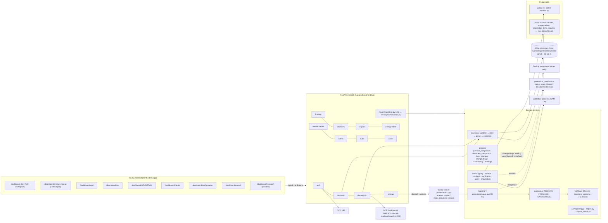
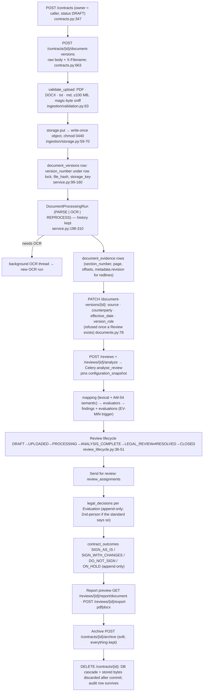

# CLM R&D — Workstream 1: Existing System & Architecture

`📁 ANALYSIS` — 2026-11-02. Research only. Decides nothing, locks nothing, authorizes no build.
Grounded in a read-only pass over branch `research/clm-contract-creation-20261102` (= `origin/main`
at `30455ff`). Paths are relative to the repository root. Build state is asserted only by
[IMPLEMENTATION_STATUS.md](../../00-project/IMPLEMENTATION_STATUS.md); where this report says
"exists", it means "the code is present at that line", not "verified".

Counterparties are written "the client" throughout.

---

## 0. Ten findings that matter most for CLM

1. **CLM creation and negotiation are explicitly out of scope in two locked records, and no
   later amendment brings them back.** Step 37 / `PROD-07` excludes *"Automatic legal clause
   rewriting · Automatic modified DOCX/PDF generation · Automatic redlining · AI negotiation"*
   (`all_lock.md:5167-5170`, `docs/05-architecture/SYSTEM_ARCHITECTURE.md:42-58`). The AB-3
   record (`AM-25`–`AM-29`) lists *"e-signature … automatic redlining, clause rewriting … multi-tenant
   external access"* as **out of V1 scope** (`all_lock.md:16040-16044`). A CLM build therefore needs
   its own amendment batch **before** any code: amend `PROD-07` and the AB-3 out-of-scope list. The
   master RAG roadmap's "amend without asking" licence does **not** cover this, because it is not
   an Ask/RAG conflict.
2. **The negotiation model already exists, in a thin form.** A Contract holds N immutable
   `document_versions` (`backend/legalmind/db/models.py:300-331`), and each version can be declared
   `version_role` = `COMPANY_DRAFT` ("what we sent"), `CLIENT_MODIFIED` ("what came back") or
   `FINAL_SIGNED` ("what was executed") (`backend/legalmind/domain/client_profile.py:66-71`,
   `backend/legalmind/api/schemas.py:359-387`). It lives in `metadata` JSONB, needs no migration,
   and is frozen once a Review exists (`backend/legalmind/api/routers/documents.py:78-128`).
   "Negotiation rounds" are, today, versions of one Contract.
3. **A marked-up document is already read as two texts.** Ingest v6–v8 keeps the proposed text as
   evidence and the original text plus each tracked change on `metadata.revision`. Word comments
   are kept beside their clause (`backend/legalmind/ingestion/service.py:55-65`). On top of that:
   - `client_changes` lists every change by section (`backend/legalmind/analysis/client_changes.py`).
   - `change_triage` reads whether each change moves risk onto LeapSwitch (`backend/legalmind/analysis/change_triage.py`, `AM-224`).

   This is most of an incoming-redline engine. **There is no outgoing-redline writer** (nothing
   produces tracked changes in a DOCX).
4. **Three diff engines exist, and none of them writes anything legal.**
   - Version comparison is clause-keyed by `section_number` (`backend/legalmind/analysis/version_comparison.py:165`).
   - Diff‑Talk compares any two documents, paired by similarity (`backend/legalmind/analysis/document_comparison.py:602`).
   - The client-change list (finding 3).

   Diff‑Talk also persists a per-change **ours/theirs** choice in `comparison_choices`
   (`models.py:862-899`, `AM-136`). That is the only existing "per-change decision" table. It is
   last-writer-wins and **not append-only**.
5. **Export is a review report generator, not a contract generator.** `export_render.py` builds a
   `Block` list (`h1|h2|h3|p|kv|quote|note|bullet|table|change|risk`, `:97-106`) and renders it two
   ways:
   - DOCX through python-docx (`:818-863`)
   - PDF through `pymupdf.Story` (`:928-956`), with a running header and a "Confidential · internal legal review · Page n of N" footer stamped on every page (`:944-953`).

   It knows no clause numbering, no defined terms, no signature blocks and no letterhead. It sets
   no document metadata (no `core_properties` / `set_metadata` anywhere in `backend/legalmind`),
   and it has no watermark.
6. **There is approved clause wording in the repository — the prior R&D said there was none.**
   - Constitution L1.14 has 8 sections with *"Drafting Notes for Counsel — Illustrative Clause Language (not yet in any signed contract)"*: §9, §10, §11, §12, §13, §15, §16 and §22 (`docs/02-legal-domain/LEGAL_CONSTITUTION_L1.14.md:344,392,440,488,561,651,703,894`).
   - 7 sections have an *Acceptable / Negotiable–Approval Required / Unacceptable* ladder.
   - This wording is already ingested into `knowledge_items` and served verbatim as counter-proposals (`backend/legalmind/api/angles.py:667-704`, `AM-152`).

   This is a clause-library seed and a fallback ladder. **Caution:** the Constitution itself labels
   the wording "illustrative", and the zero-tolerance Legal Rule says no fallbacks exist
   (`docs/architecture/LAWYER_REASONING_RESEARCH.md` §8 item 2). It is not yet issuable template
   prose.
7. **Single organisation, no tenancy.** There is no `tenant`/`org_id` column anywhere in
   `backend/legalmind`. Scope is OWNER → DEPARTMENT → ASSIGNED → LEGAL_SCOPE, all rooted in the
   Contract (`backend/legalmind/security/authorization.py:89-118`). Writes are owner-only. Platform
   Admin can never open a deal.

   The issuing **entity/brand** (LeapSwitch vs CloudPe) is not modelled. Conflict **C-19** is open
   (MEDIUM), and generated paper would need exactly that axis.
8. **Everything a CLM approval flow needs exists for *reviews*, nothing for *drafts*:**
   - point decisions, append-only (`legal_decisions`, `models.py:695-730`)
   - second-person approval read from the standard (`backend/legalmind/workflow/decisions.py:116-122`, `:219-253`, `AM-240`)
   - contract-level outcome Sign as is / Sign after our changes / Do not sign / On hold, append-only (`contract_outcomes`, `models.py:736-758`, `AM-174`)
   - Send for review (`review_assignments`, `reviews.py:442-508`)
   - reopen (`AM-175`)

   All of it hangs off a Review, which hangs off an uploaded version.
9. **No outbound channel of any kind.**
   - No email, no SMTP, no webhook, no notification store.
   - The bell says *"LegalMind does not send notifications yet"* (`frontend/src/components/workspace/WorkspaceShell.tsx:146-147`).
   - `smtplib` is on the CI egress blocklist (`backend/tests/test_import_boundaries.py:100-103`). Only four modules may reach the network: generation, published-policy GET, OIDC, S3.
   - E‑signature and send-to-the-client are absent and each needs a new egress record.
10. **The lowest-risk "draft" path is the ingestion path you already have.**
    `ingest_document(db, storage, contract_id, uploaded_by, data, filename, declared_mime)` takes
    **bytes** (`backend/legalmind/ingestion/service.py:115-173`). A rendered DOCX could be stored
    as version N, declared `COMPANY_DRAFT`, and analysed by the same engine against the same
    standards. The returned markup then becomes version N+1, declared `CLIENT_MODIFIED`, and the
    existing redline, triage, comparison and decision machinery applies unchanged.

    The pieces that are genuinely new are:
    - template storage
    - questionnaire answers
    - the renderer for contract-grade DOCX
    - approval of a draft *before* it is sent
    - execution / e-signature

---

## 1. Architecture as built

**How it is put together:**
- **Monolith:** one FastAPI app (`backend/legalmind/api/app.py`) and one Celery worker on two queues: `analysis` and `assist` (`backend/legalmind/worker/app.py:47-56`).
- **Analysis:** queued when a broker is configured. Inline otherwise, which production refuses (`worker/dispatch.py:1-35`, `WorkerUnavailable`).
- **OCR:** runs in a daemon thread inside the API process, not in Celery (`worker/dispatch.py:259-396`).
- **Egress allowlist:** enforced in CI (`backend/tests/test_import_boundaries.py:108-150`). Allowed are the generation seam (`assist/llm/generation.py`), published-policy refresh, OIDC, and S3.

---

## 2. Page and route inventory

The detail below comes from a full frontend pass. Every dashboard route is wrapped by
`WorkspaceShell` (`frontend/src/app/dashboard/layout.tsx:35`). Nav entries come from
`navItemsFor` (`frontend/src/components/workspace/model.ts:477-545`).

**Query parameters actually used:** `id`, `version`, `compare`, `finding`, `classification`,
`evidence`, `left`, `right`, `user`, `department`, `sso`, `next`.

**Legacy redirects** (`frontend/next.config.ts:36-45`): `/contracts`, `/reviews`, `/audit`,
`/configuration` and `/admin` redirect.

| Route | What it does | Gate |
|---|---|---|
| `/` | Redirects to `/dashboard` | — |
| `/login` | Password and SSO sign-in | none |
| `/dashboard` (no `id`) — `DocumentsListView`, `app/dashboard/page.tsx:279-1373` | Upload hero, My/Department toggle, 4 stat tiles, recent-contracts table with a row menu (Edit / Transfer / Archive / Restore / Delete), recent activity, first-run `Pipeline`. Dialogs: `UploadContractDialog`, `EditContractDialog` (`:1384`), `ArchiveContractDialog`, `DeleteContractDialog` (`:1608`), `TransferContractDialog` | `contract.view`; each action has its own permission |
| `/dashboard?id=` — `WorkspacePage` (`components/workspace/WorkspacePage.tsx`) | The contract workspace. Header has a version select (`:286`), Upload revised version (`:302`), Compare versions (`:323`) via `VersionComparison`, Compare in Diff‑Talk (`:316`), Send for review (`:457`), View report (`:441`), and a company-documents dialog (`:565`). `WorkspaceLayout` holds `DocumentPane` (centre), `FindingsPane`, `AnalysisPanel` (Summary, angles, contract decision) and `AskDock` | `contract.view` |
| `/dashboard/reviews` | Review queue with a status filter | `review.view` |
| `/dashboard/reviews?id=` — `ReviewReportPage` | Report preview from the same blocks as the export, plus `ExportControl` (PDF/DOCX) | `review.view`; body needs `report.view`; export needs `export.generate` |
| `/dashboard/legal` | Flat table of findings awaiting a decision, across reviews | `legal.review` |
| `/dashboard/ask` — `AskWorkspace` | Chat assistant: attachments, model picker, deal review / contract memo, deal questions. Attachments are never Contracts (`AM-133`) | `assist.ask` |
| `/dashboard/diff` — `DiffTalkPage` | Any two documents, or a website policy, side by side, with ours/theirs choices and "Copy for Legal" | **no page gate**; nav needs `document.view` |
| `/dashboard/clients` | Client directory, or a client workspace (Documents / Details / Notes / Activity tabs, upload-to-client, link existing documents, version history) | `contract.view` |
| `/dashboard/configuration` | Company Standards: list, draft, edit, publish | `configuration.*` |
| `/dashboard/admin`, `/departments`, `/roles`, `/audit` | Users, departments, roles, audit trail | `user.manage` / `role.manage` / `audit.view` |
| `/dashboard/research` | A note plus `AskDock` with no contract | **no gate, not in nav** (`model.ts:537-543`). The comment there says the screen reads "isn't available yet", but the page renders a working dock — a stale comment |

### Overlap and duplication found

| Concern | Surfaces | Verdict |
|---|---|---|
| **Upload** | 1. `UploadContract` + `UploadContractDialog` (Dashboard) · 2. `UploadDocument` (workspace, revised version) · 3. `clients/UploadToClient` · 4. Diff‑Talk `Setup` slot upload · 5. Ask attachments | Real duplication. 1, 3 and 4 each re-implement create → upload → declare/suggest → analyse (`UploadContract.tsx:145-189`, `UploadToClient.tsx:101-149`, `Setup.tsx:120-137`). They share only `uploadFirstDocument` and `chainAnalysis`. Ask's path is deliberately different |
| **Ask chat** | `AskDock` (941 lines; workspace and Research) vs `AskWorkspace` (1260 lines; `/dashboard/ask`) | Real duplication. Two chat surfaces with two answer renderers: `WsAnswerView` (`AskDock.tsx:611`) and `TranscriptTurn` |
| **Findings / points** | `FindingsPane` (the only one that records decisions) · `Angles.LegalAngle` "Open points" in the same workspace's Summary tab · `AnalysisPanel` tiles · Dashboard `FindingsCell` · `/dashboard/legal` table · `ReviewReportPage` `PointCard` · Ask `ComparisonTable` · Ask `DealReview` | 6+ separate renderers of one dataset. Two of them sit side by side in one screen |
| **Versions** | `WorkspacePage` select · `VersionComparison` dual select · `ClientDocuments` "View history" (`:362-445`) · Diff‑Talk version picker (`Setup.tsx:20-45`) | 3–4 separate version UIs, no shared component |
| **Diffs** | `VersionComparison` (same contract, clause by number) vs Diff‑Talk (any two documents, by similarity, word diff) | Conceptual overlap, different engines and endpoints. A third, the client's tracked changes, appears in three places: inline in `DocumentPane.tsx:988-993`, a count in `Angles.tsx:201-215`, a tag in `ReviewReportPage.tsx:257` |
| **Contract edit / delete** | Dashboard `EditContractDialog` / `DeleteContractDialog` vs `ClientDocuments` `EditDocumentDialog` (`:168`) / `DeleteDocumentDialog` (`:280`) | Duplicated dialogs. Three separate row-menu implementations |
| **Client's documents** | Workspace `CompanyDocuments` dialog vs `ClientDocuments` vs `LinkExistingDocuments` | Three views of one query |
| **Report** | `ReviewReportPage` only; everything links to it | One component, reused correctly |
| **Decisions** | `DecisionControl` (points) and `ContractDecision` (whole contract), each mounted once | No duplication |

**Dead code:**
- `ClassificationGlossary.tsx` is never imported.
- `StatePill`, `TableCard` (`Primitives.tsx`) and `Pager` (`Feedback.tsx`) are unused.
- `api.ts` methods `documentContentUrl`, `finding`, `evaluations`, `user` and `deleteUser` have no caller.

**CLM-shaped UI that exists:** none.
- No template, wizard, stepper, watermark or e-signature component.
- No send-to-client action.
- "Draft" carries three unrelated meanings:
  - `ContractStatus.DRAFT`
  - a configuration draft
  - `version_role COMPANY_DRAFT`
- Copy-only drafting aids exist: Ask "Draft email · for review, not approved wording" (`AnswerProse.tsx:149-173`), and the counter-proposal card "Recommended wording to send back" (`Angles.tsx:271-285`).

---

## 3. Document lifecycle as built

**Where the files live:**
- Production stores files on local disk at `/var/lib/legalmind/documents` (`ops/production/README.md:145`), backed up separately as `documents-<stamp>.tar`.
- S3 is implemented and opt-in through `LEGALMIND_STORAGE_BACKEND=s3` (`backend/legalmind/api/storage.py:16-28`).
- Storage keys are a content hash plus a random suffix. There is no update primitive. `discard` exists only for contract deletion (`ingestion/storage.py:32-45`).
- Ask attachments keep **no bytes** (`api/temporary_review.py:13`).

**How versions are modelled:**
- A `contracts` row is the deal: owner, name, `contract_type`, `ContractStatus` (DRAFT / ACTIVE / SUPERSEDED), `archived_at`, `counterparty_id`.
- A `document_versions` row is one file, numbered `UNIQUE(contract_id, version_number)` (`models.py:324-326`).
- A version's reading is its latest completed processing run.
- A Review pins one version and one `configuration_snapshot` (`models.py:530-555`).
- There is **no draft/version-of-a-template concept**. Nothing links two contracts. `AM-42` r3 forbids document-to-document relationship tables.

**Immutability guarantees:**

| Guarantee | Mechanism | Where |
|---|---|---|
| Original bytes never change | Write-once store, 0440 | `ingestion/storage.py:59-70` |
| Version metadata frozen once reviewed | 409 if a Review exists | `routers/documents.py:99-104` |
| Re-read refused while anything relies on it | `_reprocess_blockers` | `routers/documents.py:131-155` |
| `audit_events`, `legal_decisions` append-only | `legalmind_append_only()` trigger | `alembic/versions/80dccb65caf6…:425-438` |
| …but cascade delete passes (`pg_trigger_depth() > 1`); `contract_outcomes` added | `AM-176` | `alembic/versions/d8b3f1a6c4e2…:42-61` |
| Every Finding has ≥1 Evaluation | Deferred constraint trigger EV-MIN | `80dccb65caf6…:396-415` |
| A retired statute generation is never deleted | Trigger | `b5d9f2a4c7e1…:63-67` |
| Configuration versioned, never edited | `*_versions` tables + immutable snapshots | `models.py:389-525` |

**What is not immutable:**
- `contracts.status` and `name`
- `document_versions.metadata` before a Review exists
- `comparison_choices` (last writer wins)
- `counterparties`

**Deletion breaks rule 17 by design** (`AM-55`).

---

## 4. Reusable services for CLM

| Capability | What exists | Reuse value for CLM | Limits |
|---|---|---|---|
| **Render** | `export_render.Block` model + `render_docx` / `render_pdf`, `RENDERERS` (`api/export_render.py:97,818,928,959`). Escapes HTML, prints a page frame | High for draft previews and approval packets | Plain python-docx `Document()` (default styles), no numbering list definitions, no cross-references, no signature block, no letterhead, no core-properties scrub, no watermark, no tracked-change writing. Not "contract-grade" |
| **Diff / redline (read)** | `version_comparison.compare_versions` (`:165`), `document_comparison.compare` (`:602`), `client_changes`, `change_triage`, ingest v6–v8 redline reader (PDF struck/underlined colour, DOCX `w:ins`/`w:del`/moves/comments) | High. Incoming client markup is solved | Comparison never writes a verdict (33.16). Output is text only, no DOCX redline |
| **Per-change choice** | `comparison_choices` ours/theirs, `PATCH /comparisons/choices` (`routers/documents.py:431-455`) | Medium. It is the shape of a per-change decision | Keyed on Diff‑Talk `row_key`, mutable, no reason or justification, not linked to a Review, "about WORDING only, never a Legal Decision" (`AM-136` r2) |
| **Clause segmentation** | Parser `detect_clause_number` (`ingestion/parsing.py:263`), `Segment` (`:131`), `mapping.service.load_clauses` (`mapping/service.py:62`), `consistency.py` cross-reference checks | High for reading drafts back | Parser numbering only; it never generates numbers (34.12) |
| **Engine as a pre-send self-check** | `run_analysis` (`analysis/service.py:193`) against 78 active standards; `temporary_review` runs it inside a rolled-back SAVEPOINT (`api/temporary_review.py`) | High. A generated draft can be checked against our own standards before sending, with nothing persisted | Requires evidence rows, so the draft must be parsed like an upload |
| **Counterparty** | `counterparties` with profile fields (`models.py:202-263`), `contracts.counterparty_id` | High for party blocks in a template | No address-for-notices, signatory or registration fields. Free-text profile only. Visibility rooted in contracts; no global list (`AM-42` r6) |
| **Permissions / Guard** | `Guard` (`api/deps.py:185-428`), `authorization.py`, catalogue (`security/permissions.py:103-118`) | High. Every new route follows the same pattern | No template/draft permissions exist |
| **Audit** | `audit.record` (`security/audit.py:151`), 54 action names, append-only | High | Add new action names only |
| **Review workflow** | Locked Step 30 state machine (`workflow/review_lifecycle.py:36-51`), decisions, second person, contract outcome, assignment (Send for review), reopen, `review_progress` stage (`workflow/review_progress.py`) | High for reviewing a returned client version. Medium for approving our own draft (that is not a Review) | A Review requires an uploaded, analysed version |
| **Ask hand-off** | Workspace `AskDock` per contract; `askIntent` "Ask about this" seed; Ask → evaluator routing (`routed_to_evaluator`, `assist/service.py:147`); Ask deal review over chat files (`api/deal_review.py`, `AM-229`/`AM-236`); draft-email card (copy only) | Medium. A "start a draft" redirect fits the existing redirect pattern | Ask may never produce a position or Legal Decision (`AM-25` r1–r5). Ask attachments never become Contracts (`AM-133` r1) |
| **Counter-proposal wording** | `angles._proposals`: Constitution Drafting Notes, or else the Company Position, verbatim from `knowledge_items` (`api/angles.py:667-704`). Positions-permission gated | High as a clause-library seed | Illustrative per the Constitution's own label. 8 sections only |
| **Notifications / email** | None. The bell is a placeholder. `smtplib` is CI-blocked | — | New egress needs a record |
| **Background jobs** | Celery `analysis` / `assist` queues; Redis broker | Medium (rendering big drafts, signing callbacks) | OCR still runs in an API thread |

---

## 5. Constitution and Company Standards: storage, versioning, retrieval

| Layer | Stored as | Versioning | Published / snapshotted | Retrieved by |
|---|---|---|---|---|
| **Legal Constitution** | Markdown `docs/02-legal-domain/LEGAL_CONSTITUTION_L1.14.md` (2086 lines; L1.5 and L1.10–L1.13 kept beside it) | New file per version, recorded by an AM record | Ingested by `tools/ingest_constitution.py` into `assist.knowledge_sources` / `knowledge_items` (one current source, migration `e5a8c3f1d9b4`); `constitution.CURRENT_VERSION` | Ask (positions lane, `legal_position.view` / `configuration.view`), `angles._proposals`, `change_triage` topics. Never by the evaluator directly |
| **Company Standards** | One JSON per Requirement under `backend/config/company_standards/` (86 files incl. 7 retired, plus 3 under `proposed/`); generated §31 files via `tools/generate_section31_standards.py --check` | `requirements` → `requirement_versions` → `company_standard_versions` / `legal_rule_versions` / `mapping_rule_versions` / `evaluation_rule_versions` (`models.py:389-499`). A changed file appends a version | `tools/import_ratified_standards.py --publish` or `POST /configuration/publish` (`routers/configuration.py:294`) → `configuration_snapshots` + items (hash-unique). Each Review pins one snapshot. Live snapshot `0908b436`, 78 active | The evaluator through the snapshot. Ask's position chunks (`assist.position_chunks`) exclude DEPRECATED (`AM-71`) |
| **Statutes** | `config/statutes/registry.json` + ingested `assist.statutes` / `statute_chunks` with generations (retired never deleted) | Generation rows | `tools/ingest_statutes.py` | Ask statute lane; enforceability notes (`AM-242`) |
| **Website policies** | Daily GET (`AM-130`) → knowledge sources | Daily refresh | Timer `legalmind-published-policies` | Ask, Diff‑Talk website side |

Each standard carries:
- `configuration.document_type`
- a `constitution` block with section, topic and basis
- `mapping_rules`
- `evaluation_rules`
- the zero-tolerance `legal_rule`
- since `AM-239`, an optional sourced `favourable_direction`

It **encodes a required position, not output prose**. The prior R&D's distinction still holds
for standards. Only the Constitution's Drafting Notes carry prose.

---

## 6. Document generation and export today — exactly

| Output | Endpoint | Content |
|---|---|---|
| Review report PDF / DOCX | `POST /reviews/{id}/export {format}` (`routers/export.py:60-104`) | `build_export_model` (`export_render.py:329`): cover (contract, client name, owner, version, stage), key, points with clause quote / our standard (position-gated) / action, client changes, change-triage risks, next steps. Rate-limited per user; audited `report.exported` |
| Report preview | `GET /reviews/{id}/report/document` (`:129-134`) | The same `Block` list as JSON. Preview and file cannot differ |
| Original file | `GET /document-versions/{id}/content` | The stored bytes |
| Copy-to-clipboard text | Frontend only | Ask draft email, counter-proposal wording, Diff‑Talk "Copy for Legal" |

**Nothing produces:**
- a contract
- a filled template
- a modified copy of an uploaded document
- tracked changes
- a signature page
- an email

---

## 7. AuthN, AuthZ, roles, department scope, audit, tenancy

**Authentication**
- Server-side sessions for password login. OIDC carries a stateless 24h JWT whose `roles` claim is advisory (`AM-36`).
- Permissions are resolved from the database on every request (S-1; `security/resolver.py`).
- JIT provisioning can never mint `NEVER_PROVISIONED_BY_IDP`: legal authority and admin (`permissions.py:150-153`).

**Permission catalogue** (`permissions.py:37-118`):

| Group | Permissions |
|---|---|
| Contracts | `contract.view`, `.create`, `.update`, `.archive`, `.transfer` |
| Department | `department.view` |
| Documents | `document.upload`, `.view`, `.download` |
| Reviews | `review.create`, `.view` |
| Findings | `finding.view`, `.comment` |
| Evaluations | `evaluation.view` |
| Legal authority | `legal.review`, `legal.decision`, `legal.approve_customization` |
| Internal position | `legal_position.view` |
| Configuration | `configuration.view`, `.draft`, `.publish`, `.deprecate` |
| Reporting | `report.view`, `report.generate`, `export.generate` |
| Assist | `assist.ask` |
| Audit | `audit.view` |
| Administration | `user.manage`, `role.manage`, `platform.manage` |

`finding.comment` is granted but **no comment feature or table exists** (grep finds no use
outside `permissions.py`).

**Roles** (`permissions.py:208-261`):

| Role | Holds |
|---|---|
| `USER` | Own deals end to end, incl. `legal_position.view` and `export.generate` |
| `DEPARTMENT_LEAD` | `USER` + `department.view`, transfer, all `configuration.*`, `report.generate` |
| `PLATFORM_ADMIN` | Admin and audit only. Never contract content |
| `DEVELOPER` | Everything except legal authority |
| `LEGAL_REVIEWER`, `LEGAL_DECISION_AUTHORITY` | Hidden "future legal" tier. Grantable only by a holder (S-8). Decisions require an explicit `legal.decision` grant (SEC-02 / ROLE-05) |

**Scope:** OWNER (read + write) → DEPARTMENT (read) → ASSIGNED (read; AB-100, Step 24 r6) →
LEGAL_SCOPE (`REC-09`, read) → otherwise a byte-identical 404 (`authorization.py:89-135`,
`SEC-07`). An archived contract refuses every write.

**Audit:** `audit_events` is append-only, with 54 action names (`security/audit.py`). Cross-owner
reads are audited by basis (`contract.read_via_department_scope` etc.).

**Tenancy:** single organisation. No tenant or organisation key in any table or query.
"Multi-tenant external access" is out of V1 scope per the AB-3 record. A counterparty never
logs in — there is no external user type.

---

## 8. Missing backend capabilities for CLM

| Capability | Today | Gap |
|---|---|---|
| Templates and template versions | None (grep: no table, route or module). Constitution Drafting Notes (8 §) and ratified positions only | A whole new aggregate: template, immutable published versions, approval |
| Clause library | Counter-proposals read live from `knowledge_items` (`angles.py:667`) | No addressable, versioned clause objects, no alternates or fallbacks, no per-document-type assembly |
| Questionnaire answers | None | Answer storage, validation, and the mapping from answers to clauses and fields |
| Generated drafts | None | Render → store → (optionally) ingest as `COMPANY_DRAFT` version |
| Outbound / sent versions | `version_role COMPANY_DRAFT` exists as a **declaration** only | No "sent at / sent to / channel" fact, no sending |
| Negotiation rounds | Implicit: version N (ours) → N+1 (theirs) on one Contract | No round object. Version roles cannot change after a Review. No link between a round and the decisions taken in it beyond Review → version |
| Per-change decisions | `comparison_choices` (Diff‑Talk, mutable, wording-only); `legal_decisions` (per Evaluation, i.e. per *standard*, not per client change) | No decision on an individual tracked change that is not covered by a standard (the AM-223 "not checked — a person reads it" bucket) |
| Approvals of our own draft | Second-person approval and contract outcome exist only for Reviews | Approval-to-send gate for a draft. Template approval / publication |
| Comments / threads | DOCX comments are *read* (ingest v8); `finding.comment` unused | No comment table |
| E-signature / execution | `FINAL_SIGNED` is a declaration; `ContractOutcome SIGN_*` is a recommendation | No signing, no executed-copy hash link, no effective / expiry / renewal dates beyond declared `effective_date` |
| Notifications | None | Any channel at all |
| Entity / brand of issuing paper | Not modelled (C-19 open) | Needed before generating LeapSwitch vs CloudPe paper |

---

## 9. Candidate database changes

Under `IMPL-01` every new table, column or enum needs an approved amendment batch.

| Candidate | Purpose | Status | Could an existing table absorb it? |
|---|---|---|---|
| `templates`, `template_versions` (status DRAFT/APPROVED/PUBLISHED/RETIRED, blocks JSONB, fields JSONB, constitution_refs, approved_by/at) | Template aggregate | **Needs an approved amendment batch** | Partly. The `requirements` → `*_versions` → `configuration_snapshots` pattern is the precedent. A template could be a file-first config like standards (JSON under `backend/config/templates/` imported into versioned rows), which mirrors how standards are ratified. **New rows, still new tables** |
| `clauses`, `clause_versions` (+ alternates / fallback rank) | Clause library | **Needs an approved amendment batch** | No. `knowledge_items` is an assist-schema retrieval record (`AM-79`), not an authoring object, and must not become a legal table. Fallback rank also collides with zero tolerance (§10) |
| `draft_requests` / `questionnaire_answers` (answers JSONB, template_version_id, contract_id) | Questionnaire | **Needs an approved amendment batch** | Possibly into `document_versions.metadata` JSONB (the D-3 / Q2 precedent used for type, source and `version_role`). Low-ceremony, but answers would then be frozen per version and unqueryable. Acceptable for an MVP if the owner allows the JSONB route again |
| Generated draft = a normal `document_versions` row (`version_role=COMPANY_DRAFT`, `metadata.generated_from = {template_version_id, answers_hash}`) | Generated drafts | **JSONB keys only** (D-3 route), no new column if the owner accepts it. The prior R&D's `generated_documents` / `generated_document_*` tables are then unnecessary | **Yes.** `contracts` + `document_versions` + write-once storage absorb it. The draft is then reviewable by the existing engine |
| `version_sends` (version_id, sent_by, sent_at, channel, recipient) | Outbound / sent | **Needs an approved amendment batch** (or `audit_events` only) | An audit action `document.sent` gives "who sent what when" with no schema change. A table is needed only for querying |
| `negotiation_rounds` | Rounds | **Avoid.** It collides with `AM-42` r3/r4 (no relationship or deal entity) | **Yes.** Rounds = consecutive versions on one Contract + `version_role` |
| `change_decisions` (version_id, change_key, decision, justification, decided_by, version_number; append-only) | Per-change decisions on clauses no standard covers | **Needs an approved amendment batch.** Must be kept apart from `legal_decisions` (one decision per Evaluation, Step 31) and from the five axes | Partly. `comparison_choices` has the right shape but is mutable and wording-only (`AM-136` r2). Extending it to version pairs inside one contract and making it append-only is an amendment to `AM-136` |
| `draft_approvals` | Approval to send | **Needs an approved amendment batch** | Partly. `review_assignments` + `contract_outcomes` cover "a reviewer looked and chose". A draft that is ingested and analysed gets a Review, so Send for review + contract outcome could *be* the approval. Approval-of-own-paper vs decision-on-their-paper must stay distinct (rule 13) |
| `signatures` / `executions` (version_id, provider, envelope_id, signed_at, signed_file_hash) | E-signature | **Needs an approved amendment batch, a new egress record and a provider decision** (`AM-25` out-of-scope list) | `version_role=FINAL_SIGNED` + `effective_date` cover the manual path today |
| `contracts.issuing_entity` / brand | C-19 | **Needs an approved amendment batch** (already registered as needing one) | No |
| New permissions `template.manage`, `template.publish`, `document.generate`, optional `draft.approve` | AuthZ | Catalogue change. Permissions are rows: **needs an approval / amendment record** | — |

---

## 10. Technical risks and locked-decision collisions

| # | Collision | Locked source | Consequence for CLM |
|---|---|---|---|
| R1 | Automatic modified DOCX/PDF generation, automatic redlining, clause rewriting and AI negotiation are excluded from V1 | `PROD-07` / Step 37 (`all_lock.md:5164-5171`); AB-3 out-of-scope list (`all_lock.md:16040-16044`) | **Blocker.** An amendment batch must widen V1 scope first. Template fill (deterministic) is the easiest case to argue; "AI negotiation" the hardest |
| R2 | Assist lane never writes legal or configuration tables and never states a position absent from a ratified source | `AM-25` r1–r5, `AM-28`, import boundary (`tests/test_import_boundaries.py`) | No LLM may author template text, choose clauses, or decide a fallback. An LLM may at most suggest field boundaries at authoring time (human-confirmed, like `AM-34` / `AM-54`). Generation lives outside `legalmind/assist` |
| R3 | Zero-tolerance Legal Rule: no tolerance bands, ACCEPTABLE only from MATCH (+ `AM-239`'s in-our-favour form) | Manager ruling 2026-08-19; `AM-33`; `AM-239` | A negotiation playbook's preferred → fallback → walk-away ladder has no place in the evaluator. Fallbacks may be stored as *wording* only, and any acceptance is still a Legal Decision. This needs an owner policy call (LAWYER_REASONING_RESEARCH §8.2) |
| R4 | Rule 17 append-only; `legal_decisions` / `audit_events` / `contract_outcomes` triggers | AUD-01, Step 31 r14, `AM-176` | New approval, decision and signature records must be append-only (versioned rows, highest wins), not status updates. Cascade delete (`AM-55`) will take them with the contract. Decide whether executed or signed records may be deleted at all |
| R5 | 54.6: no document or clause text beyond short excerpts in the repository | Locked 54.6; `test_source_material.py` | Template prose cannot be committed the way standards JSON is (standards hold short quotes). Templates need to live in the DB or the gitignored `legal-docs/`, or need an owner ruling that approved template text is configuration, not source material. **Material decision** |
| R6 | Rule 21: never manufacture legal content | CLAUDE.md rule 21 | The Constitution's Drafting Notes are self-labelled "illustrative … not yet in any signed contract". The leapswitch MSA template (D6) has a §17.2 vs §17.7 contradiction and was reconciled away from its own cap (`AM-43` r4). There is **still no approved, issuable MSA/NDA template**. The owner must supply or designate one |
| R7 | Five state axes never share a field or enum; RESOLVED ≠ MATCH | `REC-06`, DECISION_STATE_MODEL | Template status, draft status, round status and signature status must each be their own vocabulary. Never reuse `DRAFT` from `ContractStatus` / `ReviewStatus` / `ConfigStatus`. The UI already has three meanings of "draft" |
| R8 | SEC-07 / LEGAL-02: omitted not nulled; byte-identical 404 | SEC-07, API-10 | Template fields carrying internal positions (cap value, fee floor) must be omitted for callers without `legal_position.view`. A generated draft visible to the client must never carry an internal-position annotation. Export already serializes under the caller's permissions; keep that property |
| R9 | No document-to-document relationship table; no deal/matter entity | `AM-42` r3/r4; AB-13 | A "draft → executed contract" link, or a "negotiation" entity spanning contracts, is forbidden. Keep everything inside one Contract |
| R10 | Version metadata frozen once a Review exists | 33.7 / 34.15 r3; `routers/documents.py:99` | Declare `version_role` (and `generated_from`) at creation, before analysis. Correcting it later means a new version |
| R11 | Egress allowlist (4 modules); `AM-30` t1/t10; C-17 | `tests/test_import_boundaries.py:108-150` | E-signature providers, email/SMTP and webhooks each need a new lock record and an allowlist entry. Sending a draft to the client is a new disclosure path |
| R12 | Entity/brand not modelled | C-19 open (MEDIUM) | Generating CloudPe paper from LeapSwitch standards is the exact substitution the Constitution §4 forbids. Resolve C-19 before multi-brand generation |
| R13 | `PROD-02` / `PROD-05`: approval never modifies the contract; a customized contract is a separate version or document | Steps 1, 2, 34 | **Supports** the "draft is a new version" model. Applying approved wording to a client version must create version N+1, never edit N |
| R14 | Renderer fidelity | `export_render.py` | Default python-docx styles, no multilevel numbering, no defined-term or cross-reference handling, no metadata scrub. Building a contract-grade DOCX writer is real work (see workstream 04) |
| R15 | UI sprawl | §2 | Adding a builder as a seventh upload/version/diff surface would deepen existing duplication. A CLM screen should reuse `WorkspacePage` (versions, compare, send for review, decisions) and add only the authoring step |

### What is stale or wrong in `DOCUMENT_BUILDER_RND.md` (2026-09-15), checked against code

| Prior claim | Current fact |
|---|---|
| "40 ratified files" | 86 files, 78 active (`backend/config/company_standards/`, snapshot `0908b436`) |
| Ten document types | 13: `PARTNER_AGREEMENT`, `VENDOR_AGREEMENT` and `DISTRIBUTION_AGREEMENT` were added by `AM-72` (`domain/document_types.py:59-73`) |
| `legalmind/assist/routing.py`, `intent.py`, `generation.py`, `service.py:575 ask()` | Moved: `assist/query/routing.py`, `assist/query/intent.py`, `assist/llm/generation.py`; `ask()` is at `assist/service.py:1259`. An agent path (`assist/agent/*`) and multiple providers (DeepSeek, Bonsai) now exist |
| "Constitution is never chunked or retrieved" / L1.10 | Retrieved since `AM-79` (`knowledge_items`); canonical L1.14 |
| "No approved output template exists in any form" | Still true for an issuable template. But 8 Constitution sections carry Drafting-Notes clause language, already served verbatim as counter-proposals (`angles.py:667-704`) |
| `Block` = h1/h2/h3/p/kv/quote/note | Also bullet / table / change / risk. A page header and footer stamp exist. The metadata-scrub question it left open: **confirmed not done** |
| "No comment primitive anywhere" | Still no comment table, but DOCX comments are now ingested and shown (v8, `AM-223`) |
| No reviewer workflow | Send for review, second-person approval, contract outcome and reopen now exist (`AM-167`–`AM-179`, `AM-240`) — a ready approval spine |
| `GeneratedDocument` separate from `Contract` ("two separate object graphs") | Now the weaker choice. `version_role`, redline reading, triage and the review workflow all key on Contract → versions. A separate graph would duplicate them and could never be compared with the client's returned markup without a cross-graph link (`AM-42` r3) |
| No wizard component | Still true |
| No watermark | Still true. The PDF has a "Confidential · internal legal review" page frame |
| `/dashboard/builder` under the AM-57 workspace, "use `--ws-*` tokens" | Still the right token set. Note that shadcn / Tailwind is now approved incrementally (2026-09-10). Diff‑Talk added `react-diff-viewer-continued` |
| No e-signature / out of scope | Unchanged, and reinforced by the AB-3 out-of-scope list it did not cite. It also missed `PROD-07`'s explicit exclusion of "Automatic modified DOCX/PDF generation" |
