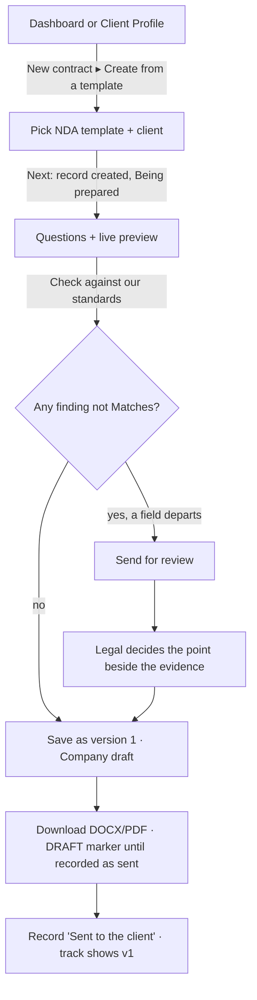
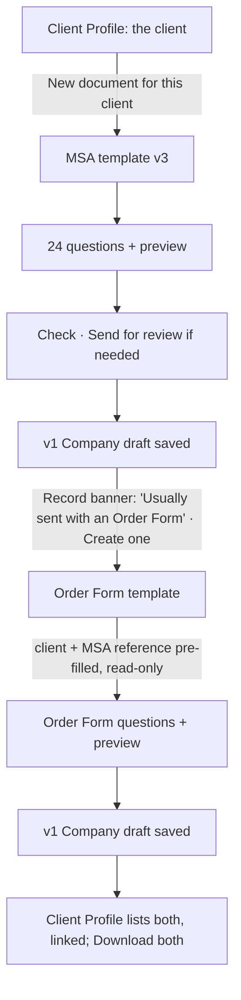
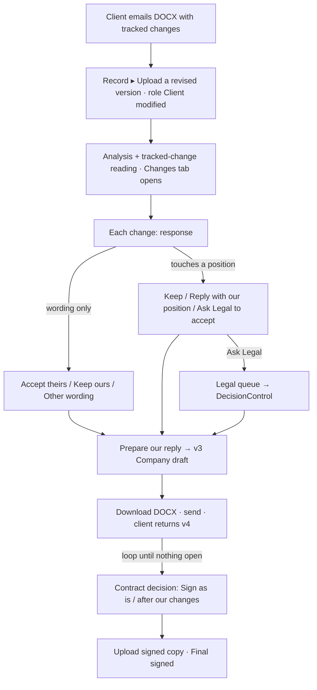
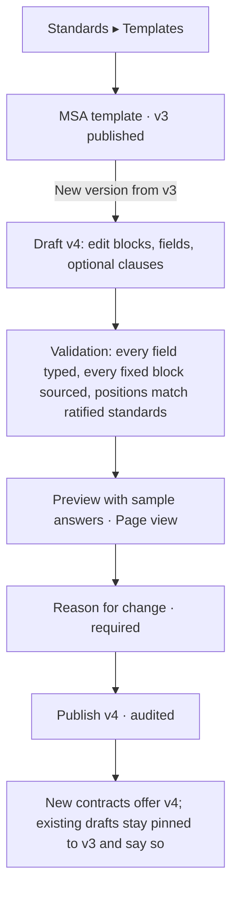

# CLM R&D — 03 · UX and information architecture for creating, reviewing and negotiating contracts

📁 `ANALYSIS / PROPOSAL`. Written 2026-11-02 by workstream 3 (product design and UX research). It decides nothing,
locks nothing and authorises no build. Every claim about the current product was read from the
`research/clm-contract-creation-20261102` worktree (`frontend/src/**`) on 2026-11-02. Claims about
other products cite the vendor's own page.

Labels used throughout:
- **VERIFIED (URL)**: read on the vendor's own documentation page.
- **SNIPPET (URL)**: seen only as a search-engine excerpt, because the page itself returned 403.
- **PRACTICE**: common industry practice, not tied to one source.
- **RECOMMENDATION**: this workstream's proposal.

Ironclad's help centre, DocuSign CLM and Icertis could not be read (403 or behind a login). Nothing is claimed
about them beyond what is marked.

---

## 0. The recommendation in one paragraph

**Do not add a "Create", "Review", "Negotiation" or "History" page.** LegalMind already has the
object a CLM is built around: one contract record at `/dashboard?id=…`. It has versions, and each version has
a declared source (ours or theirs) and a declared role (Company draft, Client modified or Final signed). It
also has a review, findings, point decisions and a contract decision. Creating, reviewing, negotiating and
finalising are **stages of that one record**.

So the plan is:
- **"New contract"** becomes a split action on the Dashboard: *Create from a template* or *Upload a contract*.
- Both actions land in the same record.
- The record gains three tabs: **Document** (today's workspace), **Changes** (negotiation) and
  **Versions** (timeline).
- A **negotiation track**, built from the version roles that already exist, sits in the header.
- Templates are administered under **Standards**, not under a new nav item.
- The two legal queues (**Reviews** and **Legal**) merge into one.

The result is one page fewer in the nav, not three more.

---

## 1. Inventory of what exists today

### 1.1 The navigation

The nav is built in `components/workspace/model.ts` `navItemsFor()`, and every item is hidden by permission:

| # | Nav label | Route | Who sees it |
|---|---|---|---|
| 1 | Dashboard | `/dashboard` | `contract.view` |
| 2 | Reviews | `/dashboard/reviews` | `review.view` **and** `legal.review` |
| 3 | Legal | `/dashboard/legal` | `legal.review` |
| 4 | Client Profiles | `/dashboard/clients` | `contract.view` |
| 5 | Diff-Talk | `/dashboard/diff` | `document.view` |
| 6 | Ask | `/dashboard/ask` | `assist.ask` |
| 7 | Standards | `/dashboard/configuration` | `configuration.view` |
| 8 | Administration | `/dashboard/admin` (+ `/roles`, `/departments`, `/audit`) | `user.manage` or `audit.view` |
| — | *(no nav item)* | `/dashboard/research` | Orphan. Its nav line is commented out in `model.ts`, and Ask covers it. |

The shell also renders a floating **Ask** button on every screen that has no Ask of its own
(`WorkspaceShell.tsx`).

### 1.2 Pages and what each one does

| Page / view | File(s) | What it does |
|---|---|---|
| **Dashboard list** | `app/dashboard/page.tsx` `DocumentsListView` | Four status tiles (draft · analysing · needs attention · analysed). A 7-column table (Document · Type · Status · Findings · Last Analyzed · Added · Action). Upload dialog. Edit, archive, delete and transfer dialogs. Recent activity. |
| **Contract workspace** (the de-facto contract record) | `/dashboard?id=` → `WorkspacePage.tsx`, `WorkspaceLayout.tsx` | **Header chips:** type, contract status, source (ours/theirs), client, effective date, a **version `<select>`**. **Header actions:** "Upload a revised version", "Compare in Diff-Talk", "Compare versions" (toggles the `VersionComparison` panel), **Send for review**, **View report**, **Share**. **Body (AM-57):** contents index · document · side card with tabs **Summary / Findings** and a docked **Ask**. Below 900 px it becomes one region at a time with top tabs. |
| ↳ Document pane | `DocumentPane.tsx` | Text view with evidence highlights and reader annotations. Shows **the client's tracked changes and notes inline under each passage** (`ws-row__marked`: Changed/Added/Removed, `<del>`/`<ins>`, "Their note"). Has an **Original** view, which is the PDF in a native-browser `<iframe>`. |
| ↳ Summary | `AnalysisPanel.tsx` | Stage line, counts per reader word, the ⚖️ Legal and 💼 Business angles, the **contract decision** (`ContractDecision.tsx`: Sign as is / Sign after our changes / Do not sign / On hold), and Key Obligations (assist lane). |
| ↳ Findings | `FindingsPane.tsx` | Filter by reader word, then finding → evaluation → evidence. Includes `DecisionControl` (per point), `EscalateControl`, and the counter-proposal from the Constitution (`FindingCounterProposal`, AM-152). |
| ↳ Version comparison | `VersionComparison.tsx` | A deterministic clause-by-clause comparison of two versions (33.15). It deliberately has **no word-level redline** (owner boundary, 2026-09-04/05). It quotes the analysis's finding next to a changed clause, read-only. |
| **Report** | `/dashboard/reviews?id=` → `ReviewReportPage.tsx` | The Review's report and its PDF/DOCX export (`ExportControl`). Reached from the queue and from the workspace's "View report". |
| **Reviews queue** | `/dashboard/reviews` | A list of Reviews filtered by lifecycle status. |
| **Legal queue** | `/dashboard/legal` | Every finding with `DECISION_REQUIRED`, across visible Reviews. It deep-links to the workspace with `?finding=`. Triage only; nothing is decided here. |
| **Client Profiles** | `/dashboard/clients` (`?id=`) | The client directory, then one client's file. Tabs: Documents (one flat list, with **version rows under each document** and per-version role), Details, Notes, Activity. "Compare" deep-links to the workspace with `?compare=1`. |
| **Diff-Talk** | `/dashboard/diff?left=&right=` | Any two documents side by side (a website document or any version). Word marks in red (ours) and green (theirs). **A choice per difference** (Keep ours / Accept theirs · Leave it out / Add it · Keep ours / Remove it), stored server-side and shared (AM-136). "Copy for Legal". No verdict (33.16, AM-137). |
| **Ask** | `/dashboard/ask` (`AskWorkspace.tsx`) plus `AskDock` inside the workspace | Cited Q&A. Also **deal review** (`DealReview`/`ContractMemo`: several of a client's files reviewed side by side, with the words Must change / Ask for a change / Legal decides) and comparison tables. |
| **Standards** | `/dashboard/configuration` | Requirements and Company Standards: form editing (DD-23), publishing a snapshot (DD-24), list format (DD-25). Uses the older `.card`/`.btn` styles. |
| **Administration** | `/dashboard/admin/*` | Users, roles, departments, audit log. |

### 1.3 Overlaps: the same thing shown in more than one place

| Thing | Where it appears | Assessment |
|---|---|---|
| **Findings** | (1) Dashboard row "Findings" column · (2) workspace Summary counts · (3) workspace Findings tab · (4) Legal queue rows · (5) Report body · (6) Ask comparison tables and `DealReview` rows · (7) Client Profile document rows (review status) | (1), (2), (4), (5) and (7) are legitimate summaries that deep-link to (3), the only place a decision is made. **(6) is a second presentation with its own vocabulary** (Must change / Ask for a change / Legal decides next to Change needed / Needs a decision). That is a real inconsistency, but it belongs to the Ask lane and is out of scope here except to say: *do not add a third vocabulary for negotiation.* |
| **Versions** | (1) workspace header `<select>` · (2) `VersionComparison` panel · (3) Client Profile version rows · (4) Diff-Talk pickers | No single place shows the history **as a history**: who sent what, when, and in which round. The `<select>` only switches; Client Profiles lists the rows but cannot open a timeline. |
| **Diffs** | (1) `VersionComparison` (clause level, no word marks) · (2) Diff-Talk (word marks plus a choice per change) · (3) the DocumentPane's inline tracked changes (the client's own markup) · (4) Ask comparison tables · (5) change triage (AM-224, behind a flag, off) | **This is the largest overlap.** There are three different ways to see "what changed", each with a different rule on colour and on choices. The workspace header offers two of them as adjacent links ("Compare in Diff-Talk", "Compare versions"). |
| **Reports** | (1) `/dashboard/reviews?id=` · (2) "View report" in the workspace header | One page, two entries. It is fine, but leaving it pulls the reader out of the record. |
| **Legal work queue** | (1) Reviews · (2) Legal | Both are for `legal.review` holders. One lists Reviews, the other lists the points inside them. A reviewer has to know which list to open. |
| **Ask** | Ask page · workspace dock · Research (orphan) · floating button | Settled by DD-19/DD-21 ("one product in two places"). Research should be redirected to Ask and its file removed. |

---

## 2. How comparable products structure this

### 2.1 The repository and the single contract record

- **SpotDraft. VERIFIED.** The "Contract Details" page is one record:
  - **Header:** title, Reference ID and a breadcrumb back to the repository.
  - **Left panel** (status and actions): Status · Documents ("Upload New Version", "Compare Versions") · Approvals (Approve/Reject/Remind/Reassign) · Recipients · Internal Review · Intake Form · Activity Log (filters: All/Comments/Emails/Approvals/Versions/Reviews).
  - **Right panel** (static data): parties, intake responses, metadata, related contracts.
  - While the document is open, these collapse into **Status / Information / Activity Log** tabs.
  - Source: https://help.spotdraft.com/articles/9252034779-unveiling-the-new-contract-details-page-your-unified-contract-dashboard
- **Ironclad. SNIPPET.** A completed workflow becomes a "record" holding its documents and properties. Its
  Activity Feed can be filtered by user, step, document, approvals and properties.
  https://support.ironcladapp.com/hc/en-us/articles/12286328876823-Welcome-to-Ironclad
- **Juro. VERIFIED.** One contract is one browser document. Internal users default to Suggesting mode, and the
  side panel carries the comments and the counterparty's changes.
  https://intercom.help/juro/en/articles/5897857-negotiating-in-juro

**PRACTICE:** every one of these keeps create → negotiate → sign **inside one record**, with stage-specific
panels. None of them gives negotiation a top-level page of its own.

### 2.2 Creation: a form, then a document

- **Juro. VERIFIED.**
  - Template *smartfields* (text, number, dropdown, date) are highlighted green for internal users and render as plain
    text for the counterparty. An unfilled field shows its name internally and a blank externally.
    https://intercom.help/juro/en/articles/5652971-using-smartfields
  - *Rules* show or hide text on a smartfield condition. A "Viewing" mode shows the counterparty's view.
    https://intercom.help/juro/en/articles/5653125-adding-and-managing-rules
  - Questionnaires for internal creators are built by Org/Workspace admins.
    https://intercom.help/juro/en/collections/3177668-building-your-first-template-for-org-and-workspace-admins
- **Ironclad.**
  - VERIFIED: a launch form, tagged fields, "only pre-approved templates", conditional clauses.
    https://ironcladapp.com/product/workflow-designer
  - SNIPPET: conditional clauses are set up in Workflow Designer.
    https://support.ironcladapp.com/hc/en-us/articles/12250550045463-Create-a-Conditional-Clause-in-Workflow-Designer

### 2.3 Negotiation

- **Juro. VERIFIED** (https://intercom.help/juro/en/articles/5897857-negotiating-in-juro):
  - The counterparty's first redline sets the status to NEGOTIATION.
  - While the counterparty redlines, the document is locked for us until they "Send back new version". Each round
    is a new version.
  - We accept or reject **per change** by hovering, or in an "External comments" panel.
  - Resolved suggestions stay anchored in the text.
  - Unresolved ones can block signing.
- **SpotDraft. VERIFIED.**
  - Every edit, uploaded counterparty redline or finalisation creates a **numbered version**.
  - Version History is a preview plus a **Version Timeline** (action, user, notes, file source).
  - "Compare Version" picks two versions or an uploaded file and produces a redline you can export or "Upload as
    New Version".
  - Sources: https://help.spotdraft.com/articles/9273604156-contract-version-history-updated ·
    auto-upload of a counterparty's emailed version, only in Draft/Redlining:
    https://help.spotdraft.com/articles/3599748196-ai-counterparty-version-auto-upload
- **Ironclad. SNIPPET.**
  - Editor "Track Changes", "Save as New Version" with a comment, and counterparty changes added and then
    accepted or rejected. https://support.ironcladapp.com/hc/en-us/articles/12274871100055-Use-Ironclad-Editor
  - Versions are tagged sent to / received from the counterparty.
    https://support.ironcladapp.com/hc/en-us/articles/12293696311575-Q1-2023-Release-Notes
- **Microsoft Word. VERIFIED.**
  - Insertions are underlined and deletions struck through, and different authors get different colours.
  - There are Accept/Reject This Change, Next/Previous, Accept All/Reject All, and a **Reviewing Pane** listing every
    change with a count.
  - https://support.microsoft.com/en-us/office/track-changes-in-word-197ba630-0f5f-4a8e-9a77-3712475e806a
- **Google Docs. VERIFIED.** Suggesting mode, accept/reject per suggestion, preview with or without changes.
  https://support.google.com/docs/answer/6033474

### 2.4 Approvals and playbook positions

- **Juro. VERIFIED.**
  - Approvers are set on the template and inherited. Approvers see contracts in a "To Do" tab (TO APPROVE).
  - **An internal edit after approval restarts approval.** An approver tied to specific smartfields is pulled back
    in only when those fields change.
  - https://intercom.help/juro/en/articles/5653139-handling-approvals
- **SpotDraft. VERIFIED.** A playbook guideline marked "Is Not Met" can trigger an approval (beta). Approvals
  do **not** reset automatically.
  https://help.spotdraft.com/articles/9083925706-using-verifai-guidelines-to-trigger-approvals-and-reviews-beta
- **Ironclad. SNIPPET.**
  - Playbooks hold preferred and fallback positions; a clause matching none is "non-standard".
    https://support.ironcladapp.com/hc/en-us/articles/24948981301143-Create-Ironclad-AI-Playbooks-in-Workflow-Designer
  - Fallbacks live in Playbooks, not in the Clause Library.
    https://support.ironcladapp.com/hc/en-us/articles/30659446762647-Clause-Library-Overview
  - Approval reset is configurable.
    https://support.ironcladapp.com/hc/en-us/articles/40675997675031-Configure-Approval-Resets-in-Workflow-Designer

### 2.5 Telling AI suggestions from approved positions

- **Juro AI Review. VERIFIED.**
  - Results go into the External Comments tab, rated "Acceptable"/"Unacceptable" against a chosen playbook.
  - An **"i"** icon shows the playbook position and a **"?"** icon the AI's conclusion.
  - "Once you accept or reject a redline, this cannot be undone."
  - https://intercom.help/juro/en/articles/12691465-ai-review-in-juro
- **SpotDraft VerifAI. SNIPPET.** "AI Suggested Changes" sit in a card per guideline, with tabs to switch
  between playbook positions. https://help.spotdraft.com/hc/en-us/articles/31094359246493
- **Ironclad Jurist. VERIFIED.** Playbook-driven redlines arrive as tracked changes in the Word add-in. The
  lawyer switches each between Preferred, a Fallback or no redline.
  https://ironcladapp.com/resources/articles/jurist-redlining-playbooks
- **Finding.** No vendor page we could read documents a distinct visual marker for AI edits as against human
  tracked changes. **LegalMind must do better than the market here**: rule 12, AM-25 and AM-28 make
  provenance a legal property, not a styling choice.

---

## 3. Answers to the design questions

### 3.1 Which pages stay independent

| Page | Why it stays |
|---|---|
| **Dashboard** (list) | The front door, and AM-38 locks the name. It gains the "New contract" split action and nothing else. |
| **Client Profiles** | A different question ("what do we have with this client?", DD-18). It gains "New document for this client", which pre-fills the client. |
| **Ask** | DD-19/DD-21. It gains a handoff button (builder R&D §9) and no generation. |
| **Diff-Talk** | Stays for **cross-document** comparison, such as our website TOS against the client's contract before a call (AM-137). Comparing *versions of one contract* moves to the record's Changes tab. |
| **Standards** | Gains a **Templates** tab, where template admin happens (§3.3). |
| **Administration** | A control plane (DD-7 §5). Unchanged. |

### 3.2 What to consolidate

| Merge | Into | How |
|---|---|---|
| **Reviews** and **Legal** | one **Legal** page with two views: *Points awaiting a decision* (default) and *Reviews*. A third view, *Drafts awaiting approval*, appears once creation ships. | The nav loses one item. Both views reuse the existing tables. Old URLs redirect. |
| **"Compare versions"** panel, **"Compare in Diff-Talk"** for same-contract versions, and the **inline client changes** | the record's **Changes** tab | One place answers "what did the client change, and what do we say to each change". `VersionComparison`'s clause pairing and Diff-Talk's `Review.tsx` block and choice model are the building blocks. |
| Header **version `<select>`** and Client Profile **version rows** | the record's **Versions** tab (timeline) | The `<select>` becomes a compact "Version 3 of 4 ▾" switcher that opens the Versions tab. Client Profile rows link to it. |
| **Report** (`/dashboard/reviews?id=`) | stays a page | It is per Review, prints, and is linked from the Legal queue. Only the header label changes, to "Report", and it opens in the same tab. *Low priority; do not churn it.* |
| **Research** (orphan) | **Ask** | Redirect, then delete the file. |

### 3.3 What becomes a tab, panel or step

| Thing | Becomes |
|---|---|
| Creation | **A step sequence inside the record** while the contract is a "Draft being prepared": *1 Template · 2 Questions · 3 Review the draft*. It is not a separate route tree. The builder R&D's `/builder/[templateId]` path segment would also break AM-38's fixed-pathname convention (no record id in a path segment). |
| Negotiation | **The Changes tab** of the record. It is visible once a version from the client exists (source *Client's paper* or role *Client modified*) or once there are ≥ 2 versions. |
| Version history | **The Versions tab.** |
| Approvals | **A panel**, not a tab. It sits in the right column's Summary, where `StageLine`, `DecidedRow` and `ContractDecision` already live. Per-point decisions stay beside the evidence in Findings (DESIGN.md: "a Legal Decision is made beside the evidence"). |
| Template administration | **The Templates tab under Standards.** |
| Clause library | **Not built** until approved clause wording other than templates and the Constitution exists. At that point it is a second tab under Standards (§3.6). |

### 3.4 The central contract record

The record is the existing `/dashboard?id=…` page, restructured as:

```
Header      ← back · Contract name · type · client · source of the version on screen · effective date
            Negotiation track:  Being prepared ─ Company draft ─ Client modified ─ … ─ Final signed
            Review stage chip (AM-179 — unchanged, one per screen)
            Actions: [Send for review] [Download ▾] [Share] [⋯ Upload a revised version]
Tabs        Document  |  Changes (n)  |  Versions (n)
Document    = today's AM-57 workspace (contents · document · Summary/Findings/Ask), or, while being
              prepared, the questionnaire · live preview · Summary
Changes     = clause-level change list · redline · one response per change
Versions    = timeline
```

Tab state lives in `?tab=`. The existing `?version=`, `?finding=`, `?classification=` and `?compare=1` links keep
working, and `?compare=1` opens Changes.

**The negotiation track is not a new state axis.** It is drawn from the version roles that already exist
(`VERSION_ROLES`: Company draft · Client modified · Final signed), plus "Being prepared" for a draft with no
version yet. Rules:
- Each dot is a version and can be clicked.
- It never shares a field, enum or colour with the five legal axes, the Review lifecycle or the AM-179 review stage.
- It is labelled "Versions", not "Stage", so the screen still shows **one** "stage" (AM-179).

Whether the server derives and returns it is for workstreams 1 and 2. If it is ever stored, that is a new column
and needs an amendment under `IMPL-01`.

### 3.5 Moving from create to review to negotiate to final

The steps are in order, with no wizard chrome beyond step 3:

1. **Create.** "New contract" → *Create from a template* → pick type and template → answer the questions → live preview →
   **Save draft**. The record now exists with v1, role *Company draft*, source *Our paper*.
2. **Review (internal).** Saving runs the same analysis an upload runs (`chainAnalysis`). A field value or
   requested edit that departs from a ratified standard becomes an ordinary Finding: *Change needed* or
   *Needs a decision*. **Send for review** (which exists) routes it to Legal. Generating the final
   (non-watermarked) document is blocked until every point is decided. That is the existing AM-175 rule, reused.
3. **Send.** **Download ▾** offers DOCX and PDF of v1 with the *Draft — not yet agreed* marker until a person
   records it as sent. The record notes "Sent to the client" in the timeline. Sending is by email outside
   LegalMind; there is no e-mail egress to add.
4. **Negotiate.** The client returns a DOCX → **Upload a revised version** (which exists) → role *Client modified* →
   analysis plus tracked-change reading (AM-157/AM-223, which exist) → the **Changes** tab opens with every change
   listed. Each change gets a response (§3.7). Changes that touch a ratified position carry the engine's
   finding beside them.
5. **Respond.** **Prepare our reply** produces the next *Company draft* (v3). It holds our accepted and kept
   wording plus our counter-wording. Whether that DOCX carries real tracked changes is a backend question for workstream 2/4.
6. **Final.** When nothing is open and the contract decision is *Sign as is* or *Sign after our changes*
   (AM-174), the signed copy is uploaded as *Final signed*. The track's last dot fills in. E-signature is out of scope.

### 3.6 How versions and findings are shown

- **Versions** are a timeline, newest at the top (§6.8). Each entry shows:
  - number, role and source;
  - who and when;
  - where it came from ("Generated from MSA template v3", "Uploaded", "Our reply to v2");
  - change counts for that round;
  - a one-line review outcome, using the existing stage words.
- **Findings** stay exactly where they are: Summary counts and the Findings drill. In the Changes tab, a change that
  touches a requirement shows **the finding's own reader word and one-line reason**, quoted from the analysis and
  labelled "From the review of version n". It is never re-derived (rule 18, VersionComparison's existing rule, 33.16).
- **Changes are wording; findings are measurement.** The change list keeps Diff-Talk's neutral kind tags
  (Wording changed / Added by the client / Removed by the client). The reader word sits in a separate slot with its
  own icon. Red and green appear only on words.

### 3.7 Responding to each change, and telling AI from approved

**The per-change controls** reuse Diff-Talk's words (AM-136), with one change forced by the zero-tolerance Legal Rule:

| The change… | Controls shown | Why |
|---|---|---|
| touches **no** ratified requirement | **Accept theirs** · **Keep ours** · **Reply with other wording** | Nothing to measure, so the owner decides, as in Diff-Talk today. |
| departs from a **ratified position** (finding: Change needed / Needs a decision) | **Keep our position** (default) · **Reply with our position** (inserts the Constitution's own counter-wording, AM-152) · **Ask Legal to accept theirs** | Zero tolerance: any deviation is UNACCEPTABLE and needs a Legal Decision. A non-legal user may only *request* acceptance. Request is not act (DESIGN.md). The request appears in the Legal queue and is decided with the existing `DecisionControl`. |
| is **in our favour** under AM-239's approved rule form | **Accept theirs** | The engine already classed it Acceptable. Show the finding's reason. |

**"Approved fallback" does not exist in LegalMind.** The zero-tolerance rule (2026-08-19/20) means there is
one position, not a ladder. `LAWYER_REASONING_RESEARCH.md` §8.2 lists fallback positions as an owner decision.
So the wireframe has **no fallback picker**. If the owner later approves stored fallback wording, it slots in as a
second source under "Reply with…", labelled *Approved alternative wording*, and it never changes a verdict.
**OWNER DECISION REQUIRED** before anything is drawn for it.

**Provenance grammar.** Every block of wording on these screens carries exactly one provenance label, in a
fixed position (above the text, small caps, with an icon), from a closed set of six. Provenance is said in words
first; colour is never the only signal.

| Provenance | Label (fixed words) | Icon | Text treatment | May carry a reader word? |
|---|---|---|---|---|
| Ratified position | **Our position · Constitution §n** | scale (`IconScale`) | serif quote role, solid left rule | — (it *is* the standard) |
| Published template text | **Template wording · MSA v3** | lock (`IconLock`) | body serif, no rule | — |
| Engine result | the existing reader word: **Matches our standard / Change needed / Missing / Needs a decision** (AM-184; `USER_STATUS_LABELS` is the single source) | existing status icons | — | **Only this row** |
| A person's ruling | **Decided by \<name\>, \<date\>** plus reason | check | plain | — |
| The client's wording | **Client's wording** / **Their note** | none; `<ins>`/`<del>` marks | Diff-Talk's word marks | — |
| Assistant-drafted wording (if the assist lane is ever permitted to draft) | **Suggested wording — written by the assistant, not approved** | sparkle (`IconSparkle`, Ask's mark) | dashed left rule, never serif-quote | **Never** |

Rules:
1. A reader word (Matches our standard / Change needed / Missing / Needs a decision) appears **only** on engine output.
   Assistant text never wears a status word, a status icon or a status colour.
2. No probability, "likely", "the AI thinks", "confidence" or percentages. The assistant label says *who wrote it*,
   not *how sure*.
3. Assistant wording can never be inserted into a draft as-is. **Use this wording** turns it into a *requested
   change* that needs a decision, like any other departure. Today AM-25 forbids the assist lane from stating a
   position absent from a ratified source, so this row is **reserved**: for V1 the only counter-wording source is
   AM-152's Constitution quotes.
4. The deal-review words in Ask (Must change / Ask for a change / Legal decides) must not be brought into the record.
   One vocabulary per axis.

---

## 4. Proposed IA and navigation

### 4.1 The suggested IA, item by item

The suggested IA was: Contracts / Create / Review / Negotiation / Templates / Clause Library / History.

| Suggested | Verdict | Reason |
|---|---|---|
| Contracts | **Keep, as "Dashboard"** | AM-38 locks the label "Dashboard". Renaming needs an amendment, and nothing is gained. |
| Create | **Reject as a page** | Creation is an action that produces a record. Put it as a split button on the Dashboard and Client Profiles, and as a handoff in Ask. A nav item for a verb invites a second list of drafts, which is the two-implementations failure. |
| Review | **Reject** | It is a stage of the record. The legal *queue* already exists as Legal. |
| Negotiation | **Reject** | It is a tab of the record. Juro and SpotDraft both keep it inside the record (VERIFIED, §2.3). |
| Templates | **Accept as a tab under Standards** | Only template admins need it. Standards is already their place (`configuration.*`). Users meet templates in the "New contract" picker. |
| Clause Library | **Defer** | Today the approved clause text is the Constitution and the ratified standards, already reachable. A library page with nothing new in it fails "no empty tabs" (ClientTabs, owner). |
| History | **Reject** | Version history is the record's Versions tab. The audit history is Administration → Audit. |

### 4.2 Proposed tree

```
LegalMind
├── Dashboard                       /dashboard                  [+ New contract ▾  Create from a template | Upload a contract]
│   └── Contract record             /dashboard?id=…&tab=
│       ├── Document  (default)     prepared: Questions · Preview · Summary
│       │                           otherwise: Contents · Document · Summary/Findings/Ask  (AM-57, unchanged)
│       ├── Changes   (n)           shown once a client version exists or there are ≥ 2 versions
│       └── Versions  (n)           timeline
├── Client Profiles                 /dashboard/clients          [+ New document for this client]
├── Legal         (legal.review)    /dashboard/legal?view=      Points awaiting a decision · Reviews · Drafts awaiting approval
├── Ask                             /dashboard/ask              (+ "Start an NDA draft" handoff; never fills a field)
├── Diff-Talk                       /dashboard/diff             any two documents (cross-document)
├── Standards     (configuration.*) /dashboard/configuration?tab=   Standards · Templates  (· Clause library, deferred)
└── Administration                  /dashboard/admin/*
```

That is **7 nav items, against 8 today** (Reviews folded into Legal). Research is redirected.

---

## 5. Existing page → proposed home

| Existing | Proposed | Change |
|---|---|---|
| `/dashboard` list | same | Add the split "New contract" action and a "Being prepared" filter value (a presentation of the draft bucket, not a new status). |
| `/dashboard?id=` workspace | Contract record → **Document** tab | Header reorganised (track, tabs). The body is unchanged. |
| Header version `<select>` | compact switcher plus **Versions** tab | Switching stays one click. |
| "Upload a revised version" | `⋯` menu in the header, plus a "Client returned it" button in the Changes empty state | Same component (`UploadDocument`), plus a required *role* choice. |
| "Compare versions" → `VersionComparison` | **Changes** tab | Clause pairing reused. Owner boundary "no word redline" lifted for this tab only; see §10. |
| "Compare in Diff-Talk" (same contract) | **Changes** tab | Kept only for "compare with our website document" (cross-document). |
| Inline client changes in `DocumentPane` | stay, and gain a "Respond in Changes →" link | Reading in place is still useful. |
| `SendForReview`, `ContractDecision`, `StageLine`, `DecidedRow` | **Approval panel** inside Summary | Grouped under one heading. Components unchanged (`DecisionControl` and `EscalateControl` untouched). |
| `/dashboard/reviews` (queue) | `/dashboard/legal?view=reviews` | Redirect. |
| `/dashboard/reviews?id=` (report) | unchanged | Label only. |
| `/dashboard/legal` | `/dashboard/legal` (default view) | Gains view switcher. |
| `/dashboard/research` | → `/dashboard/ask` | Redirect, then delete. |
| `/dashboard/clients` | same | "New document for this client". Version rows link to the record's Versions tab. |
| `/dashboard/diff` | same | Unchanged. |
| `/dashboard/configuration` | same, with a Templates tab | New tab. |
| *(builder R&D)* `/dashboard/builder`, `/builder/[templateId]` | **not created** | Absorbed into the record (see §10). |

---

## 6. ASCII wireframes (desktop ≥ 1280 px, existing `--ws-*` tokens)

### 6.1 Dashboard (the contracts list)

```
┌ LegalMind  Dashboard  Client Profiles  Legal  Ask  Diff-Talk  Standards  Administration      🔔  (A) Asha ▾ ┐
├──────────────────────────────────────────────────────────────────────────────────────────────────────────┤
│ Dashboard                                                                  [ New contract ▾ ]            │
│                                                                              ├ Create from a template     │
│ [Being prepared 3] [Analysing 1] [Needs attention 5] [Analysed 22]           └ Upload a contract          │
│ ┌ Search documents… ┐  Type ▾  Client ▾  Status ▾                                   Sort: Newest ▾       │
│ ┌──────────────────────────────┬──────┬──────────────┬───────────────────────┬──────────┬────────┬──────┐ │
│ │ Document                     │ Type │ Versions     │ Findings              │ Updated  │ Owner  │      │ │
│ ├──────────────────────────────┼──────┼──────────────┼───────────────────────┼──────────┼────────┼──────┤ │
│ │ MSA — the client (Pune DC)   │ MSA  │ ●─●─○  v3    │ ✓ 18 · △ 3 · ◇ 1      │ 2 h      │ Asha   │  ⋯   │ │
│ │ NDA — the client             │ NDA  │ ●      v1    │ —  being prepared     │ 10 min   │ Asha   │  ⋯   │ │
│ │ Order Form #2 — the client   │ OF   │ ●─●    v2    │ ✓ 7 · ◇ 2             │ 1 d      │ Ravi   │  ⋯   │ │
│ └──────────────────────────────┴──────┴──────────────┴───────────────────────┴──────────┴────────┴──────┘ │
│   ●=Company draft  ●=Client modified (hollow)  ◆=Final signed — text legend, shapes not colour only       │
└──────────────────────────────────────────────────────────────────────────────────────────────────────────┘
```

The "Versions" column replaces nothing. It is the only new cell. The Findings column is unchanged (DD-9 icons with
words in the accessible name).

### 6.2 New contract: pick the type and template

```
┌ New contract ─────────────────────────────────────────────────────────── (disclosure, not a modal: DD-11) ┐
│ 1 Template   2 Questions   3 Review the draft                                                            │
│                                                                                                          │
│ What are you preparing?                                                                                  │
│  (•) NDA — Mutual          Template v4 · published 12 Oct 2026 · 9 questions                             │
│  ( ) NDA — One-way (we disclose)   Template v2 · published 12 Oct 2026 · 8 questions                     │
│  ( ) MSA                   Template v3 · published 20 Aug 2026 · 24 questions · usually with an Order Form │
│  ( ) Order Form            Template v1 · needs an MSA on this client                                     │
│  Only published templates are listed. A type with no published template is not offered.                  │
│                                                                                                          │
│ Client   [ the client ▾ ]  (or) [ New client… ]       Contract name  [ NDA — the client              ]   │
│                                                                                     [ Cancel ] [ Next → ]│
└──────────────────────────────────────────────────────────────────────────────────────────────────────────┘
```

It is a radio list, not a card grid: dense and keyboard-native, matching DD-25's list format. Pressing Next creates the
record (empty, "Being prepared"), so a refresh never loses work.

### 6.3 Questions (step 2), with the live preview beside them

```
┌ ← NDA — the client   NDA · the client · Being prepared            [Save draft] [Download draft ▾] [Share] ┐
│   Versions: ○ Being prepared                                                                             │
│   Document | Changes | Versions                                                                           │
├───────────────────────────────┬──────────────────────────────────────────────┬──────────────────────────┤
│ QUESTIONS            6 of 9 ✓ │ PREVIEW  (continuous · Page view ▸)           │ SUMMARY                  │
│ ▾ Parties                     │  MUTUAL NON-DISCLOSURE AGREEMENT              │ Not yet checked.         │
│   Client legal name *         │  This Agreement is made on [Effective date]   │ [Check against our       │
│   [ the client Pvt Ltd      ] │  between Leapswitch Networks Pvt Ltd …        │  standards]              │
│   Registered address *        │  and ⟦the client Pvt Ltd⟧ …                   │                          │
│   [                         ] │                                               │ After a check:           │
│   ⚠ Required                  │  1. Definitions                    🔒 Template│ ✓ 7 Matches our standard │
│ ▾ Term                        │  1.1 "Confidential Information" means …       │ △ 1 Change needed        │
│   Term (years) *              │  …                                            │   Term 5 years — our     │
│   [ 3 ]                       │  4. Term. This Agreement continues for        │   position is 3 years    │
│ ▾ Optional clauses            │     ⟦3⟧ years …                               │   (Constitution §n)      │
│   [x] Non-solicitation  ⓘ     │  5. Non-solicitation …   (included)           │   → Needs Legal before   │
│   [ ] Residuals         ⓘ     │                                               │     the final document   │
│                               │  ── field you filled: ⟦ ⟧ dotted underline ── │                          │
│ [Ask Legal to change fixed    │  ── empty required field: [Effective date] ── │ Approval                 │
│  text…]                       │                                               │  Not sent for review     │
│              [← Back] [Next →]│                                               │  [Send for review]       │
└───────────────────────────────┴──────────────────────────────────────────────┴──────────────────────────┘
```

- Clicking a field in the preview focuses its question, and focusing a question scrolls the preview.
  This uses `data-field-key`, parallel to `data-evidence-id`.
- **Check against our standards** saves and runs the server analysis. The UI evaluates nothing (rule 18).
- The live preview renders plain substitution locally, from the server's template blocks. That is display only.

### 6.4 Review the draft (step 3): the clause outline and the full preview

```
┌ ← NDA — the client …                                                                                    ┐
├──────────────────────┬───────────────────────────────────────────────────────────┬────────────────────┤
│ CONTENTS             │  [Continuous | Page view]   Find…   Zoom 100% ▾            │ SUMMARY            │
│ 1 Definitions     ✓  │ ┌───────────────────────────────────────────────────────┐ │ ✓ 8 Matches        │
│ 2 Obligations     ✓  │ │  DRAFT — NOT YET AGREED                       page 2/6 │ │ △ 0 Change needed  │
│ 3 Exclusions      ✓  │ │  4. Term                                               │ │ ◇ 1 Needs a        │
│ 4 Term            ◇  │ │  This Agreement continues for ⟦5⟧ years …             │ │   decision         │
│ 5 Non-solicitation✓  │ │   ┆ Requested change — needs a decision (Legal)       │ │   Term: 5 years    │
│ 6 Return of info  ✓  │ │   ┆ Asha asked: "client insists on 5 years"           │ │   asked by Asha    │
│ 7 Governing law   ✓  │ │                                                       │ │                    │
│ Annexure A        ✓  │ │  IN WITNESS WHEREOF …                                  │ │ Approval           │
│ Signature blocks  —  │ │  For Leapswitch ______  For the client ______          │ │ With Legal since   │
│                      │ └───────────────────────────────────────────────────────┘ │  10:42 (Priya)     │
│                      │                                                           │ Final document:    │
│                      │   [← Back to questions]            [Save as version 1 →]  │  blocked until 1   │
│                      │                                                           │  point is decided  │
└──────────────────────┴───────────────────────────────────────────────────────────┴────────────────────┘
```

The contents status marks are the **same** markers the workspace's contents index already uses. The marker on clause 4
is the engine's word, not the editor's.

### 6.5 The contract record, negotiation track in the header

```
┌ ← MSA — the client (Pune DC)  MSA · [the client] · Client's paper · Effective 1 Nov 2026                 ┐
│   Versions:  ● v1 Company draft ── ● v2 Client modified ── ○ v3 our reply (being prepared) ── ◇ Final    │
│   Review: With Legal                                  [Send for review] [Download ▾] [Share] [⋯]         │
│   Document │ Changes 47 │ Versions 3                                                                    │
├──────────────┬────────────────────────────────────────────────────┬─────────────────────────────────────┤
│ (AM-57 workspace — Contents · Document · Summary / Findings / Ask — exactly as today)                   │
└──────────────┴────────────────────────────────────────────────────┴─────────────────────────────────────┘
```

### 6.6 Changes: the negotiation comparison

```
┌ … Document │ Changes 47 │ Versions 3 ─────────────────────────────────────────────────────────────────── ┐
│ v1 Company draft  →  v2 Client modified (uploaded by Ravi, 30 Oct)   [compare other versions ▾]         │
│ Show: All 47 · Touch our positions 12 · Wording only 35 · Answered 20 · Open 27      ↑ ↓   [Prepare our reply]│
├─────────────────────────────┬──────────────────────────────────────────────────────────────────────────┤
│ CHANGES                     │ ▌ 13  §13.2 Limitation of liability     ⟲ Wording changed · 1 of 3 sentences│
│ ◇ 13 §13.2 Liability   open │   CLIENT'S WORDING                                                       │
│ △ 14 §13.4 Indirect    open │   …aggregate liability shall not exceed the fees paid in the ░three░      │
│ ✓ 15 §14 Indemnity  replied │   ▓six▓ months preceding the claim…   (Their note: "standard for us")    │
│ · 16 §15 Notices  accepted  │   ─────────────────────────────────────────────────────────────────       │
│ · 17 §16.1 Assignment  open │   FROM THE REVIEW OF VERSION 2   △ Change needed — cap 6 months of fees; │
│ · 18 §18 Definitions  open  │   our position is 12 months of total fees.                    [open point]│
│ …                           │   OUR POSITION · Constitution §9                                 ⚖        │
│                             │   ┃ "…shall not exceed the total fees paid in the twelve (12) months…"   │
│ ◇ △ ✓ = the review's word,  │                                                                          │
│   shown only on changes     │   Your response   ( ) Keep our position                                  │
│   that touch a position;    │                   (•) Reply with our position (inserts the wording above)│
│   "·" = wording only        │                   ( ) Ask Legal to accept theirs  → reason [          ]  │
│                             │   Comment to the client (optional) [                                   ] │
│                             │ ─────────────────────────────────────────────────────────────────────────│
│                             │ ✓ 16  §15 Notices — Accept theirs                                [Change]│
│                             │ ▌ 17  §16.1 Assignment    ＋ Added by the client                          │
│                             │   CLIENT'S WORDING  "…may assign to an affiliate without consent…"       │
│                             │   No ratified position covers this — your call.                          │
│                             │   Your response   ( ) Add it   ( ) Leave it out   ( ) Reply with other   │
│                             │                   wording → [                                ]           │
└─────────────────────────────┴──────────────────────────────────────────────────────────────────────────┘
  [Side by side | Inline] toggle at the top right: Inline = Word-style <del>/<ins> in one column (the default under 1280 px).
```

- **The block anatomy is Diff-Talk's** (DESIGN_PLAN §4): heading with choice, changed sentences first, decided
  blocks fold to one line, keys 1/2/3 choose.
- **The added rows are the review row and the position row**, each labelled per §3.7.
- **No green or red chrome** on the block. Word marks only.
- The "Reply with other wording" text a person types for a no-position change is that person's wording,
  labelled with their name in the reply version.

### 6.7 The approval panel (in Summary)

```
┌ APPROVAL ───────────────────────────────────────────────┐
│ Review stage   With Legal                                │
│ Reviewer       Priya (since 31 Oct, 10:42)   [Change]    │  ← SendForReview (exists)
│                                                          │
│ Waiting on a decision           3                        │
│  ◇ §13.2 Liability — Ask Legal to accept theirs  [open]  │  ← links to Findings ?finding=
│  ◇ §4 Term — requested change (5 years)          [open]  │
│  ◇ §21 Governing law — two clauses differ        [open]  │
│ Decided                         9   [show]               │  ← DecidedRow (exists)
│                                                          │
│ Decision on the contract                                 │  ← ContractDecision (exists, unchanged)
│  Opens when every point is decided.                      │
└──────────────────────────────────────────────────────────┘
```

Only a `legal.decision` holder sees decision buttons, and they appear inside Findings, untouched. This panel lists
and links. An account without the permission sees no greyed button (DESIGN.md: absent, not disabled).

### 6.8 The version timeline

```
┌ … Document │ Changes 47 │ Versions 3 ─────────────────────────────────────────────────────────────────── ┐
│ ○ v3  Company draft — our reply to v2        being prepared · Asha · today                              │
│       20 accepted · 15 kept ours · 12 replied with our position · 0 open           [Open] [Compare v2]   │
│ │                                                                                                        │
│ ● v2  Client modified · Client's paper       uploaded by Ravi · 30 Oct 2026 · the client's DOCX         │
│       47 changes · 6 notes from the client · review: With Legal (3 points open)    [Open] [Compare v1]   │
│ │     ↳ "Sent to the client" — recorded by Asha, 24 Oct                                                  │
│ ● v1  Company draft · Our paper              generated from MSA template v3 by Asha · 24 Oct 2026        │
│       review: Review complete — no point needs a decision                [Open] [Download PDF · DOCX]    │
└──────────────────────────────────────────────────────────────────────────────────────────────────────────┘
```

---

## 7. User journeys

### 7.1 Create an NDA



### 7.2 Create an MSA and an Order Form



The Order Form's reference to the MSA is a **pre-filled, locked field**. Linking two records needs no
relationship table: AM-42 says relatedness is derived. Whether "this Order Form is under that MSA" needs storage is
**for workstream 1/2**.

### 7.3 The client returns a redline, through to the final



### 7.4 A template admin publishes a new template version



Template text is **source material** (rule 21). The first versions must be supplied by the owner, never authored
in this screen. Pinning drafts to the version they were generated from is the same principle as configuration
snapshots (rule 16).

---

## 8. Document preview options

The question is how a reader *sees* the draft or the returned contract. DOCX and PDF are **export formats**, not
editing environments.

| Option | Page breaks / headers / footers | Nested numbering, tables, annexures, signatures | Editing | Licence | Fit with current stack |
|---|---|---|---|---|---|
| **Native browser PDF** (`<iframe>` of a server-rendered PDF) | Exact. It is the real output (pymupdf `Story`, already in `export_render.py`). | Exact, as rendered | None | n/a | **Already used** by DocumentPane's Original view. Zero dependency. No highlight or field-click linkage. |
| **Server-structured HTML** (the template Block model rendered as semantic HTML, `--ws-*` styles) | Continuous, with no real pages. `@page` CSS is honoured only on print. | Good: numbering from the block tree, real `<table>` | Click-to-field, highlights, provenance labels | n/a | **Same pattern as DocumentPane's Text view.** Zero dependency. Best accessibility. |
| **Paged.js** (CSS Paged Media polyfill) | Good in-browser pages, running headers/footers, page numbers | Good if the HTML is good | Display only | MIT. VERIFIED: https://github.com/pagedjs/pagedjs | New dependency. Re-layouts the whole document on change, which costs latency on 40-page MSAs. Duplicates what the server PDF already does exactly. |
| **PDF.js** | Exact (renders the PDF) | Exact | Text layer, so highlights are possible | Apache-2.0. VERIFIED: https://github.com/mozilla/pdf.js | Worth it **only** if we need highlights or field clicks *on the paginated page*. The native viewer covers plain viewing. |
| **docx-preview** | **No real-time page breaking.** Only manual breaks. Fields and TOC unsupported. Tracked changes and comments experimental. | Partial | None | Apache-2.0. VERIFIED: https://github.com/VolodymyrBaydalka/docxjs | Tempting for a client's returned DOCX, but the server already reads tracked changes into rows (AM-157/AM-223). Rendering the raw DOCX would be a second, less faithful reading. |
| **mammoth.js** | Drops visual styling, table borders and comments by default (VERIFIED: https://github.com/mwilliamson/mammoth.js). Headers/footers not documented. | Semantic only | None | BSD-2-Clause | It converts to semantic HTML, which the server already does better. |
| **TipTap / ProseMirror** | No pages (continuous) | Good with custom nodes | **Full free editing.** Track changes and DOCX import/export are **paid** TipTap Pro (VERIFIED: https://tiptap.dev/pricing). ProseMirror's own track demo warns reverts "can sometimes be unintuitive" (https://prosemirror.net/examples/track/). | MIT core | Free-text editing **contradicts the locked-template model**: users fill fields; they do not edit protected text. Too much surface for V1. |
| **ONLYOFFICE Docs** | Word-faithful | Word-faithful | Full Word-like, real track changes | **AGPL-3.0**, needs its own Document Server; Community ≈ 20 users. VERIFIED: https://github.com/ONLYOFFICE/DocumentServer | A new service plus AGPL obligations (rule 19 approval). Full editing again conflicts with locked text. |
| **Collabora Online** | LibreOffice-faithful | Faithful | Full | MPL-2.0. The free CODE edition is "not recommended for production". VERIFIED: https://www.collaboraonline.com/code/ | A new server via WOPI. Same objections. |

**RECOMMENDATION: two views of one server-side source, zero new dependencies.**

1. **Continuous view (the default)** is server-structured HTML from the template's block model. This is what the
   questionnaire edits against: click-to-field, provenance labels, engine markers in the contents index,
   screen-reader friendly, instant on keystroke (plain substitution of the server's blocks).
2. **Page view (the toggle)** is the server-rendered PDF in the native browser `<iframe>`, the same renderer that
   produces the download. It is regenerated on demand ("Refresh page view") and not on every keystroke. What you
   see in Page view is byte-for-byte what you download, which is the property a reviewer actually needs before
   sending.

Revisit **PDF.js** only if users ask to click a field on the paginated page. Revisit **ONLYOFFICE** only if the owner
decides LegalMind must edit *free text* in Word fidelity. That is a product decision, not a preview one. Counsel's
free edits keep happening in Word and come back as a new version, a flow that already exists.

---

## 9. Responsive, accessibility and permitted edits

### 9.1 Responsive

- **≥ 1280 px:** three columns as drawn.
- **900–1279 px:** the existing rules apply. The side card narrows. In Changes, the list becomes a slide-over panel
  (Diff-Talk tablet rule). Inline redline is the default.
- **< 900 px:** one region at a time with top tabs, as `WorkspaceLayout` already does. Questions and Preview become
  two tabs. The phone is for **reading and responding** (a response per change works at 44 px targets with the Diff-Talk
  phone action bar). Template authoring is desktop-only, and the screen says so rather than half-working.
- Record tabs (Document/Changes/Versions) collapse into a `<select>` below 600 px, never a horizontal scroll.

### 9.2 Accessibility

All of this is built in from the start, not checked afterwards:

- **Tabs** have real tab semantics (`role=tablist`, arrow keys), as WorkspaceLayout already does. The negotiation track is an
  ordered list of links with `aria-current` on the version on screen.
- **Redlines:** `<ins>`/`<del>` plus visually hidden "client added:" / "client removed:" text. Never colour alone.
  Contrast ≥ 4.5:1 on tints (Diff-Talk §4.3).
- **Provenance** is spoken. Each block's label is its heading (`aria-labelledby`). Icons are decorative because the words carry it.
- **Questionnaire:**
  - native inputs;
  - `<fieldset>`/`<legend>` per group;
  - required marked in text, not only `*`;
  - errors tied by `aria-describedby`;
  - a summary of missing fields at the top on submit, with focus moving to it;
  - save status in a polite live region.
- **Keyboard:** j/k (or ↑ ↓) next/previous change, 1/2/3 response, `[`/`]` previous/next field. All are listed in the
  existing `KeyboardShortcutsHelp`.
- **Page view:** the native PDF viewer's accessibility depends on the PDF being tagged. Whether pymupdf `Story` output
  is tagged is **to verify (workstream 4)**. The continuous HTML view is the accessible reading surface either way.
- **No motion** beyond `prefers-reduced-motion`-respecting fades. No progress theatre. Generation is a status line.

### 9.3 Permitted edits: what is locked, what is editable

| Part of the draft | Who can change it | How it looks | What happens |
|---|---|---|---|
| **Fixed template text** | No one in the draft | Plain document text. A small 🔒 "Template wording · v3" label appears on hover or focus of a clause, not on every paragraph. | **"Ask Legal to change this text…"** opens a request with proposed wording and a reason. It is shown inline as a dashed-rule *Requested change — needs a decision (Legal)*. It creates a point that needs a decision. The final document stays blocked until it is decided. |
| **Fields** | The contract owner | ⟦value⟧ with a dotted underline. An empty required field shows the field name in brackets plus a "Required" note (fail closed: never silently blank). | It is edited only in the questionnaire, or by clicking the field, which focuses its input. A value the engine measures (e.g. a term, a cap, a payment period) is checked **by the server** on "Check against our standards". A departure shows the engine's word (Change needed / Needs a decision) beside the field and in Summary. |
| **Optional clauses** | The contract owner, only where the template declares them optional | A checkbox with a one-line "what this clause does" from the template | It is included or excluded. If it carries a ratified position, excluding it is measured as *Missing* by the engine, not by the UI. |
| **Clause order, numbering, defined terms** | No one | — | Computed from the block tree at render. Never typed. |
| **Our reply wording during negotiation** | The contract owner (positions: the Constitution's own words, inserted read-only; other wording: free text on a no-position change only) | Labelled with the author's name | A typed reply that touches a ratified position is measured on the reply version like any other text. |
| **Confidential fields** (internal positions, LEGAL-02) | — | **Omitted** for readers without the positions permission, never greyed or nulled (SEC-07) | The "Our position" row in Changes does not render for them; the response options remain. |

The pattern for "this edit needs approval" is the same everywhere: dashed left rule + **"Requested change — needs a
decision (Legal)"** + the requester's name and reason. It resolves to **"Decided by \<name\>, \<date\>"** after
`DecisionControl` records it, with no optimistic update.

---

## 10. Conflicts and tensions with prior R&D and decisions

These are reported, not resolved (rule 5).

1. **DOCUMENT_BUILDER_RND §2 and §8 recommend a top-level `/dashboard/builder` nav item and a `/builder/[templateId]` route.**
   This proposal **disagrees**.
   - Its main argument is that a generated draft is "not a contract we received" and would cause a category error in
     the Dashboard. That is answered by the per-version `source` (Our paper / Client's paper) and `version_role`
     (Company draft / Client modified / Final signed) axes. Those shipped 2026-09-10, five days before that R&D, and it
     does not mention them.
   - A negotiated contract *is* our draft and their redline in one record. Splitting creation into a separate
     section would force a hand-off at exactly the point where the history matters most.
   - `/builder/[templateId]` also breaks AM-38's fixed-pathname convention.
   - Its preview recommendation (structured HTML, server PDF via the existing renderer, no new dependency) and its
     locked-field, fail-closed form are **kept**.
2. **VersionComparison's owner boundary**, "deliberately NOT a Word-style visual diff… no redline" (2026-09-04/05),
   is lifted for the Changes tab. The precedent is Diff-Talk (2026-10-12), which the owner approved with word
   marks. VersionComparison itself can stay as the clause-pairing engine. **Flag for owner awareness**; the existing
   Diff-Talk ruling arguably already covers it.
3. **The "approved fallback" requested in the brief does not exist** under the zero-tolerance Legal Rule. It is
   listed as an owner decision in `LAWYER_REASONING_RESEARCH.md` §8.2. The design shows no fallback picker. **OWNER
   DECISION REQUIRED** before one is drawn.
4. **The status words.** The brief says "Acceptable / Requires modification / Needs a decision" (AM-56). The product
   now says **Matches our standard / Change needed / Missing / Needs a decision** (`AM-184`, which amends AM-56;
   `USER_STATUS_LABELS`). This document uses AM-184's words. Any new screen must import them, not retype them.
5. **AM-179, one review stage on every screen.** The negotiation track must not be called a "stage", or a screen
   shows two. It is labelled "Versions".
6. **AM-38** locks the label "Dashboard", so "Contracts" is rejected.
7. **Folding Reviews into Legal** changes a Step 52.6 screen's placement. DESIGN.md calls the IA "locked-adjacent
   (52.5)". It is presentation only, and no lock record names the Reviews nav item, but the owner should see it.
8. **DD-9's deliberate omissions** ("Add custom clause", Key Risks "View suggestion") are respected:
   - Nothing here lets a user add free clauses to a template draft; they can only *request* a change, which Legal decides.
   - Suggested counter-wording comes only from the Constitution (AM-152) until AM-25 is amended.
9. **DESIGN.md is not binding for new UI** (owner, 2026-10-13). Its principles are cited here only where they derive
   from locked rules: no optimistic legal acts, absent not disabled, request ≠ act.
10. **Deal-review vocabulary in Ask** (Must change / Ask for a change / Legal decides) differs from the record's reader
    words. This proposal does not import it. Reconciling the two belongs to the Ask lane, not here.

### Inputs this design needs from the other workstreams

- **Workstream 1/2:**
  - the template block model and whether a template field maps to a Requirement so the engine can measure it;
  - whether "Being prepared" is a contract with zero versions or a v1 draft;
  - whether "Sent to the client" is a recorded event;
  - storage for "Order Form under MSA" (or derive it).
- **Workstream 2/4:**
  - whether "Prepare our reply" emits DOCX with real `w:ins`/`w:del` tracked changes (python-docx has no tracked-change API);
  - whether the server PDF is tagged for accessibility.
- **Owner:**
  - fallback wording (item 3);
  - the first real templates (rule 21: supplied, never authored here).
