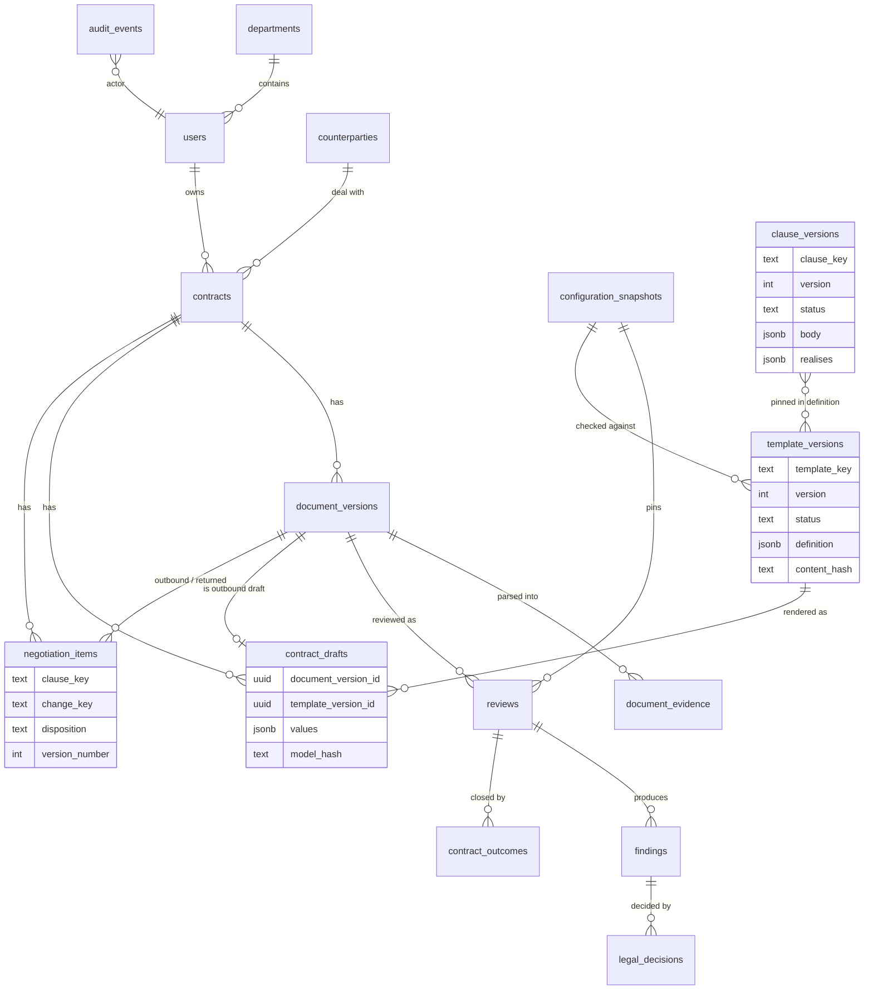
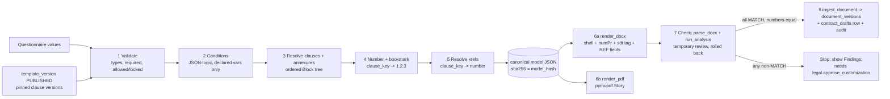
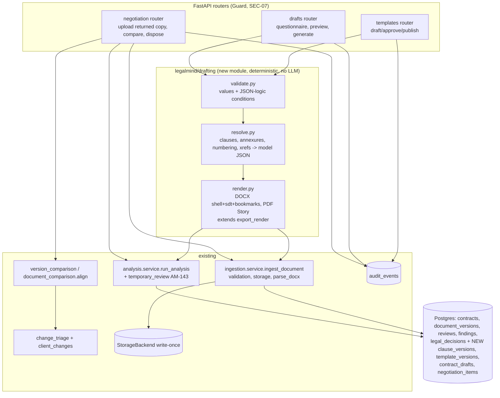

# CLM R&D — 04 · Document engineering: templates, generation, negotiation

> 📁 **ANALYSIS / PROPOSAL — decides nothing.** Workstream 4 of 4 (backend and document
> engineering) of the 2026-11-02 R&D on MSA/NDA contract **creation, review and
> negotiation**. Research only: no code, no migration, no dependency installed. Every new
> table below **needs an approved amendment batch**; every library not already installed
> is flagged **new dependency, needs approval** (rule 19, Step 39 stack). AM/AB numbers
> are deliberately not taken here (see the AM/AB collision rule).
>
> Labels: **VERIFIED** (a URL, or `file:line` in this worktree at `research/clm-contract-creation-20261102`,
> or a command run on this server) · **PRACTICE** (industry practice, not verified here) ·
> **RECOMMENDATION** (this workstream's proposal).

Builds on, and does not repeat, [DOCUMENT_BUILDER_RND.md](../DOCUMENT_BUILDER_RND.md)
§5–7, §10, §19–20 (Block-list template model, `TemplateVersion`, reuse of
`export_render.py`). Where this document departs from it, it says so and why.

---

## 0. The answer in one screen

| Question | Answer |
|---|---|
| Source of truth | **Structured clause JSON** (a clause library of versioned clauses + an ordered template version that pins them). Never a DOCX used as a template. Confirms DOCUMENT_BUILDER_RND §5.1. |
| DOCX renderer | **python-docx** (installed, MIT) + a **house-style shell DOCX** (styles + one multilevel list), with Word-native numbering, bookmarks and REF fields, and every clause wrapped in a **tagged content control** carrying its stable clause ID. **No new dependency.** |
| PDF renderer | **pymupdf.Story** (installed) for preview and a read-only PDF of the draft. If the owner wants the PDF to be page-identical to the DOCX, LibreOffice headless is the upgrade — **new system dependency, needs approval**. |
| Determinism | Asserted on the **canonical JSON + extracted text**, not on bytes: neither existing renderer is byte-deterministic today (§D.6, VERIFIED by running them). |
| Check of the draft | The rendered DOCX goes back through the **existing** parser + `run_analysis` — the AM-143 rolled-back temporary review gives a "check before save" for free. A draft from an approved template must evaluate all-MATCH; that is the regression test. |
| Minimal new tables | **4**: `clause_versions`, `template_versions`, `contract_drafts`, `negotiation_items`. Everything else reuses `contracts`, `document_versions`, `counterparties`, `reviews`, `legal_decisions`, `contract_outcomes`, `audit_events`. |
| Negotiation | Most of the reading already exists (tracked changes, comments, moved/deleted paragraphs, clause pairing, change triage, client-changes report, version comparison). Missing: **stable-ID alignment** of a returned DOCX to our outbound clauses, a **negotiation round** record, and **per-clause decisions on client changes**. |
| Hard blocker | **No approved MSA or NDA template exists.** Constitution §7.1 and §15.5 call both reference/template material, not a lawyer-approved standing template; and the MSA template already fails closed against `LIABILITY-MSA-001`. Clause text must be supplied/approved, never authored here (rule 21). |

---

## 1. What already exists — VERIFIED against the code

| Capability | Where | Notes |
|---|---|---|
| Block model, one content model, two renderers | `backend/legalmind/api/export_render.py:97` (`Block`), `:818` (`render_docx`), `:928` (`render_pdf`), `:959` (`RENDERERS`) | Report export only. `Block` kinds: h1–h3, p, kv, quote, note, bullet, table, change, risk. No numbering, no cross-references, no clause identity, no conditional sections. |
| DOCX header/footer + PAGE/NUMPAGES fields | `export_render.py:822-828`, `:866` (`_field`, a `w:fldSimple`) | The pattern for REF fields already exists. |
| PDF via pymupdf.Story | `export_render.py:881-958` | HTML from **escaped text only** (`html.escape`) — no injection path. Header/footer stamped after layout because Story has no page-margin boxes. |
| Installed libs | `backend/pyproject.toml:23-24`; `pip show` on this server: pymupdf 1.28.2 (**AGPL-3.0 or Artifex commercial**), python-docx 1.2.0 (MIT), lxml 6.1.1, Jinja2 3.1.2, reportlab 4.1.0 | Jinja2 is present system-wide (`Required-by:` empty) but **not declared** in `pyproject.toml` and imported nowhere in `backend/` — using it would be a new declared dependency. reportlab is pulled by ocrmypdf. |
| Not installed | `which soffice libreoffice pandoc` → nothing | LibreOffice and Pandoc would be new system dependencies. Playwright exists only as a **frontend dev dependency** (`frontend/package.json:36`, Node, tests). |
| DOCX parse: body order, tables, content controls, custom XML, footnotes, headers, comments | `backend/legalmind/ingestion/parsing.py:2620` (`parse_docx`), `:2522` (`_docx_children` looks *through* `w:sdt`) | Looks through content controls but **does not read `w:tag`** and does not read bookmarks (`grep 'w:tag\|bookmarkStart'` → no hits). |
| Word auto-numbering read as Word displays it | `parsing.py:2451` (`_docx_list_numbers`, AM-185), used at `:2671` | The `parse_docx` docstring at `:2634` still says "N-AUTONUM … not rendered" — **stale docstring**, the code reads it now. |
| Tracked changes as two versions | `parsing.py:2424` (`_docx_revision`: `w:ins`/`w:del`/`w:moveFrom`/`w:moveTo`), `:2392-2395` (visible vs original run XPath), PDF markup `:870+` (AM-146) | Per paragraph: `{"original": …, "changes": [{"deleted","inserted"}]}` on the evidence row's `metadata.revision`. Whole deleted/moved blocks kept on a neighbour (`drop`, AM-157). |
| Reviewer comments beside their clause | `parsing.py` `parse_docx` (comments part, `comment_ids` → `metadata.comments`) | AM-223 surfaces them. |
| DOCTYPE/XXE refusal, macro refusal | `parsing.py:2644-2651` (QA-096), `:2657-2658` (`MACRO_ENABLED`); python-docx parser `resolve_entities=False` (VERIFIED: `docx.oxml.parser.oxml_parser`) | |
| Upload bounds (zip bomb) | `backend/legalmind/ingestion/validation.py:30-40, 108-124` | 100 MB file, 2× unpacked, 20 MB XML, 20,000 paragraphs; magic-byte sniffing `:127`. |
| Write-once storage, SHA-256 | `backend/legalmind/ingestion/storage.py:21` (`fingerprint`), `:69` (chmod 0o440), S3 backend `:93` | |
| Same-contract version comparison | `backend/legalmind/analysis/version_comparison.py:165` (`compare_versions`) | Keyed on `section_number`; text-only, no verdict (33.15/33.16). |
| Any-two-documents comparison (Diff-Talk) | `backend/legalmind/analysis/document_comparison.py:197` (`align`), `PAIR_THRESHOLD = 0.4` at `:49` | Pairs clauses by text similarity, merges/splits, reports one-side-only. `comparison_choices` table records ours/theirs per difference (`models.py:862`). |
| What each client change does to us | `backend/legalmind/analysis/change_triage.py` (AM-224) | Code reading always; review-model reading behind `LEGALMIND_CHANGE_TRIAGE` (`:76`, off). Never a Finding. |
| Every client change, grouped, measured-or-not | `backend/legalmind/analysis/client_changes.py:29` (AM-223) | |
| Evaluator | `backend/legalmind/analysis/service.py:193` (`run_analysis`) | Reproducible from version + snapshot alone (docstring `:197-202`). |
| Rolled-back "temporary review" | `backend/legalmind/api/temporary_review.py:88` (`review_file`, AM-143) | Runs the authoritative engine inside a SAVEPOINT that is always rolled back, no storage write. **Exactly the "check this draft before saving" primitive.** |
| Optimistic concurrency | `backend/legalmind/workflow/decisions.py:131`; `api/schemas.py:445-467` (`expected_version`, AM-177) | Server writes `expected_version + 1`; collision → 409. |
| Append-only in the database | `alembic/versions/80dccb65caf6_initial_locked_schema.py:425-438` (`legalmind_append_only()` on `audit_events`, `legal_decisions`); `d8b3f1a6c4e2…py:59` (`contract_outcomes`) | Trigger function reusable for new history tables. |
| SEC-07 404 | `backend/legalmind/security/errors.py:32-38`; `security/authorization.py:125` (`require_contract_readable`), `:138` (`require_contract_owned`) | |
| Ingest bytes as a new version | `backend/legalmind/ingestion/service.py:115` (`ingest_document`) | Validates, hashes, stores write-once, numbers the version under the contract's row lock, parses. A generated DOCX can enter through this unchanged. |

---

## 2. Governance gates that come before any code

1. **Rule 21 — there is no approved template to encode. VERIFIED** in
   `docs/02-legal-domain/LEGAL_CONSTITUTION_L1.14.md:291` (§7.1: the MSA documents are
   "reference / template / skeleton material … not automatically the company's final
   authoritative contractual position"), `:300` (NDA "not yet a lawyer-approved standing
   mutual template") and `:691` (§15.5). CLAUDE.md records that the MSA template "now
   fails closed against its own position" on `LIABILITY-MSA-001`. So the first
   deliverable of this programme is **an owner/Counsel-approved clause text per clause**,
   supplied, not drafted by an agent. The machinery below can be built and tested with
   **STRUCTURAL** fixtures (lorem-style placeholders that assert nothing legal), never with
   invented clause wording presented as a company position.
2. **New tables** (§C) — an approved amendment batch, appended to `all_lock.md` (rule 22).
3. **New permissions** — e.g. `template.manage`, `template.approve`, `contract.draft`
   (DOCUMENT_BUILDER_RND §19 proposed similar; reconcile names there).
4. **PyMuPDF licence.** Already in production under AGPL-3.0/commercial dual licence
   (VERIFIED: https://pymupdf.readthedocs.io/en/latest/about.html). This feature widens its
   use (generating outbound documents). Not a new risk, but an owner/legal question the
   project has not recorded an answer to — flag, do not decide.
5. **Assist-lane boundary.** Generation is deterministic substitution; **no LLM in the
   render path** (rule 9/10, AM-25). An LLM may at most *suggest* field boundaries to a
   template author, human-confirmed (DOCUMENT_BUILDER_RND §7). Negotiation triage stays
   assist-lane (AM-224) and never produces a Finding or a Legal Decision.

---

## A. Template engine — comparison and recommendation

### A.1 Options

| Option | Licence / status | Fidelity (numbering, nested lists, page breaks, headers/footers, tables, signature blocks) | Conditional sections | Deterministic | Security | Stack fit |
|---|---|---|---|---|---|---|
| **python-docx** building from structured data + a style-shell DOCX | MIT, 1.2.0 installed (VERIFIED `pip show`) | High, *if* numbering comes from a multilevel list defined in the shell (python-docx has no numbering API; numbering is set via `numPr` in oxml — the codebase already writes oxml at `export_render.py:866`). Tables, page breaks, headers/footers, fields: yes. | In our code, from the JSON | Bytes no (zip timestamps; VERIFIED §D.6); canonicalisable | No template language at all → no template injection | **Already installed. Already the DOCX renderer.** |
| **docxtpl** (Jinja2 inside a DOCX) | LGPL-2.1-only, 0.20.2 (2025-11-13), needs jinja2 + python-docx + lxml (VERIFIED https://pypi.org/pypi/docxtpl/json) | Keeps whatever Word formatting the author drew | Jinja `` / `` | Same zip caveat | Jinja tags "only … inside the same run" (VERIFIED https://docxtpl.readthedocs.io/en/latest/) — the run-splitting fragility; logic lives inside a Word file nobody diffs; a custom `jinja_env` can be passed, but Jinja's sandbox "alone is not a solution for perfect security" and small templates can DoS (VERIFIED https://jinja.palletsprojects.com/en/stable/sandbox/) | **New dependency, needs approval**; puts legal logic in an opaque binary |
| **docxcompose** (append/merge DOCX, keeps numbering/styles) | MIT, 2.2.0 (2026-06-02) (VERIFIED https://pypi.org/pypi/docxcompose/json) | Good for appending a supplied annexure DOCX as-is | n/a | — | low | **New dependency, needs approval.** Only needed if annexures arrive as Word files that must be appended verbatim. |
| **pymupdf.Story** (HTML subset → PDF) | AGPL/commercial (VERIFIED above) | Adequate for a read-only PDF: tables, page breaks via CSS; no margin boxes (header/footer stamped after layout, as today) | in our code | Not byte-identical across runs today (VERIFIED §D.6) | Escaped text only today | **Installed; already the PDF renderer** |
| **WeasyPrint** (HTML/CSS paged media → PDF) | BSD, 70.0; needs Pango/HarfBuzz system libs (VERIFIED https://pypi.org/pypi/weasyprint/json, https://doc.courtbouillon.org/weasyprint/stable/api_reference.html) | Very good: CSS counters, `@page` margin boxes, `target-counter()` cross-refs | in our code | PRACTICE: stable given fixed inputs | Default `url_fetcher` allows all protocols incl. local files → must be locked down | **New dependency + system libs, needs approval** |
| **Chromium print** (Playwright `page.pdf`) | Apache-2.0 | Good; header/footer templates | in our code | — | Headless browser in the API/worker | Playwright is a **frontend test** dependency only; using it server-side is a **new runtime dependency** (+ ~300 MB browser) |
| **Paged.js** | MIT, browser polyfill (VERIFIED https://github.com/pagedjs/pagedjs; 201 open issues, no listed releases) | Good paged media, needs a browser | — | — | — | New; maintenance signal weak |
| **LibreOffice headless** (`soffice --convert-to pdf`) | MPL-2.0 (PRACTICE) | **DOCX → PDF that looks like the DOCX** (single layout source) | n/a (converter) | No | Subprocess, must be sandboxed, single-instance profile locking, timeouts | Not installed (VERIFIED `which soffice`); **new system dependency, needs approval** |
| **Pandoc** | GPL-2.0-or-later (PRACTICE) | Markdown/HTML ↔ DOCX with a reference.docx; weak on legal multilevel numbering control | — | — | — | New; adds nothing python-docx cannot |
| **Carbone** | Carbone Community Licence, Node, uses LibreOffice/Chromium for conversion (search results, licence file not directly verified: https://github.com/carboneio/carbone) | Template-in-document like docxtpl | — | — | — | New runtime (Node service); rejected |
| **docx4j / Aspose.Words** | docx4j Apache-2.0 (Java); Aspose commercial (PRACTICE) | Best-in-class fidelity and Word-compare | — | — | — | JVM/.NET or paid; rejected for V1 |

### A.2 Recommendation

* **Canonical representation (RECOMMENDATION): structured clause JSON.** A template version
  is data: an ordered list of pinned clause versions, variables, conditions and annexures.
  Reasons specific to this repo: (1) the evaluator, the Constitution linkage and the
  stable clause IDs that negotiation needs all hang off *clauses*, not off positions in a
  Word file; (2) a JSON clause version is diffable, hashable and reviewable in a PR or an
  approval screen — a DOCX template is not; (3) it removes template injection as a class
  (no user-controlled template language exists); (4) it reuses the Block idea already in
  `export_render.py`.
* **DOCX = the negotiable artefact**, rendered by python-docx from the JSON onto a
  **house-style shell** (`backend/config/templates/house_style.docx`, authored once in
  Word: fonts, heading styles, one multilevel list "LM Clause" bound to them, page setup,
  header/footer). python-docx's `Document(path)` uses that file's styles and numbering
  definitions. This is the same idea as Pandoc's reference.docx, without Pandoc.
* **PDF = a read-only view**, rendered by the existing pymupdf.Story path from the same
  Blocks, with numbers computed by our renderer. It is *not* page-identical to the DOCX.
  If the owner needs page-identical PDF (e.g. for signature), the upgrade is LibreOffice
  headless converting our own DOCX — new system dependency, needs approval, run in the
  worker with a timeout and a throwaway profile directory.
* **Reject** docxtpl/Carbone (logic in an opaque binary, Jinja surface), Chromium/Paged.js
  (a browser in the backend for a PDF we already make), Aspose/docx4j (cost/runtime).

---

## B. Template data structure

### B.1 Clause version (the unit that is approved, pinned and tracked)

```json
{
  "clause_key": "LIABILITY.CAP",            // stable ID, never renumbered, never reused
  "version": 3,
  "status": "APPROVED",                     // DRAFT | APPROVED | RETIRED
  "title": "Limitation of Liability",
  "applies_to": ["MSA"],                    // document_types.py values
  "realises": [                              // what the clause is FOR — the evaluator link
    {"constitution_section": "9", "constitution_version": "L1.14",
     "requirement_code": "LIABILITY-MSA-001"}
  ],
  "body": [                                  // Block tree; text is FIXED unless a {var} node
    {"kind": "p", "parts": [
       {"text": "Each Party's aggregate liability … shall not exceed "},
       {"var": "cap_months"}, {"text": " months of "}, {"text": "total fees paid …"}
    ]},
    {"kind": "sub", "key": "LIABILITY.CAP.EXCLUSIONS", "body": [ … ]},
    {"kind": "p", "parts": [{"text": "subject to "}, {"xref": "CONFIDENTIALITY"}]}
  ],
  "variables_used": ["cap_months"],
  "source": {"document": "…", "clause": "…", "approved_by": "<user id>",
             "approved_at": "…", "approval_ref": "<legal decision / audit id>"},
  "content_hash": "sha256:…"                 // over the canonical JSON of body
}
```

Rules (RECOMMENDATION): text is fixed; only `{var}` nodes accept input; `{xref}` names a
`clause_key` and is resolved to a rendered number at render time; nothing else is
interpolated. A variable that *could* change the legal position (cap months, notice
days) is declared with `locked_value` or an allowed set equal to the ratified position —
changing it is not a field edit but a deviation that needs `legal.approve_customization`
(rule 13, zero-tolerance Legal Rule: any departure is a Legal Decision).

### B.2 Template version

```json
{
  "template_key": "MSA.LEAPSWITCH.STANDARD",
  "version": 4,
  "status": "PUBLISHED",                    // DRAFT | APPROVED | PUBLISHED | RETIRED
  "document_type": "MSA",
  "variant": "LEAPSWITCH",                  // entity/brand axis — C-19 is open; keep a plain label
  "effective_from": "2026-12-01",
  "jurisdiction": {"governing_law": "India", "seat": "Pune"},   // values come from ratified standards, never typed here
  "applicable_services": ["DEDICATED_SERVER", "CLOUD"],
  "constitution_version": "L1.14",
  "snapshot_hint": "<configuration_snapshot id the approval was checked against>",
  "clauses": [
    {"clause_key": "PARTIES", "version": 2},
    {"clause_key": "DEFINITIONS", "version": 5},
    {"clause_key": "DPA.REFERENCE", "version": 1, "when": {"var": "processes_personal_data", "eq": true}},
    {"clause_key": "LIABILITY.CAP", "version": 3}
  ],
  "annexures": [
    {"key": "SCHEDULE_A_SERVICES", "title": "Schedule A — Services", "required": true,
     "source": "QUESTIONNAIRE"},           // rendered from fields
    {"key": "SCHEDULE_B_SLA", "title": "Schedule B — SLA", "required": false,
     "when": {"var": "include_sla", "eq": true}, "source": "CLAUSES",
     "clauses": [{"clause_key": "SLA.CREDITS", "version": 1}]}
  ],
  "variables": {
    "customer_legal_name": {"type": "party_name", "required": true, "max_len": 200},
    "effective_date":      {"type": "date", "required": true},
    "cap_months":          {"type": "int", "locked_value": 12},
    "notice_days":         {"type": "int", "allowed": [30]},
    "processes_personal_data": {"type": "bool", "required": true},
    "include_sla":         {"type": "bool", "default": true},
    "monthly_fee_inr":     {"type": "money", "currency": "INR", "min": 0}
  },
  "questionnaire": [
    {"step": "Parties", "fields": ["customer_legal_name", "customer_address", "customer_cin"]},
    {"step": "Commercials", "fields": ["monthly_fee_inr", "term_months"]},
    {"step": "Data", "fields": ["processes_personal_data"],
     "help": "Plain-language question text, written by the template owner"}
  ],
  "approval": {"publish_requires": ["template.approve"], "second_person": true},
  "content_hash": "sha256:…"               // over the canonical JSON incl. pinned clause hashes
}
```

### B.3 Condition language — safe and deterministic (RECOMMENDATION)

JSON-Logic-shaped, evaluated by ~40 lines of our own Python (no library, no `eval`, no
Jinja): operators `eq, ne, in, gt, gte, lt, lte, and, or, not`, operands only
`{"var": name}` of **declared** variables or literals. Unknown operator or variable →
the template fails validation at **authoring** time, not at render time. Users never
author conditions; only template authors do, and the authoring screen validates.

### B.4 Where stored

| What | Where | Why |
|---|---|---|
| Clause versions, template versions | **DB rows with JSONB body** (§C) | Must be pinned by FK from generated drafts, queried, permission-gated, and immutable by trigger once approved. Mirrors `requirement_versions`/`company_standard_versions`. |
| Seed / authoring source | `backend/config/templates/*.json` in git, imported by a tool (like `tools/` import of company standards, publish refuses invalid) | PR review of clause wording; the same "file → import → versioned row" path the 86 standard files already use. |
| House-style shell DOCX | `backend/config/templates/house_style.docx` (no clause text, only styles) | Binary, but contains no legal content, so 54.6 is not engaged. |
| Generated artefacts (DOCX/PDF) | Existing `StorageBackend` (write-once, `storage.py:48/93`) via `ingest_document` | One storage abstraction; hash + chmod already there. |

---

## C. Relational model

### C.1 Candidate entities against existing tables

| Candidate | Verdict | Reuse / new |
|---|---|---|
| Contract | **Reuse** `contracts` (`models.py:266`) | A drafted deal is a Contract from the start (owner, department scope, archive, transfer, counterparty all work unchanged). |
| ContractParty | **Reuse** `counterparties` (`:202`) + `contracts.counterparty_id` | Signatory names/addresses are draft *variables*, not a party table (AB-13 forbids a relationship table; no CRM fields). |
| ContractDocument / ContractVersion | **Reuse** `document_versions` (`:300`) | Every outbound draft and every returned copy is a version, immutable, hashed, parsed, reviewable. |
| ContractChange | **Reuse** `document_evidence.metadata.revision` (AM-146/157) + computed comparison | Changes are *derived* from two versions; storing them again duplicates the parser. Only the *decisions* on them are new state. |
| ClauseDecision | **Reuse** `legal_decisions` where the change produced a Finding; **new** `negotiation_items` for changes no Finding covers | A Legal Decision resolves an Evaluation (AB-1.1) — a client change without a Finding has nothing to attach to. |
| Approval | **Reuse** `legal_decisions` / `contract_outcomes` (`:736`) for contract-level; template approval = a status transition + `audit_events` | No generic approvals table. |
| ContractAuditEvent | **Reuse** `audit_events` (`:839`, append-only trigger) | |
| ContractField | **Fold into** `contract_drafts.values` JSONB | Values are only meaningful against one pinned template version; a row-per-field table adds joins and nothing queries a single field. (DOCUMENT_BUILDER_RND §19 proposed `generated_document_fields`/`_sections`; this proposes folding them.) |
| ClauseLibrary + ClauseVersion | **New** `clause_versions` (identity = `clause_key`, no separate parent table) | |
| ContractTemplate + TemplateVersion | **New** `template_versions` (identity = `template_key`) | One table each, not two: a `templates` parent row carries nothing a key column doesn't. |
| GeneratedDocument | **New** `contract_drafts` | Links contract version ↔ template version + values + hashes. |
| NegotiationRound | **Fold into** `contract_drafts`/`document_versions` + `negotiation_items.round_no` | A round is "outbound version N → returned version N+1"; both are versions already. |

### C.2 New tables (each **needs an approved amendment batch**)

```sql
-- 1. clause library
CREATE TABLE clause_versions (
  id UUID PRIMARY KEY,
  clause_key TEXT NOT NULL,            -- stable ID, e.g. LIABILITY.CAP
  version INT NOT NULL,
  status TEXT NOT NULL CHECK (status IN ('DRAFT','APPROVED','RETIRED')),
  body JSONB NOT NULL,                 -- §B.1
  realises JSONB NOT NULL,             -- constitution section + requirement codes
  content_hash TEXT NOT NULL,
  created_by UUID NOT NULL REFERENCES users(id),
  approved_by UUID REFERENCES users(id), approved_at TIMESTAMPTZ,
  created_at TIMESTAMPTZ NOT NULL DEFAULT now(),
  UNIQUE (clause_key, version)
);
-- 2. templates
CREATE TABLE template_versions (
  id UUID PRIMARY KEY,
  template_key TEXT NOT NULL, version INT NOT NULL,
  document_type TEXT NOT NULL,
  status TEXT NOT NULL CHECK (status IN ('DRAFT','APPROVED','PUBLISHED','RETIRED')),
  definition JSONB NOT NULL,           -- §B.2, clause refs pinned by (key, version)
  content_hash TEXT NOT NULL,
  checked_snapshot_id UUID REFERENCES configuration_snapshots(id),  -- all-MATCH proof (§D.7)
  created_by UUID NOT NULL REFERENCES users(id),
  approved_by UUID REFERENCES users(id), approved_at TIMESTAMPTZ,
  effective_from DATE, created_at TIMESTAMPTZ NOT NULL DEFAULT now(),
  UNIQUE (template_key, version)
);
-- 3. a generated draft = one outbound document version
CREATE TABLE contract_drafts (
  id UUID PRIMARY KEY,
  contract_id UUID NOT NULL REFERENCES contracts(id) ON DELETE CASCADE,       -- AM-55 cascade
  document_version_id UUID NOT NULL UNIQUE REFERENCES document_versions(id) ON DELETE CASCADE,
  template_version_id UUID NOT NULL REFERENCES template_versions(id),
  values JSONB NOT NULL,               -- validated variable values
  model_hash TEXT NOT NULL,            -- sha256 of the canonical resolved JSON (determinism key)
  renderer_version TEXT NOT NULL,
  pdf_storage_key TEXT,                -- optional read-only PDF of the same model
  created_by UUID NOT NULL REFERENCES users(id),
  created_at TIMESTAMPTZ NOT NULL DEFAULT now()
);
-- 4. what we decided about each client change no Finding covers
CREATE TABLE negotiation_items (
  id UUID PRIMARY KEY,
  contract_id UUID NOT NULL REFERENCES contracts(id) ON DELETE CASCADE,
  outbound_version_id UUID NOT NULL REFERENCES document_versions(id) ON DELETE CASCADE,
  returned_version_id UUID NOT NULL REFERENCES document_versions(id) ON DELETE CASCADE,
  clause_key TEXT,                     -- NULL = a clause the client added
  change_key TEXT NOT NULL,            -- deterministic id of the change (hash of before/after)
  disposition TEXT NOT NULL CHECK (disposition IN ('ACCEPT','REJECT','COUNTER','ESCALATED')),
  counter_text TEXT,
  justification TEXT NOT NULL,
  decided_by UUID NOT NULL REFERENCES users(id),
  version_number INT NOT NULL,         -- append-only supersession, like legal_decisions
  created_at TIMESTAMPTZ NOT NULL DEFAULT now(),
  UNIQUE (returned_version_id, change_key, version_number)
);
```

Immutability: `legalmind_append_only()` (existing) on `negotiation_items`; a
`BEFORE UPDATE` trigger on `clause_versions`/`template_versions` that permits only the
status transitions `DRAFT→APPROVED→PUBLISHED→RETIRED` and refuses any change to `body`/
`definition` once not DRAFT; `contract_drafts` is insert-only (cascade on contract
delete, as AM-176 already did for decisions). A `negotiation_items.disposition` is
**not a Legal Decision** and must never be rendered as one; where a change touches a
point a Finding covers, the decision goes through `legal_decisions` as today, and
`ACCEPT` of a change on a ratified position is only reachable by a holder of
`legal.decision` (zero-tolerance rule).

### C.3 ER diagram



Ownership/permissions (RECOMMENDATION): drafts and negotiation items inherit the
Contract's scope (owner writes; department lead reads; out of scope → byte-identical 404
via `require_contract_readable`); template/clause authoring is a configuration-like
permission pair (draft vs approve/publish, second person, mirroring
`configuration.draft`/`configuration.publish`, `permissions.py:80-81`); clause text is
not confidential, but `realises` (which standard a clause realises) is a legal position
and is **omitted** for users without the positions permission (LEGAL-02, SEC-07).

---

## D. Generation pipeline



1. **Validation** — pure function over `template.variables`; unknown keys refused (the
   DOCUMENT_BUILDER_RND §5.3 structural argument: there is no input for "remove the cap").
   Money as integer paise + currency; dates ISO; strings length-capped and stripped of
   control characters.
2. **Conditions** — §B.3 evaluator. Deterministic, total, no I/O.
3. **Clause resolution** — fetch exactly the pinned `(clause_key, version)`; refuse if any
   is not APPROVED (a template cannot be published over a draft clause). Annexures appended
   in declared order.
4. **Auto-numbering** — our renderer computes the number for every clause and sub-clause
   from the resolved tree (top-level `1.`, `1.1`, `1.1.1`; schedules `Schedule A`,
   paragraphs `A.1`). The DOCX carries Word-native numbering (`numPr` to the shell's
   multilevel list) so a counterparty inserting a clause in Word renumbers naturally; the
   PDF prints the computed number as text.
5. **Cross-references** — `{xref: clause_key}` → computed number. In DOCX: a
   `w:bookmarkStart w:name="_LM_<clause_key>"` on the clause heading and a
   `REF _LM_<key> \r \h` field whose cached result is our computed number (Word refreshes
   it on F9 or print). Bookmark names ≤ 40 chars (PRACTICE: Word's limit) → hash long keys.
   An xref to a clause excluded by a condition **fails validation at publish time** — never
   "see Section [ ]".
6. **Render** — DOCX: every clause wrapped in a block-level content control `w:sdt` with
   `w:tag="lm:<clause_key>@<version>"` and `w:lock w:val="sdtLocked"` (contents editable,
   control not deletable — VERIFIED semantics: ISO/IEC 29500 `w:lock`, documented at
   https://learn.microsoft.com/en-us/previous-versions/office/developer/office-2010/cc823001(v=office.14)).
   Plus a custom document property `lm:draft_id` and `lm:model_hash`. PDF: existing Story path.
   **Determinism (VERIFIED on this server, 2026-11-02):** `render_docx` and `render_pdf`
   produce different bytes for the same Blocks two seconds apart; python-docx output
   becomes byte-identical once core properties are fixed **and** the ZIP is re-written with
   fixed entry timestamps (tested: canonical re-zip → equal SHA-256). The PDF was not made
   byte-stable by `set_metadata({})` + `tobytes(no_new_id=True)`. Therefore: **the
   determinism claim is on `model_hash` and on the parsed text**, and the artefact hash is
   an integrity hash of the stored bytes (as `document_versions.file_hash` already is).
7. **Check through the existing engine** — render → `parse_docx` → evidence →
   `run_analysis` against the current published snapshot, inside the AM-143 rolled-back
   SAVEPOINT (`temporary_review.py:88`) for preview, and as a *recorded* Review once saved.
   Two assertions, both **regression tests** run in CI for every PUBLISHED template:
   (a) **every applicable Requirement evaluates MATCH** (zero DEVIATION, MISSING,
   UNABLE_TO_EVALUATE); (b) **the parser's section numbers equal the renderer's computed
   numbers** for every clause (`_docx_list_numbers` reads Word numbering as Word displays
   it, so this proves the shell's list and our numbering agree). A template that fails (a)
   cannot be published — this is how "an approved template" and "the evaluator" are kept
   from drifting apart, and it would today catch the MSA reference template's
   `LIABILITY-MSA-001` mismatch.
8. **Store** — `ingest_document` (validation, SHA-256, write-once, version number under row
   lock, parse) + one `contract_drafts` row + one `audit_events` row
   (`contract.draft_generated`, with template version, `model_hash`, file hash). Previews
   store nothing.

Edits after generation: the user does **not** edit the rendered DOCX in LegalMind. They
change values and regenerate (a new version), or they send it out and a returned copy is
a negotiation round (§E). A deviation from a locked value is not an edit; it is a
customization that the evaluator flags and a Legal Decision accepts.

---

## E. Negotiation engine

### E.1 What exists (VERIFIED) vs what is missing

| Need | Exists | Missing |
|---|---|---|
| Read Word tracked changes (ins/del/move) per paragraph | ✅ `parsing.py:2424`, `:2392-2395` | Move **pairing** (moveFrom ↔ moveTo by `w:name`) — today a move reads as a delete + an insert |
| Deleted/moved whole paragraphs, tables, comments | ✅ AM-157 `drop`/`keep`; comments to clause (AM-223) | — |
| PDF markup (colour/strike) | ✅ AM-146, scans AM-157 | Inherently heuristic; never as strong as DOCX |
| Clean-copy vs clean-copy comparison | ✅ `version_comparison.py` (by section number, same contract); ✅ `document_comparison.align` (by text, any two docs) | Alignment by **our stable clause ID** |
| What a change does to us | ✅ `change_triage` (AM-224, code reading; model reading off) | — |
| Every change listed, measured or not | ✅ `client_changes` (AM-223) | Per-change **disposition** that persists across rounds (§C `negotiation_items`) |
| Legal assessment of the returned text | ✅ `run_analysis` on the returned version (the PROPOSED text, AM-146) | Running it on **both** our outbound and the returned version and listing Findings that changed |
| Reply document | — | A counter-draft: regenerate from the template with the agreed changes, or a reply DOCX with our tracked changes (needs a DOCX writer of `w:ins`/`w:del`; python-docx can do it via oxml, no new dep) |
| Read content-control tags / bookmarks | ❌ looked through but tag not read (`parsing.py:2522-2532`; no `w:tag` / `bookmarkStart` in the file) | Read `w:tag="lm:…"` into `evidence.metadata.clause_key` — a small additive parser change, bump the parser version |

### E.2 Alignment (RECOMMENDATION)

Three tiers, strongest first, and the tier used is reported per clause:

1. **ID-anchored** — our outbound DOCX carries `lm:<clause_key>@<version>` content controls.
   On return, the parser records the tag on each evidence row; outbound and returned
   clauses align by `clause_key` exactly. Renumbering, reordering and moves are then
   facts, not inferences: same key, different number = renumbered; same key, different
   position = moved; key absent = deleted (or the control was destroyed — reported as
   "anchor lost", fall to tier 2); evidence with no key inside the body = a client-added
   clause. Content controls survive normal Word editing; Word allows a user to remove a
   control unless locked, and `sdtLocked` prevents that (VERIFIED semantics above);
   bookmarks are the backup anchor (PRACTICE: bookmarks are dropped more easily on
   copy/paste than controls).
2. **Text-anchored** — the existing `document_comparison.align` (similarity pairing,
   merges/splits, one-side-only below 0.4) for PDFs, scans, and DOCX where anchors were
   lost or the client retyped the document.
3. **Unaligned** — reported as one side only, never forced into a pair (Diff-Talk's rule).

Tracked changes vs clean copies: when the returned DOCX has tracked changes, the
**original** side of each paragraph (`metadata.revision.original`) is compared to our
outbound text — if they differ, the client changed text **without** tracking it; this is
the highest-risk negotiation failure and must be surfaced as "untracked change" (PRACTICE:
a known tactic and a common accident). Clean returned copy: compare against our outbound
`model_hash`'s rendered text by tier 1/2.

### E.3 Textual vs substantive (RECOMMENDATION)

Normalise before diffing (whitespace, quotes, dashes, ligatures — already in
`normalize_text`), drop pure renumbering and pure formatting, then classify each
remaining change only by **what the engine already says**: (a) a Finding changed between
outbound and returned review (substantive by definition, Legal decides); (b)
`change_triage` code reading says it moves risk onto us (shown, assist-lane label); (c)
otherwise "wording changed, no standard measures it — a person reads it". A text diff
is never approval: nothing in this lane sets ACCEPTABLE; dispositions on ratified
positions require `legal.decision`.

---

## F. Security and reliability

| Concern | Position |
|---|---|
| Access control | Every draft/negotiation endpoint takes `Guard` and resolves the Contract with `require_contract_readable`/`require_contract_owned` (404 alike, SEC-07). Templates: new permission pair (draft / approve+publish, two people). `realises` omitted, not nulled, without the positions permission. |
| Template injection | None possible: no template language; user values enter only as text nodes; DOCX via python-docx (XML-escapes text), PDF via `html.escape` (existing). If Jinja/docxtpl were ever adopted: `SandboxedEnvironment`, autoescape, CPU/memory limits — and the sandbox is "not a solution for perfect security" (VERIFIED Jinja docs). |
| Inbound DOCX (returned copies) | Existing: magic-byte sniff, zip size/ratio/XML/paragraph bounds, DOCTYPE refusal, `resolve_entities=False`, macro-enabled refusal. Add: refuse/strip `word/vbaProject.bin` regardless of content type (PRACTICE), ignore external relationships (`TargetMode="External"`: remote templates, linked images — never fetched), and never re-serve a returned file except as the stored original download. |
| Outbound DOCX | Rendered from our shell only; no external relationships; custom props carry only IDs and hashes, never positions. |
| Version immutability | `document_versions` immutable (Step 26); new triggers on clause/template versions (§C.2); `contract_drafts` insert-only; artefacts write-once (chmod 0o440 / S3). |
| Audit | `audit_events` for: clause/template draft, approve, publish, retire; draft generated (template version, `model_hash`, file hash); preview check run; returned copy ingested; each negotiation disposition. |
| Concurrency | Generation numbers the version under the contract row lock (existing `_next_version_number`). Dispositions use `expected_version` → 409 (AM-177 pattern). Template publish: one PUBLISHED per `template_key`, enforced by a partial unique index. |
| Transactions | Render outside the DB transaction (CPU), then one transaction: storage put → version row → draft row → audit. Orphaned object on rollback: the existing ingestion order (number under lock, put, row) already accepts that; a sweeper is out of scope. |
| Worker vs request | Render + check is CPU-bound (Story pagination, parse, analysis). Preview in-request with a timeout (as AM-143 does); recorded generation as a worker job (locked 55.1 governs a recorded Review's analysis). LibreOffice, if ever approved, only in the worker. |
| Backup / retention | Artefacts live in the same storage as uploads, so the same backup applies (server backups are an open ops item, owner's 2026-11-02 list). Deletion follows AM-55 (contract delete cascades) — record that rule 17 does not hold for deleted drafts, as it already does not for deleted contracts. |

---

## G. Recommended backend architecture



Boundaries (RECOMMENDATION): `legalmind/drafting` may import `ingestion`, `analysis` (via
the API layer, as `temporary_review.py` does, to keep `test_import_boundaries` honest)
and `api/export_render`; it never imports `assist`. The assist lane may *read* drafts
for Ask but never writes them.

---

## H. Implementation sequence

| # | Step | Depends on | Exit check |
|---|---|---|---|
| 0 | Owner/Counsel supply approved clause text for one NDA (shortest) — or confirm a supplied document as Source of Truth (Constitution §8.1) | owner | text in hand, rule 21 satisfied |
| 1 | Amendment batch: 4 tables, permissions, the template lifecycle, "draft disposition ≠ Legal Decision" | owner approval | appended to `all_lock.md` |
| 2 | `drafting/validate.py` + condition evaluator, pure, with STRUCTURAL fixtures | 1 | unit tests incl. unknown-var / excluded-xref refusals |
| 3 | `drafting/resolve.py` (numbering, xrefs, annexures) → canonical model + `model_hash` | 2 | same input → same hash, 100 runs |
| 4 | House-style shell + `render.py` (numPr, bookmarks, REF, `sdt` tags) reusing `export_render` | 3 | parse own output: section numbers == computed numbers |
| 5 | Parser: read `w:tag="lm:…"` and bookmarks into evidence metadata (parser version bump, additive) | 4 | existing DOCX tests unchanged + tag round-trip test |
| 6 | Engine check: temporary review on the rendered draft; publish gate requires all-MATCH | 4, 0 | NDA template all-MATCH in CI |
| 7 | Generate + store + audit (`ingest_document`, `contract_drafts`) | 6 | e2e: questionnaire → version → recorded review |
| 8 | Negotiation: tier-1 alignment, untracked-change detection, move pairing, before/after Findings diff | 5 | real returned-copy specimens (rule 21: supplied, the 2026-10-27 marked-up MSA is the obvious one) |
| 9 | `negotiation_items` dispositions + counter-draft regeneration | 8 | 409 on stale `expected_version`; append-only trigger test |
| 10 | MSA template, then optional PDF fidelity upgrade (LibreOffice) only if asked | 0 for MSA | — |

---

## I. Top risks

1. **No approved template text (rule 21).** The whole creation lane is gated on supplied,
   approved clause wording; the MSA reference template already contradicts the ratified
   liability position. Building with invented wording would ship a document that looks
   authoritative and is not.
2. **Two layouts.** DOCX (Word numbering) and PDF (our numbering in Story) can disagree in
   pagination and, if the shell's list is wrong, in numbers. Mitigated by the
   parse-your-own-output numbering test; eliminated only by LibreOffice (new dependency).
3. **Untracked edits in returned copies.** The most consequential negotiation failure;
   needs the original-vs-outbound check in E.2, which does not exist today.
4. **Anchor loss.** Clients retype, paste into their own paper, or return PDF. Tier 2/3
   alignment exists but is heuristic; the UI must say which tier aligned each clause.
5. **Treating a disposition as a decision.** A "Accept" on a client change to a ratified
   position is a Legal Decision under the zero-tolerance rule; the model must route it
   through `legal.decision`, never a lighter permission.
6. **Licence.** PyMuPDF is AGPL/commercial and becomes part of an outbound-document
   pipeline — an unrecorded owner/legal question. docxtpl (LGPL) and Carbone (CCL) are
   avoided by this recommendation.
7. **Byte non-determinism** of both renderers (VERIFIED) — fine if the determinism claim
   is on the model hash; a problem if anyone later asserts "same inputs → same file".

## Sources

- https://pypi.org/pypi/docxtpl/json — docxtpl 0.20.2, LGPL-2.1-only
- https://docxtpl.readthedocs.io/en/latest/ — same-run tag rule, `jinja_env`, no default escaping
- https://pypi.org/pypi/docxcompose/json — docxcompose 2.2.0, MIT
- https://pypi.org/pypi/weasyprint/json — WeasyPrint 70.0, BSD
- https://doc.courtbouillon.org/weasyprint/stable/api_reference.html — `url_fetcher`, Pango/Fontconfig
- https://pypi.org/pypi/python-redlines/json and https://github.com/JSv4/Python-Redlines — DOCX→tracked-change DOCX, MIT, bundled .NET binaries (Docxodus); Open-XML-PowerTools archived by Microsoft. New dependency; not recommended for V1 (our parser already reads tracked changes; a redline *writer* is needed only for a reply-with-track-changes and can be done in oxml)
- https://jinja.palletsprojects.com/en/stable/sandbox/ — sandbox limits
- https://pymupdf.readthedocs.io/en/latest/about.html — AGPL / Artifex commercial
- https://learn.microsoft.com/en-us/previous-versions/office/developer/office-2010/cc823001(v=office.14) — `w:lock` (`sdtLocked`, `contentLocked`)
- https://github.com/pagedjs/pagedjs — MIT
- https://github.com/carboneio/carbone — Carbone (licence file not directly verified)
- https://playwright.dev/python/docs/api/class-page#page-pdf — `page.pdf`
