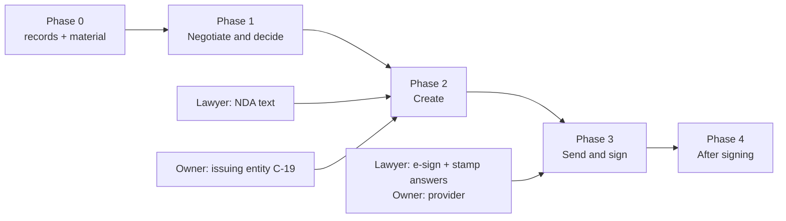

# CLM implementation plan — negotiate, create, send and sign, after signing

`📁 PROPOSAL` — 2026-11-02. The build plan for the design in [00-CLM_RND_REPORT.md](00-CLM_RND_REPORT.md). Nothing here is
built, committed or deployed. Implementation starts when the owner says so, phase by phase.

**Owner rules for this programme (2026-11-02)**

| Rule | What it means in practice |
|---|---|
| **The live server is never touched** — *"live server ko nahi chhuna"* | No deploy, no `sudo legalmind-deploy`, no `ops/deploy.sh`, no `systemctl`, no production database, no migration on production, never `source /root/.legalmind.env`, no build in `/root/Legalmind.v1`. Everything runs in a worktree against a local test database and local ports (§1). |
| **Product first** (CLAUDE.md "Product first") | A lock that blocks the design is amended through the §17 batch in the report. It is appended to `all_lock.md` when the owner confirms the batch, not before. |
| **No commit until the owner says "commit"** | Work stays uncommitted in its own worktree and is reported at the end of each work package. |
| **Zero tolerance binds the system, not people** | The engine never accepts a deviation. A holder of `legal.decision` / `legal.approve_customization` decides directly, with a second person where the standard requires it. |
| **The lawyer supplies all legal wording** (rules 7, 21) | Until the lawyer's text arrives, templates are built and tested on a synthetic placeholder template that asserts no legal content. |

---

## 1. Local environment — how everything runs without the live server

One worktree per phase, branched from `origin/main`:

```bash
git -C /root/Legalmind.v1 fetch origin
git -C /root/Legalmind.v1 worktree add /root/legalmind-worktrees/clm-p1 -b feat/clm-p1-negotiate origin/main
```

| Piece | Local setup | Guard against touching production |
|---|---|---|
| **Unit / DB tests** | From `backend/`: `set -a && . /root/.legalmind-test.env && set +a && python3 -m pytest tests/<area> -q` (role `legalmind_test`, DB `legalmind_v1_test_isolated`) plus `export LEGALMIND_SOURCE_MATERIAL_DIR=/root/Legalmind.v1/legal-docs` | The conftest guard refuses the production env file |
| **Scratch DB for end-to-end** | `PGPASSWORD=lmtest createdb -h 127.0.0.1 -U lmtest legalmind_clm_e2e`, then `alembic upgrade head` against it, `python3 -m tools.e2e_bootstrap`, and publish the standards through `POST /configuration/publish` as the bootstrap Lead | Never `pg_dump` production |
| **API** | `uvicorn` on **:8399**, from a script that sets only the scratch DB URL (plus, only when a model step is being validated, the Gemini key line alone) | Port 8000 is production: never used |
| **Frontend** | `npm ci` in the worktree; `LEGALMIND_NEXT_DIST=.next-clm LEGALMIND_API_ORIGIN=http://127.0.0.1:8399 next build`; `next start --port 3399` | `grep -c 8000 .next-clm/routes-manifest.json` must print 0 before anyone logs in; revert the build's `tsconfig.json`/`next-env.d.ts` edits |
| **Proxy** | Private nginx with a scratch config: `/api/v1/` → :8399, `/` → :3399, `proxy_read_timeout 300s`, temp paths in the scratchpad | Its own config file, never `/etc/nginx` |
| **Browser checks** | `@playwright/test` from a node script, `chromium.launch({ chromiumSandbox: false })` | Scratch accounts only |
| **E-mail** (Phase 1 notifications, Phase 3 send) | A `MailTransport` interface with a **file-sink** implementation that writes each message to the scratchpad; the relay transport is configured only at release | No socket to any mail server in local runs or CI |
| **E-sign** (Phase 3) | A `SigningProvider` interface with a **fake provider** that signs locally and calls back; the real provider's sandbox is used only after the owner picks a provider and its security review passes | No outbound host beyond the allow-list; the t8 deny-by-default test stays green |
| **Models** (Ask pre-fill, plain explanations) | Measured with the deterministic probes first; Gemini only for a final confirmation run, with call count, tokens and latency reported | Gemini cost guard |
| **Kill processes** | By exact PID only | `pkill -f` kills your own shell |

Every feature ships behind a flag, **default off**: `LEGALMIND_CLM_NEGOTIATE`, `LEGALMIND_CLM_CREATE`,
`LEGALMIND_CLM_SEND`, `LEGALMIND_CLM_SIGN`, `LEGALMIND_CLM_KEY_DATES`. Turning a flag off is the rollback.

---

## 2. Order of work and dependencies



| Phase | Starts when | Size | Feature flag |
|---|---|---|---|
| 0 | Now | S (records) | — |
| 1 | Owner confirms the §17.1 batch | L (10 work packages) | `LEGALMIND_CLM_NEGOTIATE` |
| 2 | Phase 1 merged; the lawyer's NDA text; C-19 decided | L (9 work packages) | `LEGALMIND_CLM_CREATE` |
| 3 | Phase 2; the lawyer's e-sign/stamp answers; provider chosen | M–L (5 work packages) | `LEGALMIND_CLM_SEND` / `_SIGN` |
| 4 | Phase 3, or signed copies uploaded by hand | M (3 work packages) | `LEGALMIND_CLM_KEY_DATES` |

Machinery for Phase 2 can be built on the synthetic placeholder template while the lawyer works. Only **publishing a real
template** waits on the lawyer.

---

## 3. Phase 0 — records and material (starts now, no code)

| # | Task | Who | Output |
|---|---|---|---|
| 0.1 | Confirm the §17.1 batch (A-1 … A-30); say yes or no to each §17.2 option (A-31 … A-39) | Owner | Decision list |
| 0.2 | Append the confirmed batch to `all_lock.md` (rule 22, append only), update `LOCKED_DECISIONS.md`, `CONFLICTS.md`, `IMPLEMENTATION_STATUS.md`, `DAILY_CHANGED.md`. AM/AB numbers are taken only after scanning main, every worktree and remote branches for collisions | Claude | Records-only change on its own branch |
| 0.3 | Name who holds `LEGAL_DECISION_AUTHORITY`; which standards require a second person | Owner | Grants made locally on the scratch DB for testing; production grants are the owner's own act at release |
| 0.4 | The NDA request to the lawyer: approved text, fixed/fillable parts marked, mutual vs one-way, term and survival, return/destruction, compelled disclosure (report §2.1 and §16(b)) | Claude drafts, owner sends | Request letter |
| 0.5 | Decide the issuing entity and brand (C-19): LeapSwitch, CloudPe or both | Owner | One-line ruling |
| 0.6 | Collect 3–5 real returned redlines (DOCX and PDF) from the Drive QA folder as negotiation fixtures, named "the client" | Owner points, Claude reads | Local fixtures outside the repo (54.6) |

---

## 4. Phase 1 — Negotiate and decide (no template text needed)

**Goal:** a client's marked-up contract is answered change by change, in one place. A holder decides in place, and a
reply DOCX carrying our tracked changes comes out.

| WP | What | Backend | Frontend | DB | Done when |
|---|---|---|---|---|---|
| **1.1** Answer history | Every answer to a change keeps who, when, why, round by round (A-4) | `analysis/document_comparison.py` choice writes become inserts; a current-answer view; `expected_version` → 409 | — | Migration: `comparison_choices` + `version_number`, `reason`, append-only trigger; existing rows become version 1 | Diff-Talk suite unchanged and green; history across three rounds; 409 on a stale write |
| **1.2** One change list per version pair | Merge `client_changes.py`, `version_comparison.py` and Diff-Talk pairing into one ordered change list for consecutive versions of one contract: modified · deleted · added · moved (pair `w:moveFrom`/`w:moveTo`) · new annexure; each tagged with the clause it touches and the review delta (outbound review vs returned review) | New `analysis/negotiation.py` that calls the existing three, never duplicates them | — | None | Every change in the supplied redline fixtures listed once; a move shows as one move, not delete + insert |
| **1.3** Untracked-edit check | Compare the returned copy's *accepted-all* text with our sent version, clause by clause; any difference not covered by a tracked change is flagged "changed without tracking" | `analysis/negotiation.py` | Warning banner + per-change badge | None | A fixture with one silent edit is caught; a clean round trip shows none |
| **1.4** Routing per change | Three routes (report §9.3): non-legal → the contract owner; ratified position / unmapped / no-position topic → a holder of the right; in our favour (`AM-239`) → the owner may accept. Anything not positively non-legal goes to a holder (fail closed) | `analysis/negotiation.py` + `workflow/decisions.py` (`ACCEPT_DEVIATION`, `APPROVE_CUSTOMIZATION`, second person unchanged) | — | None | Permission tests: a USER sees no accept-on-position control (absent, not disabled); a holder decides in place; second person enforced |
| **1.5** Changes tab and rail | Contract record gains **Changes (n)**: change list left, Word-style marks in the document centre (insertions underlined, deletions struck), answer card right with Keep ours · Accept theirs · Our other wording (holders) · Ask someone with the right; history line per change; "Explain this" assembled by code from the review (A-8) | `api/routers/contracts.py` (or a new `negotiation.py` router): `GET /contracts/{id}/changes?from=&to=`, `POST /contracts/{id}/changes/{key}/answers` | `components/workspace/ChangesPane.tsx` (new), `DocumentPane.tsx` marks, reuse `DecisionControl`/`EscalateControl` untouched, Diff-Talk block anatomy | None | Real-browser run on the scratch stack: every change on a supplied redline answered; nothing renders a probability or "AI thinks" |
| **1.6** Prepare our reply | From recorded answers, write the client's own DOCX back with **our** tracked changes (`w:ins`/`w:del` with author "LeapSwitch Legal" via lxml on the python-docx package, no new dependency), plus a PDF; the reply becomes the next version, role `COMPANY_DRAFT`, through `ingest_document`. Server refuses (409) while any departure we proposed is undecided | New `drafting/reply_docx.py`; `ingestion/service.py` reused as-is | "Prepare our reply" button, preview, download | None | The reply opens cleanly in Word and LibreOffice and **re-parses as exactly our changes** (round-trip test); 409 test |
| **1.7** Deal status and Contracts | Derived stage per contract: Drafting · Internal review · With client · Client returned (our turn) · Ready to sign · Signed; "Mark sent" sets `sent_at`; nav label "Contracts", readable paths `/contracts/{id}[/changes\|/versions/{n}]`, old `?id=` links redirect (A-11, A-13, A-14) | `domain/` stage derivation (pure function, no state machine stored); `documents.py` mark-sent | Dashboard tiles + filters, one-line header stage (A-12), route move | `document_versions.sent_at`, `sent_by` | Stage correct for every fixture path; SEC-07 byte-identical 404 on the path form; old links redirect |
| **1.8** To-do | One permission-scoped queue: decisions I can make, second approvals I owe, client returns on my deals, my requests answered (A-15). Reviews and Legal merge into it as views | `api/routers/reviews.py` queue read | `/todo` page; nav −1 | None | Each persona sees only its own items (persona tests) |
| **1.9** Notifications | In-app bell + notification e-mail: "asked you to decide §13.2", "decided", "client returned v2". Content is a link and a fixed sentence, never clause text | `notifications` service; `MailTransport` (file sink locally) | Bell + list | `notifications` | Messages written to the file sink with no clause text (test greps for it) |
| **1.10** Collaborators, Ask filing | Same-department collaborators may answer changes and upload returns (A-10); Ask can file a returned copy into its contract (A-20) | `security/authorization.py` negotiation resolver; `assist` hand-off | Collaborator picker; Ask "File into contract" | `contract_collaborators` | Writes by a non-collaborator 404; Ask never creates a contract silently |

**Order inside Phase 1:** 1.1 → 1.2 → 1.3 → 1.4 → 1.5 → 1.6, then 1.7–1.10 in parallel.

**Phase 1 exit test (the owner's demo):** take a real returned redline, answer every change, have a holder decide two
legal ones (one with a second person), prepare the reply, open it in Word, upload the client's next round, and see the
history on every change. All of it runs locally on :3399.

---

## 5. Phase 2 — Create (NDA first, then MSA + Order Form)

**Goal:** a salesperson creates a correct NDA in about two minutes. The same engine checks it; anything non-standard goes
to a holder.

| WP | What | Backend | Frontend | DB | Done when |
|---|---|---|---|---|---|
| **2.1** Clause and template model | `clause_versions` (immutable once approved) and `template_versions` (ordered clause pins, typed variables, conditions, optional annexures, link to the Constitution section and standard each clause realises) | New `legalmind/drafting/` module: `model.py`, `conditions.py` (a small rule evaluator, about 40 lines, no `eval`, no Jinja), `validate.py` | — | `clause_versions`, `template_versions` (partial unique index: one PUBLISHED per key) | Schema and condition tests on the synthetic placeholder template |
| **2.2** Template import | Turn the lawyer's tagged Word file into clause and template versions; a person confirms every tag (A-22 option for model-proposed tags, default off) | `tools/import_template.py` | — | — | Placeholder template imports; the lawyer's NDA imports once supplied |
| **2.3** Publish gates | A template publishes only if (a) rendered → parsed → analysed in a rolled-back temporary review (`AM-143`), **every applicable standard is MATCH**, and (b) the clause numbers the parser reads equal the numbers the renderer computed | `drafting/publish.py` reusing `analysis/service.py` | Templates tab under Standards (Lead / holder only) | — | Gate fails on a deliberately broken placeholder; passes on a correct one; CI runs it with no model |
| **2.4** Contract-grade renderer | DOCX: python-docx on a styles-only house-style shell, Word's own multilevel numbering, bookmarks + REF fields for cross-references, signature block, each clause in a locked content control tagged with its clause id. PDF: LibreOffice headless from that DOCX if A-28 is confirmed, otherwise the existing PyMuPDF Story path, labelled | `drafting/render_docx.py`, `drafting/render_pdf.py` | — | — | Determinism claimed on the resolved-model hash + parsed text (not file bytes); numbering round-trip test; opens in Word |
| **2.5** Questionnaire | Fields per template: mandatory · conditional · optional · approved options only. Server-side validation is the authority. Server drafts save as you type (A-16) | `drafting/questionnaire.py`; `POST/PATCH /drafts` | `components/workspace/CreateContract.tsx`: Questions · Preview · Summary, live HTML preview from the structure (click a value → its question), Page view of the server PDF | `draft_answers` | Required fields block generation with their names; a conditional field appears only when its condition holds |
| **2.6** Generate → v1 | "Save as v1" renders, creates the contract and version 1 with role `COMPANY_DRAFT` declared in the same transaction, writes `contract_drafts`, and runs the normal review | `drafting/generate.py` → `ingestion/service.py:ingest_document` | Lands in the contract record | `contract_drafts` | e2e: answers → v1 → recorded Review all-MATCH with standard answers; a departing answer becomes a point a holder decides |
| **2.7** Holder edits | A holder of `legal.approve_customization` may change fixed text for this contract only (never the template), recorded as `APPROVE_CUSTOMIZATION`; others ask | Reuse `workflow/decisions.py` | Locked text shows a lock; holders get "Change for this contract" | — | Master template byte-identical after a contract-level change |
| **2.8** MSA + Order Form | "New deal" creates the MSA and its first Order Form; the Order Form's services, fees, billing cycle, GSTIN and PAN are typed and validated; `governed_by_contract_id` links them (A-17, A-18) | `drafting/` + `contracts.py` | Related contracts panel | `contracts.governed_by_contract_id` | Precedence check reads main vs annexure; delete of a parent with children is refused |
| **2.9** Issuing entity + Ask pre-fill | C-19 axis on contracts, templates, standards; "Start an NDA from this" in Ask pre-fills fields, each marked "from your message" until confirmed (A-19, measured locally first) | `assist` hand-off, cost-guarded | Pre-filled fields with source marks | `contracts.issuing_entity` (+ template/standard) | Probe run with zero Gemini first; one confirmation run with calls, tokens and latency reported |

**Fixtures:** until the lawyer's text arrives, a `STRUCTURAL` synthetic template ("Clause A text", no legal content) drives
every test. Only the lawyer's text becomes a `DOCUMENT_SUPPORTED` fixture (rule 21).

**Phase 2 exit test:** create a mutual NDA from the lawyer's template in under two minutes on :3399. It comes back
all-MATCH, a holder approves one changed term for that contract only, and the DOCX opens in Word with correct numbering.

---

## 6. Phase 3 — Send and sign

| WP | What | Backend | Frontend | DB | Done when |
|---|---|---|---|---|---|
| **3.1** Send to client | E-mail the approved DOCX/PDF to a contact on the Client Profile with an editable cover note; `sent_at` set; the sent version is frozen | `MailTransport` (relay at release, file sink locally); allow-list test extended for the relay host only | Send dialog | — | Refused (409) while any departure is undecided; sent version cannot change |
| **3.2** Signing adapter | `SigningProvider` interface; fake provider locally; the owner's chosen provider behind it after its security review | `legalmind/signing/` | "Send for signature" once the contract decision is Sign as is / Sign after our changes | — | Callback signature verified; every send and callback audited with the file hash only |
| **3.3** Execution record | Signed PDF + certificate come back through `ingest_document` as `FINAL_SIGNED`; `executions` holds place, stamp reference, method, certificate hash. LegalMind never asserts a stamp article or duty; the lawyer's answer is configuration | `signing/execution.py` | Execution panel | `executions` (ON DELETE RESTRICT, A-27) | Round trip on the fake provider |
| **3.4** Signed vs agreed | Compare the signed copy with the agreed version: "Signed copy matches the agreed version", or the exact difference | Reuse `analysis/version_comparison.py` | Badge on the version | — | A one-word change in a signed specimen is caught |
| **3.5** Delete protection | A contract with an execution record cannot be hard-deleted (A-27) | `contracts.py` delete path | Message explaining why | — | Test: delete refused; archive still works |

---

## 7. Phase 4 — After signing

| WP | What | Reuses | DB | Done when |
|---|---|---|---|---|
| **4.1** Key dates | Term, renewal notice deadline, expiry, each read from the signed document's own words and cited to its evidence; an ambiguous one says "not determinable" and why | `ObligationsPanel.tsx`, the Key Obligations extraction (`AM-35`), evidence rows | `contract_key_dates` | Every date cites evidence; no date is guessed |
| **4.2** Reminders | Scheduled reminders before notice deadlines; in-app + e-mail | Worker + `notifications` + `MailTransport` | `reminders` | Reminder fires in a time-shifted test |
| **4.3** Renewal calendar, amendments | Calendar view on Contracts; "Create an amendment / new Order Form under this MSA" through the Phase 2 path (type `AMENDMENT`, `governed_by` set) | Phase 2 machinery | — | An amendment links to its MSA and is reviewed by the same engine |

---

## 8. Options the owner (+ lawyer) may switch on (report §17.2, default off)

Each sits behind its own flag and ships only on an explicit yes. Model items are measured locally first under the cost
guard. Safety condition for all: **no model-written wording reaches a client without a holder's recorded approval**.

A-31 Drafting Notes wording in replies · A-32 a fallback ladder per topic (lawyer-supplied rungs, a holder picks) · A-33 the
owner types non-legal reply wording · A-34 "Fit our wording to their clause" · A-35 "Suggest a starting draft" (holders
only) · A-36 draft cover e-mail · A-37 read-only Playbook · A-38 guest link for the client · A-39 favourable direction on
more standards.

---

## 9. Testing — every phase

| Layer | What runs | Where |
|---|---|---|
| 1 while coding | The touched module's tests only | Worktree, local test DB |
| 2 before reporting a WP | `ruff` + `mypy` + affected folders; frontend `npm run lint` + `tsc` + the touched component tests | Worktree |
| 3 end of WP | Real-browser run on the scratch stack (:3399 via the private nginx) with screenshots | Local |
| 4 end of phase | Full suite in the background on its own test DB; Ask tests with and without models if `assist/` was touched; `docs/api/openapi.json` regenerated | Local |
| CI | Runs only once the owner says commit + push | GitHub |

**Regression guarantees checked every phase:** the review of an uploaded contract is byte-identical on the existing golden
corpus; Diff-Talk, client changes and change triage suites pass unchanged; every new route returns SEC-07's byte-identical
404 out of scope; no persona gains `legal.decision` through a super-role (SEC-02); the audit trail stays append-only.

---

## 10. Delivery rhythm

- **One branch and worktree per phase** (`feat/clm-p1-negotiate`, `feat/clm-p2-create`, …), 5–6 work packages per batch,
  one "go" from the owner per batch.
- **End of each work package:** a short report giving what works, the test counts, screenshots from the local run and
  anything left open. Then wait for "commit".
- **End of each phase:** a local demo for the owner on :3399. Release to production is a separate, explicit owner decision,
  with production grants and flags set by the owner.
- **Records with every package:** `CHANGELOG.md`, `IMPLEMENTATION_STATUS.md`, `LEGALMIND_PROJECT_STATE.md`,
  `DAILY_CHANGED.md`.

## 11. What is needed, and when

| Before | From the owner | From the lawyer |
|---|---|---|
| Phase 1 | Confirm the §17.1 batch; name the holders of the right; point to 3–5 returned redlines | — |
| Phase 2 | C-19 entity/brand; yes or no on A-19/A-22 model options | Approved NDA text with fixed/fillable parts marked, then MSA + Order Form; indemnity direction; one-way NDA policy |
| Phase 3 | E-sign provider choice and its no-training/retention terms; mail relay | E-sign method (Aadhaar eSign, DSC or click-to-sign); stamp duty: who pays, which state, which article |
| Phase 4 | — | Which dates must trigger reminders, and how far ahead |
